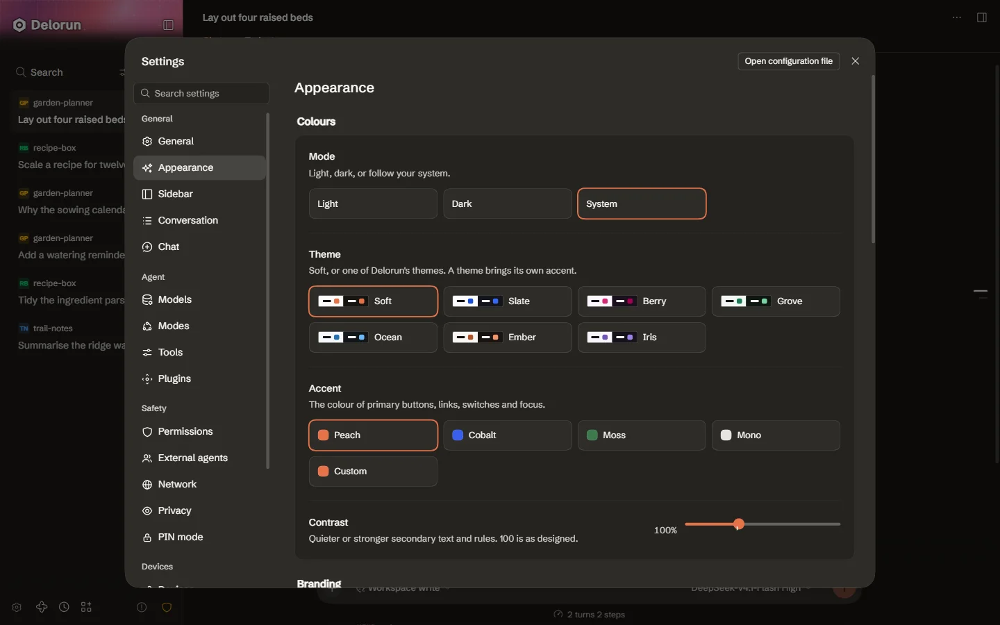
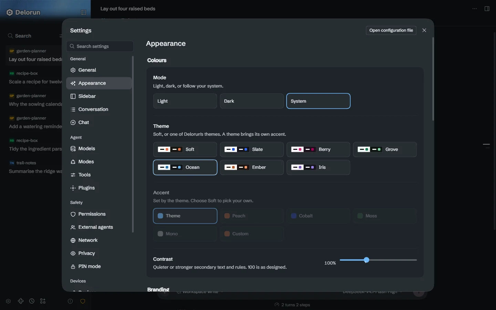

# Where to customise what

English | [中文](customise.zh.md)

## Summary

You can reshape Delorun at six levels, from a setting in the studio to the harness's own source. Each level reaches further than the one before it and costs more at each update, so choose the first one that can make your change. None of them edits Delorun's signed release, though the last runs files you changed, and an update shows what it would turn off before it does ([updates never take your work away](../safety-and-updates/trust.md)).

## Contents

- [Change one thing, see it, undo it](#change-one-thing-see-it-undo-it)
- [The levels](#the-levels)
- [Change a plugin's settings](#change-a-plugins-settings)
- [Optional plugins](#optional-plugins)
- [Give the studio your own name and icon](#give-the-studio-your-own-name-and-icon)
- [Make an agent preset](#make-an-agent-preset)
- [Write a plugin](#write-a-plugin)
- [Fork a shipped plugin](#fork-a-shipped-plugin)
- [Edit the harness itself](#edit-the-harness-itself)

## Change one thing, see it, undo it

The quickest visible change is the studio's theme. It needs no file, no restart and no terminal.

1. At the foot of the sidebar, choose Settings. In the list on the left, choose Appearance, under General.
2. Under Theme you see a row of small tiles: Soft, Slate, Berry, Grove, Ocean, Ember, Iris and Custom. Each tile shows the theme in its light and dark colours, and a short sample chat beside them previews the tile you point at. Soft is the theme Delorun starts with. Choose Ocean. A theme brings its own accent, so no accent picker shows while a theme is chosen; choose Custom to pick your own accent and contrast.

   
3. The studio's colours change at once. Delorun saved your choice in your profile: `cordis.patch.yml` under `~/.delorun/profiles/default/` now ends with a [row](../../reference/glossary.md#row) for the theme, and Settings → Setup versions lists a version called Changed the settings of Theme.

   ```yaml
   - id: delorun-theme
     name: "@delorun/plugin-theme"
     config:
       studioAdditions: true
       palette: ocean
   ```

   

4. To undo it, choose the Soft tile under Theme. The colours return and the row says `palette: soft`.

Every other settings page works the same way: you change a control, the studio shows it, and the opposite change puts it back. The levels below reach further, and each names its own way back.

## The levels

| Level | What it changes | Where it lives | What an update costs you | The way back |
| --- | --- | --- | --- | --- |
| Settings | What a plugin's settings page offers | The studio's Settings and Plugins pages | Nothing: settings carry over | Set the control back, such as Theme → Soft; Branding has Use the Delorun defaults |
| Profile patch | Any plugin's configuration; turning a plugin off | Your profile's `cordis.patch.yml` | A key a new version renames or removes; a patch restates a plugin's whole `config` | Delete the entry you added and restart; Save this setup in Settings → Setup versions first, and Switch to this version brings it back |
| Agent preset | The tools, instructions, skills and models an agent starts with | Presets made in Creator mode, kept in your profile | Little: a preset names plugins, so only a removed or renamed one breaks it | Save this setup in Settings → Setup versions before you make one; Switch to this version brings the setup back without it |
| Your own plugin | New tools, studio parts, services, plugin rows | A package installed into your profile | Its `engines` ranges: a range that excludes the new release turns the plugin off until you widen it and test | Plugins in the sidebar, the plugin, Uninstall; `delorun changes undo <id>` only stops what a change loaded |
| Fork of a shipped plugin | How one of DeepSeek Harness's plugins behaves | A renamed copy installed into your profile, with the shipped row turned off | You merge every upstream change to that plugin yourself, and its interfaces can change in any minor release before 1.0 | Uninstall the fork as for your own plugin; its patch goes with it, so the shipped plugin runs again |
| The harness itself | Anything, the plugin loop included | Your own copy of the installed release's program files, made by `delorun changes edit-harness` | Each change belongs to the installed version, and the update report says how it carries over; you run code Delorun did not sign | `delorun changes undo <id>` takes back one change; `delorun changes edit-harness --discard` takes back all of them |

## Change a plugin's settings

Most plugins have a settings page in the studio, which saves into your profile. For what a page does not offer, your profile's `cordis.patch.yml`, under `~/.delorun/profiles/<profile>/`, [patches](../../reference/glossary.md#patch) any plugin's row by its id. Settings → Plugins shows each plugin's id under its name, such as `tool-todo` for the to-do list tool. To let two to-do items be in progress at once, add this to the end of the file:

```yaml
- id: tool-todo
  config:
    allowParallelInProgress: true
```

A patch you edit by hand loads at the next start: run `delorun stop`, then `delorun start`. A patch replaces the row's whole `config`, so restate every key the plugin needs; a row with a required key missing stops Delorun from starting and the error names the key. `disabled: true` turns a row off. To undo the change, delete the entry and restart. Delorun does not save a hand edit as a version, so keep a copy of the file if you want one. DeepSeek Harness's [loading order](../../../../docs/user/develop/basic/publish.md#the-loading-order) explains which layer wins. Delorun refuses to start with a patch that turns off one of its protections, and names the file.

## Optional plugins

Some plugins do work most people never need, or need something set up first, so they ship switched off. Open Settings, Plugins, find one in the list of plugins that are off, and turn it on. The first time you turn one on, Delorun downloads it and checks it against the release's signed manifest, so that one step needs a connection; after that it works offline and updates together with Delorun. Turning it off again removes what it added.

| Plugin | What it does | Needs from you | Status |
| --- | --- | --- | --- |
| Browser | The agent browses in a browser on your computer through Playwright: Chrome when you have it, in a profile of its own, and otherwise Playwright's Chromium. Chrome DevTools and Stagehand are in the same bundle, off, because only one browser provider runs at a time. | Nothing with Chrome installed. Without Chrome, the Chromium build its Playwright expects; until it is downloaded, Plugins shows "Needs setup · Chromium download" with the command that downloads it. Stagehand also needs a model of its own. | Experimental |
| Code intelligence | A read-only `lsp` tool: go to definition, find references, find implementations, hover. | `typescript-language-server` on your PATH; until then Plugins shows "Needs setup". Other servers go in your profile patch. | Stable |
| Claude Code and Codex hooks | Runs the hooks in `~/.claude/settings.json` and `~/.codex/hooks.json` at the same points of a turn, and loads Claude Code mods. | Your own hook files; a missing file registers no hooks. | Experimental |
| Webhooks | A signed GitHub webhook can start a chat, on `127.0.0.1:3081` behind a proxy or tunnel you provide. | `DELORUN_GITHUB_WEBHOOK_SECRET` in the environment, and a rule of your own; the endpoint row starts off, and Plugins shows "Needs setup" until the secret is set. | Experimental |
| External agents | The agent hands a task to the Codex or Claude Code program you already have installed, and runs Python in tool programs. | The program installed and signed in, and `python3` for Python; one that is missing is left out. Python is not available on Windows. | Experimental |
| Computer use (Cua Driver) | The agent sees and operates desktop windows through the Cua Driver SDK. | Desktop permissions for the program that starts Delorun. On Linux and Windows only; on macOS it shows as unavailable, and Computer use is the plugin there. | Experimental |

When an optional plugin needs something from your computer, Plugins says so on its row: "Needs setup · Needs typescript-language-server installed", with the fix beside it (a command with a copy button, a link to the setting, or a guide). The row never stops other plugins. Delorun looks again each time you open Plugins and each time you return to its window, so the message goes away by itself once you install the program or set the value. Code intelligence's language-server rows and Webhooks' GitHub endpoint are off until you turn them on; Plugins tells you what they still need.

Experimental plugins can change or break between releases. Webhooks and Browser open a network listener or a real browser, so read what each does before you turn it on. Claude Code and Codex as agents are separate plugins in the same list.

## Give the studio your own name and icon

Settings → Branding changes how the studio presents itself. You can hide the icon and name on the empty chat screen and in the sidebar header, replace "Delorun" with your own name, replace the mark with an icon you pick from the workspace icon set or with a PNG, JPEG or WebP image of up to 256 KB, and replace "What are we working on?" with one of the preset lines or your own. The name also shows in the browser tab, and an uploaded image becomes the tab's icon. The name is 1 to 40 characters of plain text and the greeting 1 to 80.

The sign-in and pairing pages that other devices open show the same name and icon, or neither when you hide the mark. Those pages appear before anyone signs in, so anyone who can reach your address sees them. A picked icon appears in the studio only; the sign-in pages keep the Delorun mark for it. If a saved name, greeting or image cannot be used, the studio shows the Delorun defaults and the Branding section says so. The Branding settings are in your profile, so a phone you have approved can change them once it holds an unlock.

## Make an agent preset

An agent preset decides which tools, instructions, skills and model an agent starts with. Make one in the studio by starting a chat in Creator mode, or package one as a plugin with `delorun plugin new <name> --kind preset` ([Write a plugin for Delorun](../plugin-guides/plugins.md)). A preset names the plugins it uses, so an update affects it only when one of them is removed or renamed.

## Write a plugin

A plugin adds behaviour without changing anything Delorun ships: a tool, a part of the studio, a service other plugins use, or a bundle of settings for existing plugins. [Write a plugin for Delorun](../plugin-guides/plugins.md) goes from `delorun plugin new` to an installed plugin. You can also start one from Settings, Plugins, Create a plugin, or ask the agent in a chat to make one in your workspace ([from the studio](../plugin-guides/plugins.md#from-the-studio), [in a chat](../plugin-guides/plugins.md#in-a-chat)); in both, turning it on is your step at the computer. [Changes protection](../../reference/glossary.md#changes-protection) is off by default, so edits to a plugin you linked, including the agent's, reload live and are logged as loaded without review; turn protection on and they wait for your approval ([Changing your harness](changing-your-harness.md)). Declare `engines.dsh` and `engines.delorun`: at an update, Delorun turns off a plugin whose ranges exclude the new release and tells you before it does, and [what a Delorun version promises a plugin](../../contracts/c22-delorun-plugin-interface.md) says what each release may change.

## Fork a shipped plugin

Delorun loads the packages it ships from its own installation, so a package in your profile with a shipped package's name never loads. To change how one of DeepSeek Harness's plugins behaves:

1. Copy its package into a folder and give it a new name in `package.json`, such as `my-todo` for `@deepseek-ai/dsh-tool-todo`, with its own `engines` ranges and a `dsh.bundle` declaration (a [bundle](../../reference/glossary.md#bundle)).
2. In the copy's `cordis.patch.yml`, turn the shipped row off and insert yours under a new id, with the configuration the shipped row had:

   ```yaml
   - id: tool-todo
     disabled: true
   - insert:
       - id: my-todo
         name: my-todo
         config:
           allowParallelInProgress: true
   ```

3. Install the copy with `delorun plugin add ./my-todo`, or work on it with `delorun plugin dev ./my-todo`.

Delorun's own plugins and the rows its protections need, such as the sandbox, cannot be replaced this way: Delorun refuses to start with any of them off and names the file that turned it off. Change those through their settings, or [edit the harness](#edit-the-harness-itself). A fork keeps the plugin's code as it was when you copied it, so check each release's changelog for the plugin and bring its changes over yourself.

## Edit the harness itself

A change to the plugin loop, the composition or Delorun's protections goes in your own copy of the installed Delorun's program files: `delorun changes edit-harness` makes the copy and prints its folder, and each file you save there is a change to Delorun itself that `delorun changes list` shows and `delorun changes undo` takes back. The installed release is never edited, but Delorun's signature and release log no longer describe the code you run, and `delorun verify` lists the files you changed. [Changing your harness](changing-your-harness.md) covers protection, which waits for your review before a change loads, and the studio's Changes section. Prefer a plugin wherever one can make the change.
