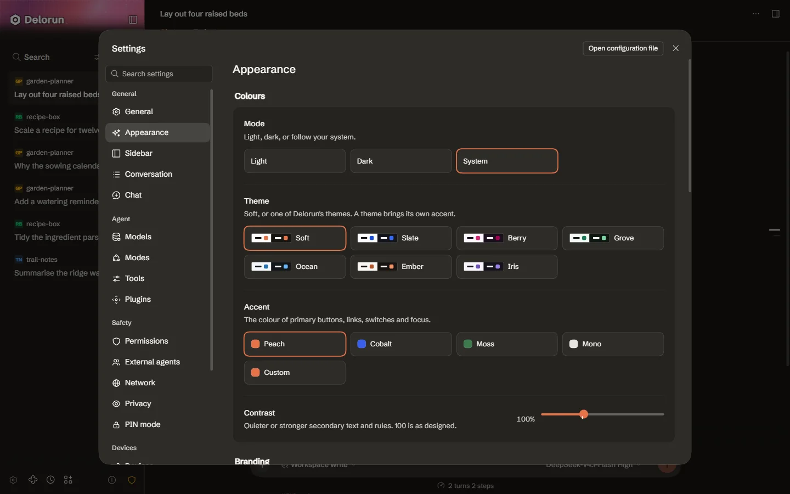
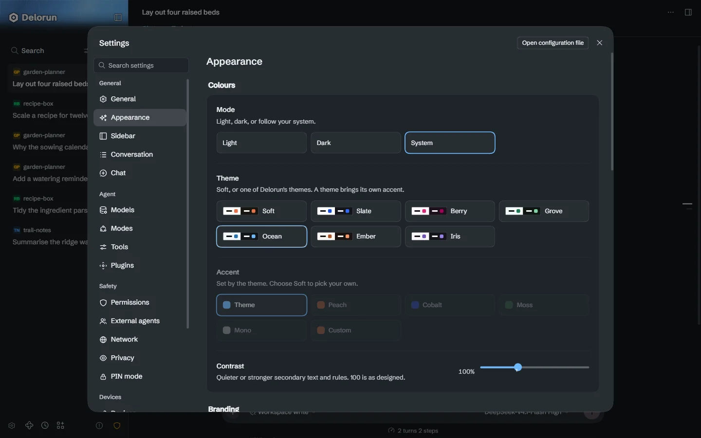

# 什么该在哪里定制

[English](customise.md) | 中文

> 英文页面是当前版本；本页可能落后于它。

本页描述 Delorun 目前的工作方式。

## 摘要

你可以在六个层级上重塑 Delorun，从 studio 中的一项设置，到 harness 自己的源代码。每个层级都比前一个触及得更远，在每次更新时也要付出更多，所以请选择第一个能实现你的更改的层级。没有哪一个会编辑 Delorun 已签名的发布版本，不过最后一个会运行你改动过的文件，而更新会在关闭任何东西之前，先显示它会关闭什么（[更新绝不会拿走你的工作](../safety-and-updates/trust.zh.md)）。

## 目录

- [更改一件事，看到它，再撤销它](#change-one-thing-see-it-undo-it)
- [各个层级](#the-levels)
- [更改插件的设置](#change-a-plugins-settings)
- [可选插件](#optional-plugins)
- [给 studio 起你自己的名称和图标](#give-the-studio-your-own-name-and-icon)
- [制作 agent 预设](#make-an-agent-preset)
- [编写插件](#write-a-plugin)
- [fork 已发布的插件](#fork-a-shipped-plugin)
- [编辑 harness 本身](#edit-the-harness-itself)

<a id="change-one-thing-see-it-undo-it"></a>

## 更改一件事，看到它，再撤销它

最快能看到的更改是 studio 的主题。它不需要文件、不需要重启，也不需要终端。

1. 在侧边栏底部选择 Settings。在左侧列表中，选择 General 下的 Appearance。
2. 在 Theme 下你会看到 Soft、Slate、Berry、Grove、Ocean、Ember 和 Iris。Soft 是 Delorun 起初使用的主题。选择 Ocean。

   
3. studio 的颜色立即改变。Delorun 已把你的选择保存在你的 profile 中：`~/.delorun/profiles/default/` 下的 `cordis.patch.yml` 现在以主题的一个[行](../../reference/glossary.zh.md#row)结尾，Settings → Setup versions 列出了一个名为 Changed the settings of Theme 的版本。

   ```yaml
   - id: delorun-theme
     name: "@delorun/plugin-theme"
     config:
       studioAdditions: true
       palette: ocean
   ```

   

4. 要撤销它，在 Theme 下选择 Soft。颜色恢复，该行再次写着 `palette: soft`。

其他每个设置页面的工作方式都相同：你改变一个控件，studio 显示出来，反向的更改则把它放回去。下面的各个层级触及的范围更广，每一层都写明了它自己的退路。

<a id="the-levels"></a>

## 各个层级

| 层级 | 它改变什么 | 它存放在哪里 | 更新时它让你付出什么 | 退回方式 |
| --- | --- | --- | --- | --- |
| 设置 | 插件的设置页面提供什么 | studio 的“设置”和“插件”页面 | 没有：设置会被保留 | 把控件设回去，例如 Theme → Soft；Branding 有 Use the Delorun defaults |
| profile 补丁 | 任何插件的配置；关闭某个插件 | 你的 profile 的 `cordis.patch.yml` | 新版本改名或移除的键；补丁会重述插件完整的 `config` | 删除你添加的条目并重启；先在 Settings → Setup versions 中选 Save this setup，之后 Switch to this version 可把它带回来 |
| agent 预设 | agent 开始时拥有的工具、指令、skill 和模型 | 在 Creator 模式中制作、保存在你的 profile 中的预设 | 很少：预设指名插件，所以只有被移除或改名的插件才会让它出问题 | 制作之前先在 Settings → Setup versions 中选 Save this setup；Switch to this version 会带回没有它的设置 |
| 你自己的插件 | 新的工具、studio 组成部分、服务、插件行 | 安装到你的 profile 中的包 | 它的 `engines` 范围：排除新发布版本的范围会让插件被关闭，直到你放宽范围并测试 | 侧边栏的 Plugins，选该插件，再选 Uninstall；`delorun changes undo <id>` 只会停止某项更改所加载的内容 |
| 已发布插件的 fork | DeepSeek Harness 的某个插件的行为 | 安装到你的 profile 中的改名副本，同时关闭已发布的行 | 你必须自己合并该插件的每一项上游更改，而它的接口在 1.0 之前的任何次版本中都可能变化 | 像卸载你自己的插件那样卸载这个 fork；它的补丁随之消失，所以已发布的插件会再次运行 |
| harness 本身 | 任何东西，包括插件循环 | 由 `delorun changes edit-harness` 制作的、你自己的已安装发布版本程序文件的副本 | 每项更改都属于已安装的版本，更新报告会说明它如何被保留；你运行的是 Delorun 没有签名的代码 | `delorun changes undo <id>` 撤销一项更改；`delorun changes edit-harness --discard` 撤销全部更改 |

<a id="change-a-plugins-settings"></a>

## 更改插件的设置

大多数插件在 studio 中都有一个设置页面，保存到你的 profile 中。对于页面没有提供的内容，你的 profile 的 `cordis.patch.yml`（位于 `~/.delorun/profiles/<profile>/` 下）可以按 id 给任何插件的行[打补丁](../../reference/glossary.zh.md#patch)。Settings → Plugins 会在每个插件名称之下显示它的 id，例如待办工具的 id 是 `tool-todo`。要让两个待办事项同时处于进行中，把下面这段添加到文件末尾：

```yaml
- id: tool-todo
  config:
    allowParallelInProgress: true
```

你手工编辑的补丁在下次启动时加载：运行 `delorun stop`，再运行 `delorun start`。补丁会替换该行完整的 `config`，所以请重述插件需要的每个键；缺少必需键的行会使 Delorun 无法启动，错误信息会指出该键。`disabled: true` 则关闭一行。要撤销这项更改，删除该条目并重启。Delorun 不会把手工编辑保存为版本，所以如果想要一份副本，请自己保留文件的副本。DeepSeek Harness 的[加载顺序](../../../../docs/user/develop/basic/publish.zh.md#the-loading-order)说明了哪一层优先。如果补丁关闭了 Delorun 的某项保护，Delorun 会拒绝启动，并指出该文件。

<a id="optional-plugins"></a>

## 可选插件

有些插件做的事大多数人用不到，或者需要先做一些设置，所以它们出厂时是关闭的。打开“设置”→“插件”，在关闭的插件列表中找到它，然后把它开启。第一次开启时，Delorun 会下载它，并对照发行版已签名的清单检查它，所以这一步需要网络连接；之后它可以离线工作，并随 Delorun 一起更新。再次关闭它会移除它添加的内容。

| 插件 | 作用 | 需要你提供 | 状态 |
| --- | --- | --- | --- |
| 浏览器 | 智能体通过 Playwright，在你电脑上的浏览器中浏览：装有 Chrome 时使用 Chrome，并使用它自己的配置文件；否则使用 Playwright 的 Chromium。Chrome DevTools 和 Stagehand 在同一个 bundle 中，处于关闭状态，因为同一时间只能运行一个浏览器提供方。 | 装有 Chrome 时无需任何东西。没有 Chrome 时，需要它的 Playwright 所需的 Chromium 版本；下载之前，“插件”会显示“需要设置 · 需要下载 Chromium”，并附上下载它的命令。Stagehand 还需要它自己的模型。 | 实验性 |
| 代码智能 | 一个只读的 `lsp` 工具：跳转到定义、查找引用、查找实现、悬停信息。 | 你的 PATH 上有 `typescript-language-server`；在此之前“插件”会显示“需要设置”。其他服务器放进你的 profile 补丁。 | 稳定 |
| Claude Code 与 Codex 钩子 | 在一轮对话的相同时间点运行 `~/.claude/settings.json` 和 `~/.codex/hooks.json` 中的钩子，并加载 Claude Code mod。 | 你自己的钩子文件；文件缺失时不注册任何钩子。 | 实验性 |
| Webhook | 已签名的 GitHub webhook 可以开始一次对话，监听 `127.0.0.1:3081`，前面需要你自己提供的代理或隧道。 | 环境中的 `DELORUN_GITHUB_WEBHOOK_SECRET`，以及你自己的规则；端点行起初是关闭的，在设置好密钥之前“插件”会显示“需要设置”。 | 实验性 |
| 外部智能体 | 智能体把任务交给你已安装的 Codex 或 Claude Code 程序，并在工具程序中运行 Python。 | 已安装并已登录的程序，以及运行 Python 所需的 `python3`；缺少的一项会被略去。Python 在 Windows 上不可用。 | 实验性 |
| 计算机使用（Cua Driver） | 智能体通过 Cua Driver SDK 查看并操作桌面窗口。 | 启动 Delorun 的程序拥有桌面权限。只支持 Linux 和 Windows；在 macOS 上它显示为不可用，那里的插件是“Computer use”。 | 实验性 |

当可选插件需要你电脑上的某样东西时，“插件”会在它的那一行说明，例如“需要设置 · 需要安装 typescript-language-server”，旁边附有解决办法（带复制按钮的命令、指向该设置的链接，或一份指南）。这一行绝不会阻止其他插件。每次你打开“插件”以及每次回到它的窗口时，Delorun 都会重新检查，所以一旦你安装了程序或设置了值，这条提示会自行消失。代码智能的语言服务器行和 Webhook 的 GitHub 端点在你开启之前是关闭的；“插件”会告诉你它们还需要什么。

实验性插件在不同发行版之间可能会改变或出问题。Webhook 和浏览器会打开网络监听端口或真实的浏览器，所以开启之前请先阅读每个插件的作用。作为智能体的 Claude Code 和 Codex 是同一个列表中的独立插件。

<a id="give-the-studio-your-own-name-and-icon"></a>

## 给 studio 起你自己的名称和图标

“设置”→“Branding”改变 studio 呈现自己的方式。你可以隐藏空白 chat 界面和侧边栏标题中的图标和名称，把 “Delorun” 替换为你自己的名称，把标志替换为你从工作区图标集中选取的图标或最大 256 KB 的 PNG、JPEG 或 WebP 图片，并把 “What are we working on?” 替换为预设语句之一或你自己的。名称也会显示在浏览器标签页中，上传的图片会成为标签页的图标。名称是 1 到 40 个字符的纯文本，问候语是 1 到 80 个字符。

其他设备打开的登录和配对页面显示相同的名称和图标，或者在你隐藏标志时两者都不显示。这些页面在任何人登录之前就会出现，所以任何能够访问你的地址的人都能看到它们。选取的图标只出现在 studio 中；登录页面仍保留 Delorun 的标志。如果保存的名称、问候语或图片无法使用，studio 会显示 Delorun 的默认值，Branding 部分会这样说明。Branding 设置保存在你的 profile 中，所以你已批准的手机在持有解锁时可以更改它们。

<a id="make-an-agent-preset"></a>

## 制作 agent 预设

agent 预设决定 agent 开始时拥有哪些工具、指令、skill 和模型。可以在 studio 中通过在 Creator 模式下开始一个 chat 来制作，也可以用 `delorun plugin new <name> --kind preset` 把它打包成插件（见[为 Delorun 编写插件](../plugin-guides/plugins.zh.md)）。预设会指名它所用的插件，所以只有当其中一个被移除或改名时，更新才会影响它。

<a id="write-a-plugin"></a>

## 编写插件

插件在不改变 Delorun 所发布的任何内容的情况下增加行为：一个工具、studio 的一部分、其他插件使用的服务，或针对现有插件的一组设置 bundle。[为 Delorun 编写插件](../plugin-guides/plugins.zh.md)从 `delorun plugin new` 讲到一个已安装的插件。你也可以从“设置”→“插件”→“Create a plugin”开始，或在 chat 中让 agent 在你的工作区中制作一个（[在 studio 中](../plugin-guides/plugins.zh.md#from-the-studio)，[在 chat 中](../plugin-guides/plugins.zh.md#in-a-chat)）；两种方式中，开启它都是你在电脑上要做的一步。[变更保护](../../reference/glossary.zh.md#changes-protection)默认是关闭的，所以对你所链接的插件的编辑（包括 agent 的编辑）会实时重新加载，并被记录为未经审阅而加载；开启保护之后，它们会等待你的批准（见[修改你的 harness](changing-your-harness.zh.md)）。请声明 `engines.dsh` 和 `engines.delorun`：更新时，Delorun 会关闭其范围不包含新发布版本的插件，并在这样做之前告诉你，而 [Delorun 版本对插件的承诺](../../contracts/c22-delorun-plugin-interface.zh.md)说明了每个发布版本可能改变什么。

<a id="fork-a-shipped-plugin"></a>

## fork 已发布的插件

Delorun 从自己的安装中加载它所发布的包，所以你的 profile 中与已发布的包同名的包永远不会被加载。要改变 DeepSeek Harness 的某个插件的行为：

1. 把它的包复制到一个文件夹中，并在 `package.json` 中给它起一个新名称，例如把 `@deepseek-ai/dsh-tool-todo` 改为 `my-todo`，并带有它自己的 `engines` 范围和一个 `dsh.bundle` 声明（即[组合包](../../reference/glossary.zh.md#bundle)）。
2. 在副本的 `cordis.patch.yml` 中，关闭已发布的行，并以新的 id 插入你自己的行，配置与已发布的行相同：

   ```yaml
   - id: tool-todo
     disabled: true
   - insert:
       - id: my-todo
         name: my-todo
         config:
           allowParallelInProgress: true
   ```

3. 用 `delorun plugin add ./my-todo` 安装副本，或用 `delorun plugin dev ./my-todo` 开发它。

Delorun 自己的插件，以及它的保护所需要的行（例如沙箱），不能用这种方式替换：只要其中任何一个被关闭，Delorun 就会拒绝启动，并指出关闭它的文件。请通过它们的设置来更改，或者[编辑 harness](#edit-the-harness-itself)。fork 会保留你复制时插件代码的样子，所以请查看该插件每个发布版本的 changelog，并自己把它的更改带过来。

<a id="edit-the-harness-itself"></a>

## 编辑 harness 本身

对插件循环、组合或 Delorun 的保护的更改，要放在你自己的已安装 Delorun 程序文件的副本中：`delorun changes edit-harness` 制作该副本并打印它的文件夹，你在那里保存的每个文件都是对 Delorun 本身的一项更改，`delorun changes list` 会显示它，`delorun changes undo` 会撤销它。已安装的发布版本从不被编辑，但 Delorun 的签名和发布日志不再描述你所运行的代码，`delorun verify` 会列出你改动过的文件。[修改你的 harness](changing-your-harness.zh.md)涵盖保护（它在更改加载之前等待你的审阅）以及 studio 的 Changes 部分。凡是插件能实现的更改，都应优先使用插件。
