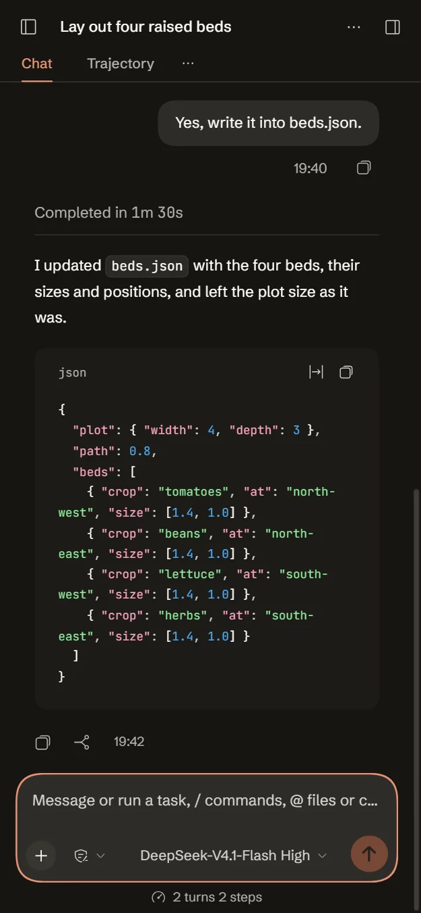

# Reach the studio from your phone

English | [中文](reach.zh.md)

## Summary

This page helps you open your studio from your phone and keep control of who can. You need Delorun running on your computer ([Install and first run](../get-started/install.md)) and [Tailscale](https://tailscale.com) on both devices ([What you need](#what-you-need)).

The [studio](../../reference/glossary.md#studio) is the page in your browser where you chat with the model. Remote access, which Delorun also calls [reach](../../reference/glossary.md#reach), lets you open that page from your phone or another [device](../../reference/glossary.md#device). It runs over your own Tailscale network. Tailscale is a service that links your devices into a private network, and that network is called your tailnet. Delorun has no service of its own in the path: Tailscale carries the traffic, and your computer decides who may sign in.

Any device on your tailnet can open the sign-in page, but only a device you approve at your computer can open your chats. To approve a device, you type the 8-digit code it shows. Opening your address, or any page of it, on a device that is not signed in takes you to the sign-in page, and back to the page you opened once you are signed in. Remote access is off until you turn it on.

## Contents

- [What you need](#what-you-need)
- [Start from nothing](#start-from-nothing)
- [Turn remote access on](#turn-remote-access-on)
- [Approve a device](#approve-a-device)
- [Keep approval yours](#keep-approval-yours)
- [What an approved phone can and cannot do](#what-an-approved-phone-can-and-cannot-do)
- [Confirm with Face ID](#confirm-with-face-id)
- [Confirm with a PIN](#confirm-with-a-pin)
- [Remove a device](#remove-a-device)
- [Turn remote access off](#turn-remote-access-off)
- [Get a one-time owner code](#get-a-one-time-owner-code)
- [What Tailscale sees](#what-tailscale-sees)
- [Next](#next)
- [For the technically curious](#for-the-technically-curious)

## What you need

- Delorun set up and working on your computer ([Install and first run](../get-started/install.md)).
- Tailscale installed on your computer and on your phone, both signed in to the same tailnet.
- HTTPS certificates turned on for your tailnet, in the DNS page of the Tailscale admin console. Tailscale needs them to give your computer a secure address.
- On Linux, permission for your user to set up `tailscale serve`, the Tailscale feature that forwards your phone's requests to Delorun. If your user does not have it, `delorun reach on tailscale` prints the one command to run yourself: `sudo tailscale set --operator=$USER`. Delorun never runs `sudo`.

## Start from nothing

Follow this path if you have no Tailscale account. Tailscale's own pages give the steps for their product, so this page links to them and does not copy them.

1. **Create an account.** Sign up at [login.tailscale.com/start](https://login.tailscale.com/start) with an identity you already have. Your devices join one private network, your tailnet, under this account.
2. **Install Tailscale on the computer where Delorun runs.** On Linux, and inside WSL2, follow Tailscale's [Linux download page](https://tailscale.com/download/linux) and sign in with `sudo tailscale up`, which prints a link to open. Install it in the Linux system that runs Delorun, not only on Windows, because `delorun reach on tailscale` runs the `tailscale` command in the system where Delorun runs.
3. **Install Tailscale on your phone.** Get the app from the App Store or Google Play ([download page](https://tailscale.com/download)) and sign in with the same account.
4. **Check that both devices see each other.** On the computer, `tailscale status` lists the phone beside the computer. In the phone's app, the computer shows as connected. If either is missing, the two are signed in to different accounts; sign one out and in again.
5. **Turn on HTTPS certificates.** In the [DNS page of the Tailscale admin console](https://login.tailscale.com/admin/dns), turn on MagicDNS if it is off, then choose **Enable HTTPS**. Tailscale's [HTTPS page](https://tailscale.com/kb/1153/enabling-https) explains it.
6. **Let your Linux user set up `tailscale serve`.** If `delorun reach on tailscale` prints `sudo tailscale set --operator=$USER`, run that command yourself once.
7. **Start Delorun and turn on remote access.** Run `delorun start`, then continue with [Turn remote access on](#turn-remote-access-on) and [Approve a device](#approve-a-device).

## Turn remote access on

Do this once, so that your phone has an address to open. In a terminal on your computer, run:

```sh
delorun reach on tailscale
```

You can also choose "Also from my phone or another device" when `delorun setup` asks how you will use Delorun, or answer yes to its remote access question.

The command checks Tailscale and asks `This changes Tailscale on this computer … Continue? (y/N)`. Answer `y`. With `--yes` it does not ask, and without a terminal and without `--yes` it refuses, so that nothing changes Tailscale unseen. It then saves the setting in your [profile](../../reference/glossary.md#profile) and prints your address, `https://<your computer's name>.<your tailnet>.ts.net`. When Delorun is running, it applies the change at once and prints whether the address is ready. Otherwise remote access starts the next time you run `delorun start`.

You should see a line that starts "Remote access is on for the profile default at https://", a statement of what an approved phone can and cannot do, and what Tailscale can see ([What Tailscale sees](#what-tailscale-sees)). If Delorun runs, the next lines say whether the address is ready. The last lines begin "To add your phone:" and give the two steps of [Approve a device](#approve-a-device), with your sign-in address, which ends in `/auth/sign-in`.

To check later, run `delorun reach status`. It shows whether remote access is on and, while Delorun runs, whether the address is ready.

If the command prints a refusal instead, find its words in [Troubleshooting](../help/troubleshooting.md#remote-access-and-devices). Nothing is turned on when it refuses.

<details>
<summary>Edge cases</summary>

- If Tailscale Funnel is on for the address, then the command refuses, because Funnel would put your sign-in page on the public internet — turn Funnel off with the command the refusal prints, then run `delorun reach on tailscale` again.
- If your Linux user may not set up `tailscale serve`, then nothing is written and the refusal prints `sudo tailscale set --operator=$USER` — run it yourself once, then run the command again.
- If another `tailscale serve` rule uses the same local port and is not this studio's own, then the command removes it. While Delorun is not serving that port, it removes every rule on it, because any program on the computer could otherwise answer your phone there.
- If Delorun is running but the address does not become ready, then the command exits with an error and tells you to fix the line above it and run it again.
- If you pass anything other than `tailscale`, then the command exits with code 2 and says the one option this build offers is `tailscale`.
- If you use more than one profile, then add `--profile <name>`; remote access is a setting of one profile.

</details>

<details>
<summary>Go further</summary>

- `delorun reach status` shows whether remote access is on and whether the address is ready, and prints the sign-in address with the steps for adding a phone.
- Choose "Also from my phone or another device" in `delorun setup`, or run `delorun setup reach`, to turn it on while you set up.

</details>

## Approve a device

A device is approved only at your computer. This keeps a stranger on your tailnet from getting in. Approve a phone like this:

1. Open an approval window for the device. If your phone is signed in to Tailscale as the same user as this computer, skip this step: the phone can ask without a window, and the studio at this computer shows the request. For any other device:
   - run `delorun devices approve`, or choose **Add a device** in the studio under Settings → Devices;
   - Delorun must be running, so start it with `delorun start` first;
   - the window lasts 5 minutes and closes at the first approval.
2. On your phone, open your sign-in address (your address followed by `/auth/sign-in`; the command prints it). The page is titled "Add this device". Check the device name it suggests and choose **Ask for approval**. The phone shows an 8-digit code and how long it stays valid.
3. On your computer, the command lists every waiting device with a number, a short request id, its name, platform and time. Type the number of the device whose screen you can see, then the code it shows. Type `c` and a number to cancel a request you do not recognise. Three wrong codes cancel only that request.

You should see "Approved <device name>. It signs in on its own now." on your computer, and the phone shows "Approved" and opens your studio. From then on the phone signs in by itself.

A phone that Tailscale reports as signed in as the user you allowed can ask outside an approval window. Either way you type the 8-digit code the phone shows, at this computer, and three wrong codes cancel the request.

`delorun devices list` and the Devices section list every approved device. The list shows an id, the name, the address, when it was approved and when it last signed in. With no device, `delorun devices list` says "No device is trusted on this computer yet. Add one with delorun devices approve."

<details>
<summary>Approving in the studio</summary>

- In Settings → Devices, each waiting device has its own code field and a **Cancel request** button.
- A device that asked without a window shows as a notice at the top of the studio: choose **Enter code**, type the 8 digits in the box that opens, and the box approves at the eighth digit. The notice never takes the keyboard from a field you are typing in.
- Under Settings → Devices you can choose who may ask, whether a request shows as a notice, a code box or only in the list, and the window and request lifetimes. `delorun setup reach` lets you allow every device on your tailnet to ask without a window, and `delorun reach status` says who may ask. On a phone, this part says to change it at your computer.

</details>

<details>
<summary>Edge cases</summary>

- If the phone says "Your computer isn’t ready yet", then the approval window is closed — do step 1, then choose **Try again** on the phone.
- If the phone says "Too many devices waiting", then 5 requests already wait — type `c` and a number at your computer to cancel each one you do not recognise, or choose **Cancel request** in the Devices section, then ask again from the phone. A waiting request is never replaced on its own.
- If you type the wrong code, then you may type it again; the third wrong code cancels only that request — ask again from the phone for a new code. The phone shows "Request cancelled".
- If a code is older than 5 minutes, then the phone shows "This code expired" — ask again.
- If `delorun devices approve` finds no request before the window closes, then it exits with "No device asked for approval before the window closed" — run it again and ask from the phone within 5 minutes.
- If `delorun devices approve` runs where nothing can answer its question (standard input is not a terminal or has closed), then it exits with code 1 and "this needs you at a terminal to answer; run it in one" — run it in a terminal.
- If remote access is off, then `delorun devices approve` still works and says a phone cannot reach this computer yet — turn it on with `delorun reach on tailscale` first.
- If Delorun is not running, then `delorun devices approve` refuses and says to run `delorun start`.
- If a device name or platform contains control or text-direction characters, then the home refuses it and the phone asks for a different name.
- If you choose a device you cannot see, then do not type its code; type `c` and its number to cancel it.
- If your phone's browser prefers Chinese, then the sign-in page is in Chinese.

</details>

<details>
<summary>Go further</summary>

- Run `delorun devices approve --profile <name>` to approve a device for another profile.
- Approved devices stay approved when you turn remote access off and on again ([Turn remote access off](#turn-remote-access-off)).

</details>

## Keep approval yours

Approval is meant for you, at your computer. Three facts help you keep it that way.

- **The code ties an approval to the screen you read.** Any device on your tailnet can ask while the window is open, and Delorun cannot tell where a request comes from. A code read from another device does not match. The code does not prove who holds the device: anyone holding your unlocked phone when you approve it gets the approval.
- **Commands the model runs in the [sandbox](../../reference/glossary.md#sandbox) cannot approve devices.** The studio's Devices section answers only a browser that holds the studio's own sign-in, and `delorun devices` talks to Delorun through a channel that needs a token from a file in your Delorun home. A command in the sandbox can read neither.
- **A program running as you, outside the sandbox, can approve a device while you are away.** That is true of any command you let run with [full access](../../reference/glossary.md#full-access). Another program or another user of the computer can reach the studio's port, but needs the studio's sign-in to use the Devices section. Outside an approval window, Delorun refuses every request to be approved.

## What an approved phone can and cannot do

An approved phone is you: it can already ask the model to do things, so it can do everything that is no riskier than a message. A few sensitive actions ask you to confirm, with Face ID or your PIN, either one at a time or within a Face ID pass, and a few things never work from a phone.



Without asking, the phone can:

- read your chats and workspaces, and follow a chat while it runs;
- reply, attach files, edit or withdraw a queued message, fork a chat, and start a chat in a [workspace](../../reference/glossary.md#workspace) you already have, with any of your [presets](../../reference/glossary.md#preset). Choosing a preset grants nothing by itself: the workspace's full access and every approval prompt still decide what that chat may do;
- read the files of a chat's own workspace and see its changes. A file outside the workspace is refused, including one reached through a link, and so is anything in Delorun's own folder;
- rename, pin, archive, restore and reorder chats, rename and reorder workspaces, and move a workspace to the trash;
- set, edit, pause and clear a chat's goal, and create, edit, run and delete scheduled follow-ups;
- choose a chat's model, which also saves it as the default for new chats;
- read the installed [plugins](../../reference/glossary.md#plugin), the profile changes you can undo, the saved setup versions and what differs between them, what the harness trusts, and the release notes of a newer version;
- see which chats are snoozed or settled and snooze or settle them, and turn dangerous mode off;
- see which MCP servers and external agents wait for your OK or hold a grant, and decline or revoke them (declining and revoking only withdraw consent);
- give feedback on a chat or a message;
- answer ordinary prompts and questions the model asks, and stop a run or a background job.

After you confirm each one with Face ID or your PIN, or while a Face ID pass is open, the phone can also:

- change settings;
- run the slash commands that change only the chat: `/compact`, `/export`, `/goal`, `/permission` and `/plan`; the phone runs no other slash command;
- install, enable, update or remove plugins, and undo or restore a profile change. Delorun's own guard plugins and remote access cannot be turned off or changed this way, and an undo or restore that would change one is refused;
- undo a plugin's change or discard any waiting change in Changes, and turn protection on;
- browse folders with the folder picker, add a workspace, and start a chat in a folder that is not one of your workspaces;
- run plugin code the model wrote;
- grant full access, whether a command asks to run outside the sandbox or a workspace asks to be put on full access, and allow an external agent to work in a workspace. The phone asks for Face ID or your PIN when you answer, and if you cancel, the prompt keeps waiting;
- accept an [MCP server](../../reference/glossary.md#mcp-server), because accepting lets its command run on your computer;
- save the setup as a version and switch to a saved version;
- loosen a workspace's network, run a trust check, and send a problem report, which can hold paths from your computer;
- keep what you changed: nothing is set back later, and undo and the saved setup versions are how you roll a change back.

No confirmation opens a window: each sensitive action asks again, also right after you approve a new phone and while you set Delorun up from it.

Only your computer, whatever the phone confirms:

- turn remote access on or off, set or change the PIN, and approve or remove devices;
- dismiss the notice that tells you a phone changed protection;
- turn update checks off (turning them on works from the phone);
- open a file or folder in an application on your computer.

The phone shows these as "Do this on your computer" with the reason.

The phone can also open a terminal, turn protection off, apply changes to your plugins or to Delorun's own files, turn a plugin off or on, start a work session, create a plugin, move a setup file in or out, or restart Delorun. Each of these takes its own confirmation, with [Face ID](#confirm-with-face-id) or your PIN, unless a Face ID pass is open.

Never, whatever the phone confirms:

- read or change your keys and other credentials, or your account;
- turn off **Ask before external agents run**; the phone can still turn it on and change its run time limit ([External agents](../safety-and-updates/safety.md#external-agents));
- loosen the permission new chats start in, such as moving it toward full access; the phone can still make it stricter;
- answer a prompt that would let the model manage workspaces and their instructions;
- open the settings file in an editor on your computer;
- reset the home.

You should see the studio's error message when a phone tries another refused action.

A workspace that you already put on full access at your computer can still be driven from the phone, and a command there can do anything your user can do. What protects you is the phone's own lock and removing the device when you lose it.

<details>
<summary>Edge cases</summary>

- If a workspace is on full access, then the phone still confirms with Face ID or your PIN to open or attach to a terminal there, and so does dangerous mode: a terminal is a shell with your authority, so the phone confirms each terminal it opens, unless a Face ID pass is open.
- If a phone's session is idle for 12 hours, or 14 days have passed since it signed in, then the session ends and its open connections close — the phone signs in again from the sign-in page with its own key.
- If you approve or remove any device, then every phone's open connections close — each phone signs in again by itself.
- If a reply shows an image as a file on your computer, or you preview a file, then it does not show on the phone — images attached to messages do show.
- If you lose a phone, then run `delorun devices remove <device id>` at once ([Remove a device](#remove-a-device)).

</details>

<details>
<summary>Go further</summary>

- **Ask before external agents run** in Settings, Safety, External agents stays a computer-only setting ([External agents](../safety-and-updates/safety.md#external-agents)).
- **Set up from your phone.** The setup guide on a phone marks a step only your computer can do, such as the PIN, says why, and offers **Do it on my computer**. That keeps the step in your home, not in the phone's browser, and the studio on your computer then shows a quiet **Finish setup · N left** in its sidebar. It opens just those steps, drops a step you already did, and goes away when none are left.

</details>

## Confirm with Face ID

Face ID is how an approved phone confirms one sensitive action at the moment it happens, with the phone's own lock instead of a code from your computer. "Face ID" here means whatever your phone uses: Face ID or Touch ID on an iPhone, a fingerprint or screen lock on Android, Windows Hello on Windows. Behind it is a passkey that stays on the phone, which the [glossary](../../reference/glossary.md#face-id) explains. Delorun never sees your face or fingerprint.

Every action a phone can take is in one of three groups:

- **Never asks.** Reading, following a chat, replying, attaching files, stopping a run, and the other actions listed above as working without asking.
- **Asks.** The actions listed above as asking each time: opening a terminal, turning protection off, applying changes to your plugins or to Delorun's own files, restarting Delorun, saving or removing a provider key, and answering a prompt that grants full access. The phone shows a sheet that names the action, and you confirm with Face ID, or with your PIN on a phone without it. One confirmation covers that one action, once, within 30 seconds, unless a Face ID pass is open (see below). Some always ask, even while a pass is open: removing another device, removing a passkey, **Show all devices** in the Face ID settings, changing **Ask again after** from a phone, turning protection off, turning full access on or off for a workspace, and allowing a chat's request for full access. Each takes Face ID for that one action, even while a pass is open, and a Face ID that confirms one of them opens no pass. Removing another device and changing **Ask again after** never accept the PIN.
- **Only at your computer.** Approving or removing devices, setting the PIN, turning remote access on or off, and the other actions listed above as staying at your computer. Face ID never opens these.

Neither a code from your computer, your PIN nor a new phone's first sign-in opens a window in which a phone asks less: a phone without Face ID confirms each sensitive action with one PIN. A terminal you opened with Face ID stays open for its own follow-up work, so you are not asked for every keystroke. It ends after 5 minutes idle, 60 minutes in all, or when the phone signs out, and a pass ending does not close it. Another terminal needs its own confirmation, or an open pass.

**Ask again after.** One Face ID on a phone can open a pass for that phone. While the pass is open, the phone does the actions in the **Asks** group without a Face ID sheet each time. Choose the length in Settings, Face ID, **Ask again after**: Every time, 5, 15, 30 or 60 minutes. The default is 15 minutes. **Every time** means one Face ID for each action, with no pass.


**The chip.** While a pass is open, the studio on the phone shows "Unlocked · 14 min" above the open chat, counting down in whole minutes, with a **Lock now** button. The chip goes at the end of the pass. Your computer never shows it.

**It does not slide.** The pass ends the chosen number of minutes after the Face ID, however much you use the phone. Changing **Ask again after**, on a phone or at your computer, ends every open pass, so a shorter time or **Every time** applies at once.

**What always asks.** The actions above that always ask still ask for Face ID while a pass is open. Reach settings, PIN mode settings and the other actions that stay at your computer stay there.

**What does not open a pass.** Your PIN, whether the phone has no Face ID or Face ID failed; a code from your computer; the first minutes after you approve a phone; dangerous mode. A phone without Face ID confirms one PIN for each action.

**What ends it.** The end of its time; 5 minutes in which the phone sends Delorun nothing, for example when it is locked in a pocket or the studio is closed; **Lock now**; the studio hidden for 5 minutes, checked again when you come back, so a phone that paused the page still locks; changing **Ask again after**; the phone signing out or its session ending; removing the phone; Delorun rotating every session; restarting Delorun. **Lock now** and the hidden check end the pass for the whole phone, so one tab hidden for 5 minutes locks the others too. A pass is kept in memory, so a restart closes it.

**Set up Face ID.**

1. **While you pair the phone.** On your computer, approve the phone as in [Approve a device](#approve-a-device). Once you do, the phone offers **Set up Face ID**. Choose it, then confirm with the phone's lock when it asks. **Skip for now** hides the offer for that visit, and Settings, Face ID offers it again.
2. **Later, on a phone that is already paired.** Open Settings, Face ID on the phone and choose **Add Face ID**. The phone shows an 8-digit code. At your computer, open Settings, Face ID, pick the phone under **Device**, type the code and choose **Confirm**. Back on the phone, choose **Set up Face ID** and confirm with its lock. The code ties the new passkey to the screen you can see, as an approval code does.

Each phone has its own passkey. Adding Face ID on one phone changes nothing on another.

**When Face ID fails or is not there.**

Choose **Use PIN instead** on the sheet to confirm the same action with your PIN ([Confirm with a PIN](#confirm-with-a-pin)). A correct PIN confirms that one action only. The sheet shows this choice as soon as Face ID is cancelled or does not work. If you have set no PIN, the sheet says **Or do this at your computer**: take that action at your computer.

Cancelling the phone's own sheet counts for nothing. A wrong passkey or a wrong PIN counts as a wrong PIN try: the fifth on one phone removes that phone, and ten across all phones pause PIN and Face ID confirmations until you run `delorun devices pin resume` at your computer.

**What Face ID does not do.**

- It does not sign a phone in. The phone's own key and your approval still do that.
- It does not let a phone do what only your computer may do, and a pass does not either.
- It does not make a stolen, unlocked phone safe by itself. On an iPhone, turn on **Stolen Device Protection** in Settings, Face ID & Passcode, so that someone who learns the phone's passcode still cannot use Face ID, change the passcode or turn the protection off away from your usual places without waiting an hour.
- It does not work in a browser that cannot make a platform passkey. Some versions of Firefox, and other browsers without one, say "This browser cannot use Face ID here"; that phone confirms actions with its PIN, or you take them at your computer. Safari on an iPhone and Chrome on Android work in the browsers tried.

<details>
<summary>Edge cases</summary>

- If you set up Face ID on one address and later change your reach address, then the old passkey does not work on the new one: the phone says to set Face ID up again.
- If the phone's sheet runs longer than 60 seconds, then the request expires — choose the action again.
- If a passkey syncs between your devices through your account, then it still works only on the phone that created it with Delorun, because the phone's own session is part of the check.
- If you choose Use PIN while a passkey fails, then the failed passkey tries still count as wrong tries.
- If you use only your computer, then nothing here applies: the computer is never asked.
- If an action's request is larger than 1 MiB, then Face ID cannot cover it — do it at your computer.

</details>

<details>
<summary>Go further</summary>

- `delorun devices list` shows each device; Settings, Face ID on your computer lists every device's passkeys with when each was last used.
- Face ID rows are listed in `AUTH_CLASSES` ([reach design](../../design/reach.md)).

</details>

## Confirm with a PIN

PIN mode lets an approved phone confirm a sensitive action by typing a PIN or passcode, the same way Face ID does: on a phone without Face ID, and on a phone with it when Face ID fails. A correct PIN confirms that one action, once; the next action asks again. A phone opens the studio without the PIN. It is off until you turn it on, and you can only turn it on at your computer. It works only on the Tailscale private address, not on a Funnel address.

The first-run guide offers this as its PIN step once phone access is on, at your computer only; **Skip** there leaves PIN mode off. You can also set it later in Settings, PIN mode, or run `delorun devices pin set` in a terminal while Delorun is running. It asks for the secret twice, with the characters hidden. A PIN has at least 6 digits and is not a repeat or a run, such as `111111` or `123456`. A passcode has at least 10 characters and is any secret that is not all digits. To pipe one line instead of typing it, add `--stdin`.

You should see "PIN mode is on, with a PIN." and a short list of what it allows. Setting or changing the PIN, turning the mode on or off, and approving a device stay at your computer.

The mode limits wrong tries. The fifth wrong try on one device removes that device and signs it out; approve it again at your computer. Ten wrong tries across all your devices pause the PIN and Face ID for everyone until you run `delorun devices pin resume`.

| Command | What it does |
| --- | --- |
| `delorun devices pin set` | Turns PIN mode on, or changes the PIN or passcode. |
| `delorun devices pin off` | Turns PIN mode off and drops the PIN. A phone without Face ID then takes its sensitive actions at your computer. |
| `delorun devices pin resume` | Resumes the PIN and Face ID after wrong tries paused them. |
| `delorun devices pin status` | Says whether PIN mode is on and how it is set. It works when Delorun is not running. |

<details>
<summary>Edge cases</summary>

- If Delorun is not running, then `pin set`, `off` and `resume` stop and say so. Start it with `delorun start`, then run the command again. Nothing changes until then.
- If the PIN is too weak, then the command says why and changes nothing (`PIN_FAILED` in [Troubleshooting](../help/troubleshooting.md)).
- If `delorun devices pin status` says "PIN mode is off. Turn it on with delorun devices pin set.", then a phone without Face ID takes its sensitive actions at your computer.

</details>

## Remove a device

Remove a device when you lose it or no longer use it. Run `delorun devices remove <device id>` with an id from `delorun devices list`, or choose **Remove** beside the device in the studio's Devices section on your computer.

You should see "Removed <device id>; <n> session(s) ended." The device is signed out at once, and its open connections close. To use it again, approve it again.

**Remove a passkey.** Remove a passkey when you replace a phone's lock or no longer trust it. At your computer, open Settings, Face ID and choose **Remove** beside the passkey, or **Remove device** to remove the whole device; removing a device with `delorun devices remove <device id>` removes its passkeys in the same step. On a phone, open Settings, Face ID: the phone lists its own passkeys, and you choose **Remove** beside one and confirm with Face ID. **Show all devices**, which asks for Face ID, lists the others. To remove another device's passkey, or another device, the phone must hold a passkey itself: a PIN cannot confirm it. You should see the passkey gone from the list; a phone with no passkey left confirms with a code or its PIN again.

<details>
<summary>Edge cases</summary>

- If Delorun is not running, then `delorun devices remove` still works: it changes the saved device records directly — the device cannot sign in again.
- If you give an id that is not in the list, then the command fails and says why — copy the id from `delorun devices list`.

</details>

## Turn remote access off

Run `delorun reach off`.

You should see "Remote access is off for the profile default." and "Tailscale no longer serves this computer's studio." A running Delorun closes the remote listener at once, and none opens at its next start. While Delorun runs, it rechecks Tailscale every minute and stops serving if Funnel is turned on for your address.

Approved devices stay approved, so turning remote access on again does not ask for them again. Remove them if you no longer want them.

<details>
<summary>Edge cases</summary>

- If Delorun stopped without cleaning up, for example when the computer lost power, then Tailscale keeps forwarding your address to the fixed local port until Delorun starts again or you run `delorun reach off`; another user of the same computer could serve a page on that port to your phone in that time — run `delorun reach off` if you share the computer.
- If Tailscale is not installed, then `delorun reach off` says so and finishes — nothing serves the studio.
- If Tailscale is installed but the rule cannot be removed, then the command says Tailscale may still serve the studio and exits with an error — fix the cause the message names (for example run the command it prints), then run it again.

</details>

## Get a one-time owner code

`delorun devices code` prints a new one-time owner code in a terminal. A code works once and for 10 minutes, on this computer's studio, and a new code replaces the previous one. It is printed only to a terminal: when its output goes elsewhere, the command tells you to run it in a terminal.

You should see "Owner code:" followed by the code, then "It works once, for 10 minutes, on this computer's studio."

You do not need the code to approve a phone: approving a device at your computer with `delorun devices approve` claims a home that has no owner yet. Nothing in the studio asks for the code.

## What Tailscale sees

Tailscale's coordination service sees your computer's name, the IP addresses of your computer and of each device, connection times and traffic volume. Tailscale can add a device to your tailnet unless Tailnet Lock is on, and it obtains the certificate for your address. Every device still needs your approval at your computer. See [What you trust when you use Delorun](../safety-and-updates/trust.md).

No outside security review of remote access has happened. Its tests fake `tailscale`, and no real tailnet or phone has exercised it.

## Next

- To see what stays protected when a phone is connected, read [What Delorun protects](../safety-and-updates/safety.md).
- To see what Tailscale and others can see, read [What you trust when you use Delorun](../safety-and-updates/trust.md).
- If something went wrong, find the message in [Troubleshooting](../help/troubleshooting.md#remote-access-and-devices).

## For the technically curious

The [device approval contract](../../contracts/c05-device-approval.md) defines the approval code and what an approved device may do. The code is computed from the device's key and from the request it sent, so a code read from another device does not match. The computer never shows or returns it.

The [reach providers contract](../../contracts/c07-reach-providers.md) defines how Delorun drives Tailscale: `delorun reach on tailscale` writes a fixed local port, the remote listener, into the profile and points `tailscale serve` at it.

The [reach design](../../design/reach.md#never-run-on-a-real-tailnet-or-phone) explains the choices and lists what stays untried.
