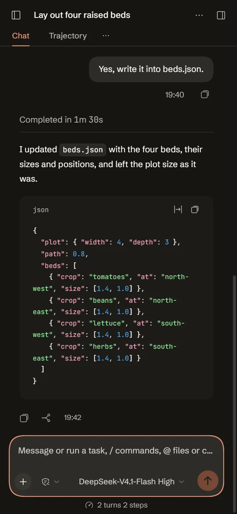

# 用手机访问 studio

[English](reach.md) | 中文

> 英文页面是当前版本；本页可能落后于它。

## 摘要

本页帮助你用手机打开你的 studio，并由你掌握谁能打开。你需要先让 Delorun 在你的电脑上运行起来（见[安装与首次运行](../get-started/install.zh.md)），并且两台设备上都装有 [Tailscale](https://tailscale.com)（见[你需要什么](#what-you-need)）。

[studio](../../reference/glossary.zh.md#studio) 是你在浏览器里与模型聊天的那个页面。远程访问（Delorun 也称它为 [reach](../../reference/glossary.zh.md#reach)）让你能从手机或另一台[设备](../../reference/glossary.zh.md#device)打开这个页面。它运行在你自己的 Tailscale 网络上。Tailscale 是一项把你的设备连接成一个私有网络的服务，这个网络称为你的 tailnet。Delorun 在这条路径上没有自己的服务：流量由 Tailscale 承载，由你的电脑决定谁可以登录。

tailnet 上的任何设备都能打开登录页面，但只有你在电脑上批准过的设备才能打开你的 chat。要批准一台设备，你需要输入它显示的 8 位数字代码。在未登录的设备上打开你的地址或它的任何页面，会先跳转到登录页面，登录之后再回到你打开的那个页面。远程访问在你开启之前是关闭的。

## 目录

- [你需要什么](#what-you-need)
- [从零开始](#start-from-nothing)
- [开启远程访问](#turn-remote-access-on)
- [批准设备](#approve-a-device)
- [让批准权掌握在你手里](#keep-approval-yours)
- [已批准的手机能做什么、不能做什么](#what-an-approved-phone-can-and-cannot-do)
- [用 Face ID 确认](#confirm-with-face-id)
- [用 PIN 确认](#confirm-with-a-pin)
- [移除设备](#remove-a-device)
- [关闭远程访问](#turn-remote-access-off)
- [获取一次性所有者验证码](#get-a-one-time-owner-code)
- [Tailscale 能看到什么](#what-tailscale-sees)
- [接下来](#next)
- [给想深入了解的人](#for-the-technically-curious)

<a id="what-you-need"></a>

## 你需要什么

- Delorun 已在你的电脑上设置好并能正常工作（见[安装与首次运行](../get-started/install.zh.md)）。
- 你的电脑和手机上都装有 Tailscale，并且都登录到同一个 tailnet。
- 在 Tailscale 管理控制台的 DNS 页面中，为你的 tailnet 开启 HTTPS 证书。Tailscale 需要它们来给你的电脑一个安全的地址。
- 在 Linux 上，你的用户需要有权限设置 `tailscale serve`，这是把手机的请求转发给 Delorun 的 Tailscale 功能。如果你的用户没有这个权限，`delorun reach on tailscale` 会打印出需要你自己运行的那一条命令：`sudo tailscale set --operator=$USER`。Delorun 从不运行 `sudo`。

<a id="start-from-nothing"></a>

## 从零开始

如果你还没有 Tailscale 账户，请按这条路径做。Tailscale 自己的页面给出了它们产品的步骤，所以本页只链接过去，不抄录。

1. **创建账户。**在 [login.tailscale.com/start](https://login.tailscale.com/start) 用你已有的身份注册。你的设备将在这个账户下加入同一个私有网络，即你的 tailnet。
2. **在运行 Delorun 的电脑上安装 Tailscale。**在 Linux 上以及 WSL2 内，按 Tailscale 的 [Linux 下载页面](https://tailscale.com/download/linux)操作，并用 `sudo tailscale up` 登录，它会打印一个要打开的链接。请安装在运行 Delorun 的 Linux 系统里，而不是只装在 Windows 上，因为 `delorun reach on tailscale` 会在 Delorun 所在的系统中运行 `tailscale` 命令。
3. **在手机上安装 Tailscale。**从 App Store 或 Google Play 获取应用（[下载页面](https://tailscale.com/download)），并用同一个账户登录。
4. **检查两台设备能互相看到。**在电脑上，`tailscale status` 会在电脑旁列出手机。在手机的应用里，电脑显示为已连接。如果任何一个缺失，说明两者登录的是不同的账户；请让其中一个退出再重新登录。
5. **开启 HTTPS 证书。**在 [Tailscale 管理控制台的 DNS 页面](https://login.tailscale.com/admin/dns)中，如果 MagicDNS 是关闭的就先开启，然后选择 **Enable HTTPS**。Tailscale 的 [HTTPS 页面](https://tailscale.com/kb/1153/enabling-https)对此有说明。
6. **让你的 Linux 用户可以设置 `tailscale serve`。**如果 `delorun reach on tailscale` 打印出 `sudo tailscale set --operator=$USER`，请自己运行一次该命令。
7. **启动 Delorun 并开启远程访问。**运行 `delorun start`，然后继续看[开启远程访问](#turn-remote-access-on)和[批准设备](#approve-a-device)。

<a id="turn-remote-access-on"></a>

## 开启远程访问

只需做一次，这样你的手机就有了可以打开的地址。在你电脑上的终端中运行：

```sh
delorun reach on tailscale
```

你也可以在 `delorun setup` 询问你将如何使用 Delorun 时，选择“Also from my phone or another device”，或对它的远程访问问题回答“是”。

该命令会检查 Tailscale，并询问 `This changes Tailscale on this computer … Continue? (y/N)`。请回答 `y`。加上 `--yes` 就不会询问；既没有终端又没有 `--yes` 时它会拒绝，这样就不会有东西在你不知情时改动 Tailscale。然后它把设置保存到你的 [profile](../../reference/glossary.zh.md#profile) 中，并打印你的地址 `https://<your computer's name>.<your tailnet>.ts.net`。当 Delorun 正在运行时，它会立即应用这项更改，并打印地址是否已就绪。否则，远程访问会在你下次运行 `delorun start` 时启动。

你应该会看到一行以 “Remote access is on for the profile default at https://” 开头的文字，一段说明已批准的手机能做什么、不能做什么的声明，以及 Tailscale 能看到的内容（见 [Tailscale 能看到什么](#what-tailscale-sees)）。如果 Delorun 正在运行，接下来的几行会说明地址是否已就绪。最后几行以 “To add your phone:” 开头，给出[批准设备](#approve-a-device)的两个步骤，并附上你的登录地址，它以 `/auth/sign-in` 结尾。

之后要检查，请运行 `delorun reach status`。它会显示远程访问是否已开启，以及在 Delorun 运行期间地址是否已就绪。

如果命令打印的是一条拒绝信息，请在[故障排查](../help/troubleshooting.zh.md#remote-access-and-devices)中找到其中的措辞。被拒绝时不会开启任何东西。

<details>
<summary>边界情况</summary>

- 如果该地址开启了 Tailscale Funnel，那么命令会拒绝，因为 Funnel 会把你的登录页面放到公共互联网上：请用拒绝信息打印的命令关闭 Funnel，然后再次运行 `delorun reach on tailscale`。
- 如果你的 Linux 用户无权设置 `tailscale serve`，那么不会写入任何内容，拒绝信息会打印 `sudo tailscale set --operator=$USER`：请自己运行一次，然后再次运行该命令。
- 如果另一条 `tailscale serve` 规则使用了同一个本地端口且不属于这个 studio，那么命令会移除它。当 Delorun 没有在该端口上提供服务时，它会移除该端口上的每一条规则，因为否则电脑上的任何程序都可以在那里应答你的手机。
- 如果 Delorun 正在运行但地址一直没有就绪，那么命令会以错误退出，并告诉你修复其上一行指出的问题后再次运行。
- 如果你传入 `tailscale` 以外的任何值，那么命令会以退出码 2 退出，并说明此构建只提供 `tailscale` 这一个选项。
- 如果你使用不止一个 profile，那么请加上 `--profile <name>`；远程访问是单个 profile 的设置。

</details>

<details>
<summary>进一步了解</summary>

- `delorun reach status` 显示远程访问是否已开启、地址是否已就绪，并打印登录地址以及添加手机的步骤。
- 在 `delorun setup` 中选择“Also from my phone or another device”，或运行 `delorun setup reach`，即可在设置过程中开启它。

</details>

<a id="approve-a-device"></a>

## 批准设备

设备只能在你的电脑上批准。这样可以防止 tailnet 上的陌生人进来。像这样批准一部手机：

1. 打开设备的批准窗口。如果你的手机以与这台电脑相同的用户登录了 Tailscale，请跳过这一步：手机无需窗口就可以提出请求，这台电脑上的 studio 会显示该请求。对于任何其他设备：
   - 运行 `delorun devices approve`，或在 studio 的“设置”→“设备”下选择 **Add a device**；
   - Delorun 必须正在运行，所以请先用 `delorun start` 启动它；
   - 窗口持续 5 分钟，在第一次批准时关闭。
2. 在手机上，打开你的登录地址（你的地址加上 `/auth/sign-in`；命令会打印它）。页面标题是 “Add this device”。核对它建议的设备名称，然后选择 **Ask for approval**。手机会显示一个 8 位数字代码以及它的有效时长。
3. 在电脑上，命令会列出每台等待中的设备，附有编号、简短的请求 id、名称、平台和时间。输入你能看到其屏幕的那台设备的编号，然后输入它显示的代码。输入 `c` 和一个编号，可以取消你不认识的请求。输错三次代码只会取消那一个请求。

你应该会在电脑上看到 “Approved <device name>. It signs in on its own now.”，手机则显示 “Approved” 并打开你的 studio。从此以后，手机会自动登录。

Tailscale 报告为以你所允许的用户登录的手机，可以在批准窗口之外提出请求。无论哪种情况，你都要在这台电脑上输入手机显示的 8 位数字代码，输错三次代码就会取消该请求。

`delorun devices list` 和“设备”部分列出每台已批准的设备。列表显示 id、名称、地址、批准时间和最近一次登录时间。没有设备时，`delorun devices list` 会说 “No device is trusted on this computer yet. Add one with delorun devices approve.”

<details>
<summary>在 studio 中批准</summary>

- 在“设置”→“设备”中，每台等待中的设备都有自己的代码输入框和一个 **Cancel request** 按钮。
- 无需窗口就提出请求的设备会在 studio 顶部显示为一条通知：选择 **Enter code**，在打开的输入框里输入这 8 位数字，输入框会在第八位数字时完成批准。这条通知绝不会从你正在输入的字段抢走键盘。
- 在“设置”→“设备”下，你可以选择谁可以提出请求、请求显示为通知、代码输入框还是只出现在列表中，以及窗口和请求的有效期。`delorun setup reach` 让你可以允许 tailnet 上的每台设备无需窗口就提出请求，`delorun reach status` 会说明谁可以提出请求。在手机上，这一部分会提示你到电脑上更改。

</details>

<details>
<summary>边界情况</summary>

- 如果手机显示 “Your computer isn’t ready yet”，那么批准窗口已经关闭：请执行第 1 步，然后在手机上选择 **Try again**。
- 如果手机显示 “Too many devices waiting”，那么已有 5 个请求在等待：请在电脑上输入 `c` 和编号来取消每一个你不认识的请求，或在“设备”部分选择 **Cancel request**，然后再从手机上重新请求。等待中的请求永远不会被自动替换。
- 如果你输错了代码，那么可以再输一次；第三次输错只会取消那一个请求：请从手机上重新请求以获得新代码。手机会显示 “Request cancelled”。
- 如果代码已超过 5 分钟，那么手机会显示 “This code expired”：请重新请求。
- 如果 `delorun devices approve` 在窗口关闭之前没有找到任何请求，那么它会以 “No device asked for approval before the window closed” 退出：请再次运行它，并在 5 分钟内从手机上提出请求。
- 如果 `delorun devices approve` 运行在无法回答其提问的环境中（标准输入不是终端，或已关闭），那么它会以退出码 1 退出，并提示 “this needs you at a terminal to answer; run it in one”：请在终端中运行它。
- 如果远程访问已关闭，那么 `delorun devices approve` 仍然可用，并说明手机目前还无法连到这台电脑：请先用 `delorun reach on tailscale` 开启它。
- 如果 Delorun 没有在运行，那么 `delorun devices approve` 会拒绝，并提示运行 `delorun start`。
- 如果设备名称或平台包含控制字符或文字方向字符，那么 home 会拒绝它，手机会要求换一个名称。
- 如果你选中了一台你看不到的设备，那么不要输入它的代码；输入 `c` 和它的编号来取消它。
- 如果你手机的浏览器偏好中文，那么登录页面是中文的。

</details>

<details>
<summary>进一步了解</summary>

- 运行 `delorun devices approve --profile <name>`，可以为另一个 profile 批准设备。
- 当你关闭再重新开启远程访问时，已批准的设备仍然保持已批准（见[关闭远程访问](#turn-remote-access-off)）。

</details>

<a id="keep-approval-yours"></a>

## 让批准权掌握在你手里

批准是留给你本人、在你的电脑上进行的。三个事实有助于让它一直如此。

- **代码把批准与你读到的屏幕绑定在一起。**窗口开启期间，tailnet 上的任何设备都可以提出请求，而 Delorun 无法分辨请求来自哪里。从另一台设备上读到的代码不会匹配。代码并不能证明谁持有这台设备：你批准时，任何拿着你已解锁手机的人都能得到这个批准。
- **模型在[沙箱](../../reference/glossary.zh.md#sandbox)中运行的命令无法批准设备。**studio 的“设备”部分只应答持有 studio 自己登录凭据的浏览器，而 `delorun devices` 通过一条需要你的 Delorun home 中某个文件里的令牌的通道与 Delorun 通信。沙箱中的命令两者都读不到。
- **在沙箱之外、以你的身份运行的程序，可以在你不在时批准设备。**对于你让它以[完全访问](../../reference/glossary.zh.md#full-access)运行的任何命令都是如此。电脑上的其他程序或其他用户可以访问 studio 的端口，但需要 studio 的登录凭据才能使用“设备”部分。在批准窗口之外，Delorun 会拒绝每一个请求被批准的操作。

<a id="what-an-approved-phone-can-and-cannot-do"></a>

## 已批准的手机能做什么、不能做什么

已批准的手机就是你本人：它已经可以要求模型做事，所以凡是风险不高于一条消息的事，它都可以做。少数敏感操作会要求你用 Face ID 或你的 PIN 确认，可以逐个确认，也可以在 Face ID 通行期（pass）内确认，另有少数事情无论如何都不能在手机上完成。



无需询问，手机可以：

- 阅读你的 chat 和工作区，并在 chat 运行时跟随它；
- 回复、附加文件、编辑或撤回排队中的消息、fork 一个 chat，并在你已有的[工作区](../../reference/glossary.zh.md#workspace)中，用你的任何[预设](../../reference/glossary.zh.md#preset)开始一个 chat。选择预设本身不授予任何权限：工作区的完全访问和每一次批准提示仍然决定该 chat 可以做什么；
- 读取 chat 自身工作区的文件并查看其改动。工作区之外的文件会被拒绝，包括通过链接到达的文件，Delorun 自己文件夹中的任何内容也一样；
- 重命名、置顶、归档、恢复和重新排序 chat，重命名和重新排序工作区，以及把工作区移到回收站；
- 设置、编辑、暂停和清除 chat 的目标，以及创建、编辑、运行和删除计划中的后续任务；
- 选择 chat 的模型，这也会把它保存为新 chat 的默认值；
- 阅读已安装的[插件](../../reference/glossary.zh.md#plugin)、你可以撤销的 profile 更改、已保存的设置版本及其之间的差异、harness 信任什么，以及较新版本的发行说明；
- 查看哪些 chat 被暂缓或已了结并暂缓或了结它们，以及关闭危险模式；
- 查看哪些 MCP 服务器和外部 agent 在等待你的同意或持有授权凭证（grant），并拒绝或撤销它们（拒绝和撤销只是收回同意）；
- 对 chat 或某条消息给出反馈；
- 回答普通的提示和模型提出的问题，并停止一次运行或一个后台任务。

在你用 Face ID 或你的 PIN 逐个确认之后，或在 Face ID 通行期开启期间，手机还可以：

- 更改设置；
- 运行只更改该 chat 的斜杠命令：`/compact`、`/export`、`/goal`、`/permission` 和 `/plan`；手机不运行其他斜杠命令；
- 安装、启用、更新或移除插件，以及撤销或恢复 profile 更改。Delorun 自己的防护插件和远程访问无法以这种方式关闭或更改，会改变它们的撤销或恢复也会被拒绝；
- 在「变更」中撤销插件的变更或丢弃任何等待中的变更，以及打开保护；
- 用文件夹选择器浏览文件夹、添加工作区，并在不属于你的工作区的文件夹中开始 chat；
- 运行模型编写的插件代码；
- 授予完全访问权限，无论是命令请求在沙箱之外运行，还是工作区请求被设为完全访问，也包括允许外部 agent 在某个工作区工作。你回答时，手机会要求 Face ID 或你的 PIN；如果你取消，该提示会继续等待；
- 接受某个 [MCP 服务器](../../reference/glossary.zh.md#mcp-server)，因为接受会让它的命令在你的电脑上运行；
- 把设置保存为一个版本，并切换到已保存的版本；
- 放宽工作区的网络、运行信任检查，以及发送问题报告（其中可能包含你电脑上的路径）；
- 保留你所做的更改：之后不会有任何东西被撤回，撤销和已保存的设置版本才是你回退更改的方式。

任何确认都不会开启一个窗口：每个敏感操作都会再次询问，刚批准一部新手机之后以及你从手机上设置 Delorun 时也一样。

只能在你的电脑上，无论手机确认什么：

- 开启或关闭远程访问、设置或更改 PIN，以及批准或移除设备；
- 关闭那条告知你有手机更改了保护的通知；
- 关闭更新检查（开启则可以在手机上进行）；
- 在你电脑上的应用程序中打开文件或文件夹。

手机会把这些显示为 “Do this on your computer”，并附上原因。

手机还可以打开终端、关闭保护、对你的插件或 Delorun 自己的文件应用更改、关闭或开启插件、开始工作会话、创建插件、移入或移出设置文件，或重启 Delorun。其中每一项都需要各自的确认，使用 [Face ID](#confirm-with-face-id) 或你的 PIN，除非 Face ID 通行期已开启。

无论手机确认什么，都绝不能做：

- 读取或更改你的密钥和其他凭据，或你的账户；
- 关闭 **Ask before external agents run**；手机仍然可以把它打开，并更改其运行时间上限（见[外部 agent](../safety-and-updates/safety.zh.md#external-agents)）；
- 放宽新 chat 开始时的权限，例如把它调向完全访问；手机仍然可以把它调得更严格；
- 回答会让模型管理工作区及其指令的提示；
- 在你电脑上的编辑器中打开设置文件；
- 重置 home。

当手机尝试其他被拒绝的操作时，你应该会看到 studio 的错误信息。

你已经在电脑上设为完全访问的工作区，仍然可以从手机上操作，那里的命令可以做你的用户能做的任何事。保护你的，是手机自身的锁，以及丢失设备时将其移除。

<details>
<summary>边界情况</summary>

- 如果工作区处于完全访问，那么手机在那里打开或连接终端时仍需用 Face ID 或你的 PIN 确认，危险模式也是如此：终端是带着你的权限的 shell，所以手机打开的每个终端都要确认，除非 Face ID 通行期已开启。
- 如果手机的会话空闲了 12 小时，或自登录起已过去 14 天，那么会话结束，它打开的连接也会关闭：手机会用自己的密钥从登录页面重新登录。
- 如果你批准或移除了任何设备，那么每部手机已打开的连接都会关闭：每部手机会自动重新登录。
- 如果回复以你电脑上的文件的形式显示图片，或你预览了某个文件，那么它不会在手机上显示：附加在消息中的图片则会显示。
- 如果你丢失了手机，请立即运行 `delorun devices remove <device id>`（见[移除设备](#remove-a-device)）。

</details>

<details>
<summary>进一步了解</summary>

- “设置”→“安全”→“外部 agent”中的 **Ask before external agents run** 仍然是只能在电脑上更改的设置（见[外部 agent](../safety-and-updates/safety.zh.md#external-agents)）。
- **从手机上设置。**手机上的设置引导会标出只有你的电脑才能完成的步骤（例如 PIN），说明原因，并提供 **Do it on my computer**。这会把该步骤保留在你的 home 中，而不是手机的浏览器里，之后你电脑上的 studio 会在侧边栏显示一个安静的 **Finish setup · N left**。它只打开这些步骤，略过你已经完成的步骤，没有剩余步骤时就会消失。

</details>

<a id="confirm-with-face-id"></a>

## 用 Face ID 确认

Face ID 是已批准的手机在敏感操作发生的那一刻确认该操作的方式，用的是手机自己的锁，而不是来自你电脑的代码。这里的“Face ID”指你的手机所使用的任何方式：iPhone 上的 Face ID 或 Touch ID、Android 上的指纹或屏幕锁、Windows 上的 Windows Hello。其背后是一把保留在手机上的通行密钥，[术语表](../../reference/glossary.zh.md#face-id)对此有说明。Delorun 从不会看到你的面部或指纹。

手机能做的每个操作都属于三组之一：

- **从不询问。**阅读、跟随 chat、回复、附加文件、停止一次运行，以及上文列为无需询问的其他操作。
- **会询问。**上文列为每次都要询问的操作：打开终端、关闭保护、对你的插件或 Delorun 自己的文件应用更改、重启 Delorun、保存或移除提供方的密钥，以及回答会授予完全访问权限的提示。手机会显示一张写明该操作的面板，你用 Face ID 确认，没有 Face ID 的手机则用你的 PIN 确认。一次确认只覆盖那一个操作，只能用一次，并且须在 30 秒内，除非 Face ID 通行期已开启（见下文）。有些操作即使在通行期开启时也始终要询问：移除另一台设备、移除通行密钥、Face ID 设置中的 **Show all devices**、在手机上更改 **Ask again after**、关闭保护、为某个工作区开启或关闭完全访问，以及允许 chat 提出的完全访问请求。其中每一项都需要为那一个操作进行 Face ID，即使通行期已开启也一样，而确认其中任何一项的 Face ID 不会开启通行期。移除另一台设备和更改 **Ask again after** 从不接受 PIN。
- **仅限你的电脑。**批准或移除设备、设置 PIN、开启或关闭远程访问，以及上文列为只能在你电脑上进行的其他操作。Face ID 从不开启这些操作。

无论是来自你电脑的代码、你的 PIN，还是新手机的首次登录，都不会开启一个让手机少问一些的窗口：没有 Face ID 的手机，每个敏感操作都用一次 PIN 确认。你用 Face ID 打开的终端会保持打开，用于它自己的后续工作，所以你不会为每次按键都被询问。它在空闲 5 分钟、总共 60 分钟或手机退出登录时结束，通行期结束并不会关闭它。另一个终端需要它自己的确认，或一个已开启的通行期。

**Ask again after**。手机上的一次 Face ID 可以为该手机开启一个通行期。通行期开启期间，手机执行**会询问**组中的操作时，不必每次都出现 Face ID 面板。在“设置”的 Face ID 中选择时长 **Ask again after**：Every time、5、15、30 或 60 分钟。默认为 15 分钟。**Every time** 表示每个操作都要一次 Face ID，没有通行期。

**标签。**通行期开启期间，手机上的 studio 会在打开的 chat 上方显示 “Unlocked · 14 min”，按整分钟倒计时，并带有 **Lock now** 按钮。通行期结束时该标签消失。你的电脑从不显示它。

**不会顺延。**无论你多频繁地使用手机，通行期都在 Face ID 之后所选的分钟数结束。更改 **Ask again after**（无论在手机上还是在你的电脑上）会结束所有已开启的通行期，所以更短的时间或 **Every time** 会立即生效。

**始终询问的操作。**上文始终询问的操作，在通行期开启时仍然要求 Face ID。远程访问设置、PIN 模式设置以及其他只能在你电脑上进行的操作，仍然只能在那里进行。

**不会开启通行期的情形。**你的 PIN，无论是手机没有 Face ID 还是 Face ID 失败；来自你电脑的代码；批准手机后的最初几分钟；危险模式。没有 Face ID 的手机，每个操作用一次 PIN 确认。

**结束通行期的情形。**时间到；手机连续 5 分钟没有向 Delorun 发送任何内容，例如它在口袋里被锁屏或 studio 被关闭；**Lock now**；studio 被隐藏 5 分钟（你回来时会再次检查，所以暂停了页面的手机仍会上锁）；更改 **Ask again after**；手机退出登录或其会话结束；移除该手机；Delorun 轮换所有会话；重启 Delorun。**Lock now** 和隐藏检查会结束整部手机的通行期，所以一个标签页隐藏 5 分钟也会锁定其他标签页。通行期保存在内存中，所以重启会关闭它。

**设置 Face ID。**

1. **配对手机时。**在你的电脑上，按[批准设备](#approve-a-device)批准该手机。批准之后，手机会提供 **Set up Face ID**。选择它，然后在它询问时用手机的锁确认。**Skip for now** 会在这次访问中隐藏该提示，“设置”的 Face ID 会再次提供它。
2. **之后，在已经配对的手机上。**在手机上打开“设置”的 Face ID，选择 **Add Face ID**。手机会显示一个 8 位数字代码。在你的电脑上，打开“设置”的 Face ID，在 **Device** 下选出该手机，输入代码并选择 **Confirm**。回到手机上，选择 **Set up Face ID** 并用它的锁确认。与批准代码一样，这个代码把新的通行密钥绑定到你能看到的屏幕上。

每部手机都有自己的通行密钥。在一部手机上添加 Face ID 不会改变另一部手机。

**Face ID 失败或不可用时。**

在面板上选择 **Use PIN instead**，用你的 PIN 确认同一个操作（见[用 PIN 确认](#confirm-with-a-pin)）。正确的 PIN 只确认那一个操作。Face ID 一被取消或无法使用，面板就会显示这个选项。如果你没有设置 PIN，面板会显示 **Or do this at your computer**：请在你的电脑上执行该操作。

取消手机自己的面板不计入任何次数。错误的通行密钥或错误的 PIN 算作一次 PIN 错误尝试：一部手机上的第五次错误会移除该手机，所有手机合计十次错误会暂停 PIN 和 Face ID 确认，直到你在电脑上运行 `delorun devices pin resume`。

**Face ID 不做的事。**

- 它不会让手机登录。登录仍由手机自己的密钥和你的批准完成。
- 它不会让手机去做只有你的电脑才可以做的事，通行期也不会。
- 它本身不能让被盗且已解锁的手机变得安全。在 iPhone 上，请在“设置”“Face ID 与密码”中开启 **Stolen Device Protection**，这样即使有人得知手机的密码，在你常去的地点之外，仍无法使用 Face ID、更改密码或关闭该保护，除非等待一小时。
- 它在无法创建平台通行密钥的浏览器中不起作用。某些版本的 Firefox 以及其他没有该能力的浏览器会提示 “This browser cannot use Face ID here”；那部手机用它的 PIN 确认操作，或者由你在电脑上执行。iPhone 上的 Safari 和 Android 上的 Chrome 在试过的浏览器中可用。

<details>
<summary>Edge cases</summary>

- 如果你在一个地址上设置了 Face ID，之后更改了 reach 地址，那么旧的通行密钥在新地址上不起作用：手机会提示重新设置 Face ID。
- 如果手机的面板停留超过 60 秒，那么请求会过期：请重新选择该操作。
- 如果通行密钥通过你的账户在你的设备之间同步，那么它仍然只在用 Delorun 创建它的那部手机上起作用，因为手机自己的会话是检查的一部分。
- 如果你在通行密钥失败时选择 Use PIN，那么失败的通行密钥尝试仍然算作错误尝试。
- 如果你只使用电脑，那么这里的一切都不适用：电脑从不被询问。
- 如果某个操作的请求大于 1 MiB，那么 Face ID 无法覆盖它：请在你的电脑上执行。

</details>

<details>
<summary>Go further</summary>

- `delorun devices list` 显示每台设备；你电脑上“设置”的 Face ID 列出每台设备的通行密钥以及各自最近一次使用的时间。
- Face ID 各行列在 `AUTH_CLASSES` 中（[reach 设计](../../design/reach.zh.md)）。

</details>

<a id="confirm-with-a-pin"></a>

## 用 PIN 确认

PIN 模式让已批准的手机通过输入 PIN 或口令来确认敏感操作，方式与 Face ID 相同：用于没有 Face ID 的手机，以及有 Face ID 但 Face ID 失败的手机。正确的 PIN 只确认那一个操作，只能用一次；下一个操作会再次询问。手机打开 studio 不需要 PIN。它在你开启之前是关闭的，并且只能在你的电脑上开启。它只在 Tailscale 私有地址上起作用，在 Funnel 地址上不起作用。

一旦开启了手机访问，首次运行引导会在 PIN 步骤中提供这一选项，且只在你的电脑上；在那里选择 **Skip** 会让 PIN 模式保持关闭。你也可以稍后在“设置”的 PIN 模式中设置，或在 Delorun 运行期间，在终端中运行 `delorun devices pin set`。它会两次询问密码，输入的字符不会显示。PIN 至少有 6 位数字，并且不能是重复或连续的数字，例如 `111111` 或 `123456`。口令至少有 10 个字符，可以是任何不全是数字的密码。要通过管道输入一行而不是手工输入，请添加 `--stdin`。

你应该会看到 “PIN mode is on, with a PIN.” 以及一份简短的允许事项列表。设置或更改 PIN、开启或关闭该模式，以及批准设备，仍然只能在你的电脑上进行。

该模式会限制错误尝试。一台设备上的第五次错误尝试会移除该设备并让它退出登录；请在你的电脑上重新批准它。你所有设备合计十次错误尝试会为所有人暂停 PIN 和 Face ID，直到你运行 `delorun devices pin resume`。

| 命令 | 作用 |
| --- | --- |
| `delorun devices pin set` | 开启 PIN 模式，或更改 PIN 或口令。 |
| `delorun devices pin off` | 关闭 PIN 模式并丢弃 PIN。没有 Face ID 的手机此后在你的电脑上执行其敏感操作。 |
| `delorun devices pin resume` | 在错误尝试导致暂停之后，恢复 PIN 和 Face ID。 |
| `delorun devices pin status` | 说明 PIN 模式是否已开启以及如何设置。Delorun 没有运行时也可使用。 |

<details>
<summary>边界情况</summary>

- 如果 Delorun 没有在运行，那么 `pin set`、`off` 和 `resume` 会停止并说明这一点。请用 `delorun start` 启动它，然后再次运行该命令。在此之前不会有任何更改。
- 如果 PIN 太弱，那么命令会说明原因且不做任何更改（见[故障排查](../help/troubleshooting.zh.md)中的 `PIN_FAILED`）。
- 如果 `delorun devices pin status` 显示 “PIN mode is off. Turn it on with delorun devices pin set.”，那么没有 Face ID 的手机在你的电脑上执行其敏感操作。

</details>

<a id="remove-a-device"></a>

## 移除设备

当你丢失了某台设备或不再使用它时，请移除它。用 `delorun devices list` 中的 id 运行 `delorun devices remove <device id>`，或在你电脑上 studio 的“设备”部分选择该设备旁的 **Remove**。

你应该会看到 “Removed <device id>; <n> session(s) ended.” 该设备会立即退出登录，它打开的连接也会关闭。要再次使用它，需要重新批准。

**移除通行密钥。**当你更换手机的锁或不再信任它时，请移除通行密钥。在你的电脑上，打开“设置”的 Face ID，选择通行密钥旁的 **Remove**，或选择 **Remove device** 移除整台设备；用 `delorun devices remove <device id>` 移除设备时，会同时移除它的通行密钥。在手机上，打开“设置”的 Face ID：手机列出它自己的通行密钥，你选择其中一个旁边的 **Remove** 并用 Face ID 确认。**Show all devices** 会要求 Face ID，并列出其他设备。要移除另一台设备的通行密钥或另一台设备，手机自己必须持有一把通行密钥：PIN 无法确认这一点。你应该会看到该通行密钥从列表中消失；没有剩余通行密钥的手机会重新用代码或它的 PIN 确认。

<details>
<summary>边界情况</summary>

- 如果 Delorun 没有在运行，那么 `delorun devices remove` 仍然可用：它直接更改已保存的设备记录，该设备无法再次登录。
- 如果你给出的 id 不在列表中，那么命令会失败并说明原因：请从 `delorun devices list` 中复制 id。

</details>

<a id="turn-remote-access-off"></a>

## 关闭远程访问

运行 `delorun reach off`。

你应该会看到 “Remote access is off for the profile default.” 和 “Tailscale no longer serves this computer's studio.” 正在运行的 Delorun 会立即关闭远程监听器，下次启动时也不会再打开。Delorun 运行期间，它每分钟重新检查一次 Tailscale，如果你的地址开启了 Funnel，就会停止提供服务。

已批准的设备仍然保持已批准，所以再次开启远程访问时不会再次要求批准它们。如果你不再需要它们，请移除。

<details>
<summary>边界情况</summary>

- 如果 Delorun 在没有清理的情况下停止了（例如电脑断电），那么 Tailscale 会继续把你的地址转发到固定的本地端口，直到 Delorun 再次启动或你运行 `delorun reach off`；这段时间里，同一台电脑上的另一个用户可以在该端口上向你的手机提供一个页面：如果你与他人共用电脑，请运行 `delorun reach off`。
- 如果没有安装 Tailscale，那么 `delorun reach off` 会这样说明并结束：没有任何东西在提供 studio。
- 如果已安装 Tailscale 但无法移除规则，那么命令会说明 Tailscale 可能仍在提供 studio，并以错误退出：请修复消息指出的原因（例如运行它打印的命令），然后再次运行。

</details>

<a id="get-a-one-time-owner-code"></a>

## 获取一次性所有者验证码

`delorun devices code` 会在终端中打印一个新的一次性所有者验证码。验证码只能使用一次，有效期 10 分钟，仅对这台电脑的 studio 有效，新验证码会取代上一个。它只会打印到终端：当输出被重定向到别处时，命令会告诉你在终端中运行它。

你应该会看到 “Owner code:” 后面跟着验证码，然后是 “It works once, for 10 minutes, on this computer's studio.”

批准手机不需要这个验证码：在你的电脑上用 `delorun devices approve` 批准设备，就会认领一个尚无所有者的 home。studio 中没有任何地方会索要这个验证码。

<a id="what-tailscale-sees"></a>

## Tailscale 能看到什么

Tailscale 的协调服务能看到你电脑的名称、你的电脑和每台设备的 IP 地址、连接时间和流量大小。除非开启了 Tailnet Lock，否则 Tailscale 可以把设备添加到你的 tailnet，并且它会为你的地址获取证书。每台设备仍然需要你在电脑上批准。见[你使用 Delorun 时信任什么](../safety-and-updates/trust.zh.md)。

远程访问尚未经过外部安全评审。它的测试使用的是伪造的 `tailscale`，从未在真实的 tailnet 或手机上运行过。

<a id="next"></a>

## 接下来

- 要了解手机连接时哪些东西仍受保护，请阅读 [Delorun 保护什么](../safety-and-updates/safety.zh.md)。
- 要了解 Tailscale 和其他方能看到什么，请阅读[你使用 Delorun 时信任什么](../safety-and-updates/trust.zh.md)。
- 如果出了问题，请在[故障排查](../help/troubleshooting.zh.md#remote-access-and-devices)中找到那条消息。

<a id="for-the-technically-curious"></a>

## 给想深入了解的人

[设备批准约定](../../contracts/c05-device-approval.zh.md)定义了批准代码，以及已批准的设备可以做什么。代码由设备的密钥和它发出的请求计算得出，所以从另一台设备上读到的代码不会匹配。电脑从不显示或返回它。

[远程访问提供方约定](../../contracts/c07-reach-providers.zh.md)定义了 Delorun 如何驱动 Tailscale：`delorun reach on tailscale` 把一个固定的本地端口（即远程监听器）写入 profile，并让 `tailscale serve` 指向它。

[远程访问设计](../../design/reach.zh.md#never-run-on-a-real-tailnet-or-phone)解释了各项选择，并列出了仍未尝试的内容。
