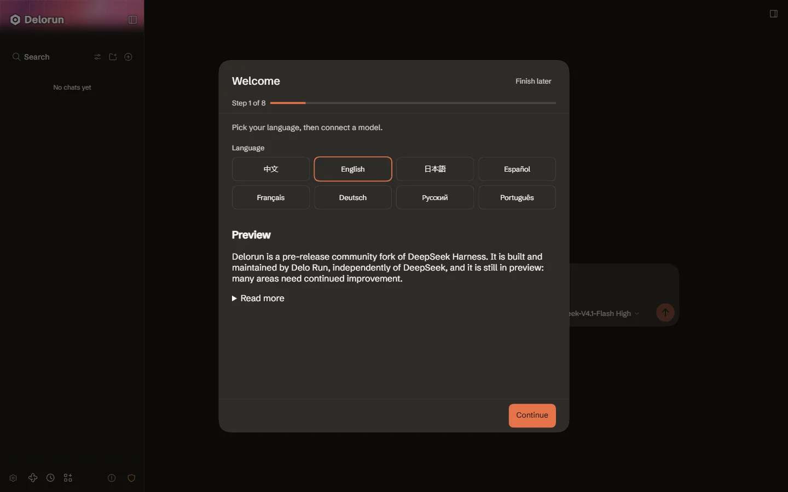

# Install and first run

English | [中文](install.zh.md)

## Summary

This page takes you from nothing to your first chat. You run one command, `npx delorun`. It downloads Delorun, checks that the download is genuine, asks a few questions and sets Delorun up. You then start it with `delorun`, and it opens in your browser. Everything then runs on your own computer. You need a computer that Delorun supports, Node.js to install and start it, and a key for the AI model you want to talk to. A chat needs the key; the studio opens without one, so you can look around first.

Delorun is an agent harness that you shape to your own work. It is built on [DeepSeek Harness](../../reference/glossary.md#stock), the open-source program that lets an AI model work on files and run commands on your computer.

## Contents

- [Before you start](#before-you-start)
- [Install](#install)
- [Windows through WSL2](#windows-through-wsl2)
- [What the launcher verifies](#what-the-launcher-verifies)
- [Setup: how you will use Delorun](#setup-how-you-will-use-delorun)
- [The studio and your first chat](#the-studio-and-your-first-chat)
- [The default workspace](#the-default-workspace)
- [A computer without a browser](#a-computer-without-a-browser)
- [Next](#next)
- [For the technically curious](#for-the-technically-curious)

## Before you start

- **A supported computer.** Linux on x64, or Windows through WSL2 ([Windows through WSL2](#windows-through-wsl2)). Delorun does not run on Linux on ARM (arm64), on native Windows or on macOS ([Roadmap](../roadmap.md)).
- **[Node.js](https://nodejs.org) 24.9 or newer.** The `delorun` command is a Node program, so it needs Node every time it starts, not only to install it. Check with `node --version`. If you have no Node, or an older one, use one of the official ways to install Node on [nodejs.org](https://nodejs.org/en/download). Ubuntu's own package for Node is far older (Ubuntu 24.04 offers Node 18), so `apt` does not give you a Node that works.
- **bubblewrap, on Linux and in WSL2.** It is the program that confines the commands a chat runs. Install the `bubblewrap` package with your system's package manager. Without it, Delorun refuses every command on a computer that has a login session or a program such as tmux running, and `delorun doctor` shows `fail sandbox` ([What Delorun protects](../safety-and-updates/safety.md#the-sandbox)).
- **A model key.** A key is a secret text that lets Delorun use an AI model on your account. The company or server that runs the model is the [model provider](../../reference/glossary.md#provider). The default is a DeepSeek API key. Other providers work too ([Model providers](providers.md)). You can skip the key during setup and add it later.
- **git**, which `delorun update` uses to save your settings before an update ([Updates](../safety-and-updates/updates.md)). First-run setup does not need it.

## Install

Run this in a terminal:

```sh
npx delorun
```

Prefer another package manager? These run the same launcher, with Node:

```sh
pnpm dlx delorun
bunx delorun
```

`npx` may first ask `Ok to proceed? (y)` before it installs the `delorun` package. Press **y** and Enter. The first run downloads and installs Delorun, which is a large download, then starts setup. Delorun prints the checks described below, then asks the first setup question. Every later `npx delorun` starts the installed Delorun and downloads nothing.

At the end, setup prints the next steps. The first is a line for you to run, `npm install -g delorun@<version>`, which installs the `delorun` command. After that you can type `delorun` instead of `npx delorun`.

Delorun keeps everything in one folder, `~/.delorun`, which only you can open ([Your Delorun home](../customising/home.md)).

<details>
<summary>Edge cases</summary>

- If you run macOS, then the launcher stops before it downloads anything and says Delorun does not run on macOS. Use Linux, or Windows through WSL2.
- If you run native Windows, then the launcher stops before it downloads anything and says Delorun runs in WSL2. Follow [Windows through WSL2](#windows-through-wsl2).
- If your computer runs another system or processor that the release does not list, then the launcher stops with `PLATFORM_NOT_RELEASED` and installs nothing.
- If your Node is older than 24.9, then the launcher stops with `Delorun needs Node 24.9 or newer to start`, and names your version. Install a newer Node from [nodejs.org](https://nodejs.org/en/download) and run `npx delorun` again.
- If a check fails, then nothing is installed ([What the launcher verifies](#what-the-launcher-verifies)). Run `npx delorun` again; if it keeps failing, see [Installs and release checks](../help/troubleshooting.md#installs-and-release-checks).
- If `npm install -g` stops with `EACCES` (permission denied), then your Node is installed for the whole system and npm cannot write there without root. Install into your own folder instead, `npm install -g --prefix ~/.local delorun@<version>`, and add `~/.local/bin` to your `PATH`.
- If you have no network, then the first install cannot download a release. Once a release is installed, starting needs no network.
- If you set `DELORUN_HOME`, then the home is created there instead of `~/.delorun` ([Your Delorun home](../customising/home.md#where-the-home-is)).

</details>

<details>
<summary>Go further</summary>

The launcher takes its own options before any `delorun` arguments:

| Option | What it does |
| --- | --- |
| `--profile <name>` | Uses another [profile](../../reference/glossary.md#profile) than `default` ([Your Delorun home](../customising/home.md#profiles)). |
| `--release <version>` | Installs this release instead of the channel's current one, when no release is installed yet. |
| `--` | Ends the launcher's options. Everything after it goes to `delorun`. |

</details>

## Windows through WSL2

Delorun runs on Windows inside WSL2, the Windows feature that runs Linux next to Windows. It does not run in a native Windows terminal such as PowerShell.

1. Install WSL2 with its default Ubuntu: open PowerShell and run `wsl --install`, then restart Windows if it asks.
2. Open the Ubuntu app from the Start menu. Everything after this happens in that terminal.
3. Install Node.js 24.9 or newer inside Ubuntu, not in Windows ([Before you start](#before-you-start)).
4. Install bubblewrap inside Ubuntu, the `bubblewrap` package ([Before you start](#before-you-start)).
5. Run `npx delorun` there and follow [Install](#install).

Keep your projects inside the Ubuntu home folder, such as `~/projects`, because files on the Windows drives (`/mnt/c`) are slow for Linux programs. Open the studio from your Windows browser at the address Delorun prints.

## What the launcher verifies

Before it installs anything, the launcher proves the download is the release the maintainer published. It prints each check:

```text
Resolving the release: the stable channel names 0.1.0-preview.2.1.
Checking the signature: 0.1.0-preview.2.1 is signed under release root 1.
Checking the release log: verified.
Downloading delorun-0.1.0-preview.2.1-linux-x64.tar.gz (…).
Installing release 0.1.0-preview.2.1.
```

- **Channel.** A preview is published on the channel named `stable`, so the first line says so.
- **Signature.** Delorun's release keys sign the release. The launcher checks the signatures and that the downloaded file matches. If anything does not match, nothing is installed.
- **Built on one machine.** Until `1.0.0`, the maintainer builds and signs each release on the maintainer's PC, and no second builder rebuilds it. The launcher installs such a 0.x release when it verifies under the preview root. It refuses a release built this way when it is a `1.0.0` release or is signed under a later root ([What you trust](../safety-and-updates/trust.md#how-releases-are-signed-in-the-preview)).
- **Public release log.** Every release is also entered in a public, append-only [release log](../../reference/glossary.md#release-log). The launcher checks the entry. If the log cannot be reached, the launcher installs the release on its signature alone, prints a warning, and checks the log again at the next start that can reach it.
- **Every start.** The launcher compares the installed files with the signed list. A start with a release installed needs no network.

You can run these checks again at any time with `delorun verify` ([Daily use](../everyday-use/daily-use.md#check-the-release-and-your-setup)). [What you trust when you use Delorun](../safety-and-updates/trust.md) says what you still rely on. The launcher installs from releases.delorun.com, with GitHub Releases and a spare host of Delorun's as fallbacks, and from no other host. It does not check the release's SBOM, and the npm package carries no build attestation.

<details>
<summary>Edge cases</summary>

- If the log contradicts the release, then the install stops. Do not work around it; see [Installs and release checks](../help/troubleshooting.md#installs-and-release-checks).
- If you want a stricter full file check at every start, then set `DELORUN_RUNTIME_FULL_CHECK_DAYS` to `0`. The default hashes every file at least every 7 days; the largest value is 30.

</details>

## Setup: how you will use Delorun

The first `delorun` on a new home runs setup. It asks one question at a time, and every question after the first offers **← Back**. Nothing is written until you choose **Save and set up** on the last screen; **Cancel** there writes nothing.

The first question asks how you will use Delorun. Its answer sets the defaults and decides which questions come next. Each choice shows what it does, who it suits and how to change it later, and the recommended choice is marked:

```text
How will you use Delorun?
● Just me, on this computer (recommended)
○ Also from my phone or another device
○ For scripts and automation
```

If you are unsure, choose the first. Most people then answer three questions: the model provider, its key, and how much Delorun asks.

| You choose | Delorun runs | Setup also asks |
| --- | --- | --- |
| **Just me, on this computer** | In the background, and opens in your browser on this computer. Nothing outside this computer can reach it. | Nothing more. |
| **Also from my phone or another device** | As above, plus a private address on your own [Tailscale network](../../reference/glossary.md#tailnet). A device you approve here with a code can read and reply to chats. | Whether to open Delorun from your phone over Tailscale ([Reach the studio from your phone](../everyday-use/reach.md)). |
| **For scripts and automation** | With no studio. You run `delorun headless "task"` from scripts or CI, with your key in an environment variable such as `DEEPSEEK_API_KEY`. | Neither the import question nor the background question. |

Every choice then asks these questions, in this order:

1. **Privacy.** A note, no question. It says that Delorun has no [telemetry](../../reference/glossary.md#telemetry) of its own, that DeepSeek Harness's desktop analytics and DeepSeek's session-log upload are off unless you turn them on, and that once a day Delorun checks whether a newer release exists and sends nothing about your installation. The note ends: `Delorun checks for new releases once a day. To turn that off before Delorun first starts, choose More settings on the last screen, or run delorun setup privacy later.`
2. **Import.** Only if you used DeepSeek Harness before and this Delorun home has no chats: `Copy your DeepSeek Harness chats, attachments and workspace list? Your DeepSeek Harness folder is only read. You can also do this later with delorun import-home.` The answer starts on No ([Switching from DeepSeek Harness](switching.md)). The automation choice never asks it.
3. **Model provider.** `Which model provider should Delorun use?` lists **DeepSeek (recommended)**, **More providers** (Anthropic, OpenAI, Google Gemini and others, or any server that speaks the OpenAI API) and **Choose later**.
4. **Model key.** The question names the provider's page for creating an [API key](../../reference/glossary.md#api-key), then asks `How should Delorun get the DeepSeek API key?` You can **paste it now** (marked recommended), and Delorun stores it in your Delorun folder where only you can read it, or **use `DEEPSEEK_API_KEY`**, which Delorun reads each time it starts. An environment variable is a named setting that your terminal passes to the programs it starts. If you choose the variable and it is not set in this terminal, setup says so at once and tells you how to set it. Setup checks a typed key with one request to the provider ([Model providers](providers.md)).
5. **Prompts.** `How much should Delorun ask before it changes things?` This is the [prompts answer](../../reference/glossary.md#prompts-answer). It has three choices:

   ```text
   ● Ask me first (recommended)
   ○ Ask less (like DeepSeek Harness)
   ○ Never ask (dangerous)
   ```

   **Ask me first** asks before a chat gets full access to a folder, adds a tool server, edits its own instructions or schedules work, and you can allow each once. **Ask less (like DeepSeek Harness)** behaves as DeepSeek Harness does: few questions, and commands still run in a [sandbox](../../reference/glossary.md#sandbox) ([What Delorun protects](../safety-and-updates/safety.md#consents)). **Never ask (dangerous)** lets any chat switch to full access with no question; it prints a warning, asks you to confirm twice and to type `full access everywhere` ([Consents](../safety-and-updates/safety.md#consents)). It is always listed last.

A review screen then lists every answer, for example for the first choice:

```text
How you use Delorun: just me, on this computer
Release check: on, once a day
Model: DeepSeek, default model. Key: read from DEEPSEEK_API_KEY at each start.
Prompts: Ask me first
Keep running in the background: yes
Remote access: off
Changes protection: unchanged
Setup name: default, studio port 3080

Nothing is saved until you choose Save and set up.
```

You should see `Save these answers and set up Delorun?` with **Save and set up**, **More settings**, **Cancel** and **← Back**. Choose **Save and set up**.

Setup then writes your answers, prints the next steps and starts nothing:

```text
Delorun is set up. Nothing is running yet.

Next:
  1. Install the delorun command, which npx does not keep:
     npm install -g delorun@0.1.0-preview.2.1
  2. Set DEEPSEEK_API_KEY in your terminal, then run delorun stop and delorun start if Delorun is running. It is the DeepSeek key you chose.
  3. Start Delorun and open the studio: delorun
     Send a first message in a new chat. The install guide's section on your first chat walks through it: https://docs.delorun.com/guide/get-started/install#the-studio-and-your-first-chat

Change an answer later: delorun setup <section> (delorun setup --list shows the sections).
If something looks wrong: delorun doctor.
```

The install step appears only when the launcher started setup, and the key step only while the key variable you chose is not set. The steps differ by choice. The phone choice adds `Add your phone or another device: delorun devices approve, then type the code it shows.`, or, when remote access is off, `Remote access is off. To turn it on later, install Tailscale and sign in, then run delorun reach on tailscale.` The automation choice replaces step 2 with `Run a task from a script or CI: delorun headless "your task"` and adds `To use the studio as well, start it any time with delorun.`

<details>
<summary>Edge cases</summary>

- If you choose **Choose later**, then no provider is set up and chats cannot answer yet. Setup says so. New chats start on `deepseek-flash` from DeepSeek, which reads its key from `DEEPSEEK_API_KEY`. Add a provider later with `delorun setup key` or in the studio's Settings, Agent, Models.
- If the provider refuses your key, then setup does not store it unless you choose **Continue without a successful check**. The review screen then says the key is not verified.
- If the launcher is built for another release channel, such as a local channel, then it is not on the npm registry, so the install step says to install the package file it came from, `npm install -g ./delorun-<version>.tgz`, and the update-check statement names that channel's host, not releases.delorun.com and GitHub.
- If you press Ctrl-C at any question, then setup prints `Setup cancelled. Nothing was saved. Run delorun to start again.` and exits with code 130. Closing the terminal before you save also writes nothing.
- If you choose **← Back** at the dangerous-mode confirmation, then you return to the prompts question.
- If you did not choose More settings and port 3080 is already used by another program, then setup does not ask about the port, and the start fails. `delorun start` prints `Delorun did not start. Delorun stopped with exit code 1 before it was running.` and then `Run delorun logs to see why, then delorun doctor to check your setup.` `delorun doctor` shows `fail port` and the fix. Run `delorun setup profile` to choose another port, then `delorun start`.
- If `~/.dsh` does not exist, or your Delorun home already has chats, then the import question is skipped.
- If setup runs without a terminal, then it cannot ask; use `delorun setup --yes` or `--config` (see Go further below).
- If you run setup with `--yes` and no `--provider`, then it sets up no model provider and prints how to add one. A script that runs `delorun headless` needs the key variable set in its own environment, because setup never stores a key it did not ask for.
- If you run setup as the root user, then **Never ask (dangerous)** is refused, by the question, by `--prompts dangerous` and by an answers document.
- If you chose to run in the terminal (background: No, under More settings), then closing the terminal stops Delorun.

</details>

<details>
<summary>Go further</summary>

- **More settings** on the review screen asks the rest: whether to check for new releases (Yes by default), whether Delorun keeps running in the background, remote access, and the [profile](../../reference/glossary.md#profile) name and the studio's port (3080 by default). Setup says when the port is in use, and asks again. Run setup with another profile name for several setups side by side ([Your Delorun home](../customising/home.md#profiles)).
- To change your mind, run `delorun setup` again. On a finished setup in a terminal it says what the run does, then asks every question again with your current choices selected. Your saved key stays: the key question offers **Keep the saved key** first and never shows it. The review marks the answers you changed, and only those are written; the rest are reported as kept. Turning dangerous mode on asks both confirmations again. Staying on it asks nothing more. With `--yes` or `--config`, a finished setup is left unchanged.
- Change one answer later with `delorun setup <section>`. `delorun setup --list` lists the sections: `privacy`, `import`, `key`, `prompts`, `background`, `reach` and `profile`.
- For scripts, `delorun setup --yes --provider deepseek-official` reads the key from `DEEPSEEK_API_KEY`. Without `--provider`, `--yes` accepts the other defaults and sets up no model provider; add one afterwards with `delorun setup key`. `delorun setup --config <file>` reads every answer from a JSON file that holds a complete answers document. A file with only `useCase` is refused. Neither form turns on remote access or imports `~/.dsh`, and neither starts Delorun: run `delorun` afterwards. `--check-key` checks a key that comes from the environment ([Model providers](providers.md#set-up-without-questions)).
- A complete answers document that reads the key from `DEEPSEEK_API_KEY` looks like this. [Answer schema](../../contracts/c11-setup-answers.md#answer-schema) explains each field.

  ```json setup-answers-example
  {
    "schemaVersion": 5,
    "useCase": "local",
    "modelProvider": { "id": "deepseek-official", "credential": { "source": "environment", "name": "DEEPSEEK_API_KEY" }, "baseURL": null, "model": null },
    "prompts": "safer",
    "background": true,
    "profile": { "name": null, "port": null },
    "reach": { "option": "none", "identityFactor": null },
    "importStockHome": false,
    "protectChanges": false,
    "updateCheck": true,
    "sections": []
  }
  ```

</details>

## The studio and your first chat

Run `delorun` after setup. It starts Delorun and opens the studio in your browser. The [studio](../../reference/glossary.md#studio) is Delorun's web page for chatting with the model. It prints where the studio is and the commands to watch and stop it:

```text
Delorun is running in the background for the profile default at http://127.0.0.1:3080/; it keeps running after this terminal closes.
See it with delorun status, follow its log with delorun logs --follow, and stop it with delorun stop.
Run delorun open to open the studio in your browser.
Opened the studio in your browser.
```

The studio listens on `127.0.0.1`, which only your own computer can reach, unless you turn on [remote access](../everyday-use/reach.md). The browser signs in with a link that works once and expires after one minute. `delorun open` opens the studio again with a fresh link.

The first time, the studio shows a short first-run guide, one step at a time, ending in a chat:



1. **Welcome.** Choose the language. A pre-release notice says that Delorun is a community fork of DeepSeek Harness that is still in preview; choose Continue to acknowledge it.
2. **Models.** Tick the model providers you use. For each, paste its key and choose **Connect**, or choose **Skip**. A key Delorun already has shows as "Key found", with where it came from (for example "From DEEPSEEK_API_KEY in the environment Delorun started with") and a "How does Delorun know?" note. There is no key box then: choose **Next** to use it, or **Replace key** to type a different one. A summary then lists what is set up.
3. **Look.** Choose colours and theme. A link under the choices opens a screen that says what the original DeepSeek Harness look turns off and what stays; if you confirm, the switch happens when you finish the guide.
4. **Agents.** Optionally add Claude Code or Codex as helpers a chat can hand work to.
5. **Recommended plugins.** Optionally add [plugins](../../reference/glossary.md#plugin), small add-ons that give Delorun more tools.
6. **Phone access.** Shown while remote access is not set up. It lists what Tailscale still needs, and offers **Not now** or **I've done this**.
7. **PIN.** Shown only in a studio on the computer that runs Delorun, once phone access is on. Choose a PIN or passcode, typed twice, and **Set PIN**, or **Skip** to leave PIN mode off. If PIN mode is already on, the step says so and links to Settings.
8. **Workspace.** Choose the [workspace](../../reference/glossary.md#workspace) for your first chat: the default one, a folder on your computer, or a git address to clone.
9. **Ready.** Choose **Start a chat**.

Most steps have Back, Continue and **Skip**, which leaves only that step; the Models step has **Connect** and **Next** while you go through providers, and the Phone access step has its own two buttons. **Finish later**, beside the step name, closes the guide and keeps your place, and the guide shows again next time. To go through the steps again, choose Settings, General, Getting started, **Run setup again**. Each step starts on your current choices, such as the mode and theme saved in Settings, and a choice changes only when you change it. On a phone, the Phone access step says that Tailscale is set up on the computer that runs Delorun.

A new chat starts in one of the agent [presets](../../reference/glossary.md#preset), which the studio calls modes: Standard, PTC, Minimal and Creator. PTC does everything Standard does and suits tasks that call tools in batches and then filter, deduplicate or summarise the results. In Creator mode, the agent writes plugins and presets with you. Type a message to chat. If you set up no provider or key, the model cannot answer; add one in Settings, Agent, Models.

<details>
<summary>Edge cases</summary>

- If the browser does not open, then run `delorun open`, or `delorun open --print` and open the printed link yourself.
- If the link says it has expired, then run `delorun open` again. Each link works once, within one minute.
- If the browser shows "unauthorized" (HTTP 401) at the studio address, then you opened the address without a sign-in link. Run `delorun open`. <!-- us-spelling: quoted output -->
- If `delorun status` says `state: not running`, then start it with `delorun start`; if the start fails, read `delorun logs` and [Starting and stopping](../help/troubleshooting.md#starting-and-stopping).
- If your key is not set, then `delorun doctor` shows a `!` line for `key`, and a chat reports that the model cannot answer. Fix it with `delorun setup key`.

</details>

<details>
<summary>Go further</summary>

- Open the studio from your phone: [Reach the studio from your phone](../everyday-use/reach.md).
- See what a chat costs: [See what a chat costs](../everyday-use/cost-meter.md).
- Reshape Delorun with plugins, presets and skills: [Where to customise what](../customising/customise.md).

</details>

## The default workspace

A chat works in a workspace: a folder on your computer whose files the model may read and change. Delorun's default workspace is `Delorun/default-workspace` in your Documents folder, or in your home folder when your system has no Documents folder. The studio creates it the first time it is used. Add your own project folders in the studio.

<details>
<summary>Edge cases</summary>

- If none of the candidate folders can be used, for example because one would lie inside your Delorun home, then the start stops with `delorun: Delorun found no folder for the default workspace.` and lists each folder with the reason. Name a folder in your profile's `cordis.patch.yml`, as the message shows ([Starting and stopping](../help/troubleshooting.md#starting-and-stopping)).
- If you would rather not use the default, then choose another folder in the first-run guide's Workspace step.

</details>

## A computer without a browser

On a server or over SSH, Delorun cannot open a browser. Forward the studio's port from your own computer, then ask Delorun for a link:

```sh
# on your own computer
ssh -L 3080:127.0.0.1:3080 you@server
# on the server, in that SSH session
delorun open --print
```

`delorun open --print` prints a link, then `This link signs in to the studio once, within one minute; run delorun open --print again for another.` Open the link in the browser on your own computer. You should see the studio.

<details>
<summary>Edge cases</summary>

- If your forward uses another local port, then the link must name it: `delorun open --print --port <that port>`. A link signs in only at the host and port it names.
- If the studio uses another port than 3080, then forward that port instead; `delorun status` prints the address.

</details>

## Next

- Use Delorun every day: [Daily use](../everyday-use/daily-use.md).
- Choose or change the model provider: [Model providers](providers.md).
- Coming from DeepSeek Harness: [Switching from DeepSeek Harness](switching.md).
- Know what is protected: [What Delorun protects](../safety-and-updates/safety.md).
- If something went wrong: [Troubleshooting](../help/troubleshooting.md).

## For the technically curious

The [release manifest contract](../../contracts/c02-release-manifest.md) and the [release log contract](../../contracts/c18-release-log.md) define every signature and log check the launcher makes. The [setup answers contract](../../contracts/c11-setup-answers.md) defines each setup question and what it writes. The [first run design](../../design/first-run.md) explains why setup asks what it asks.
