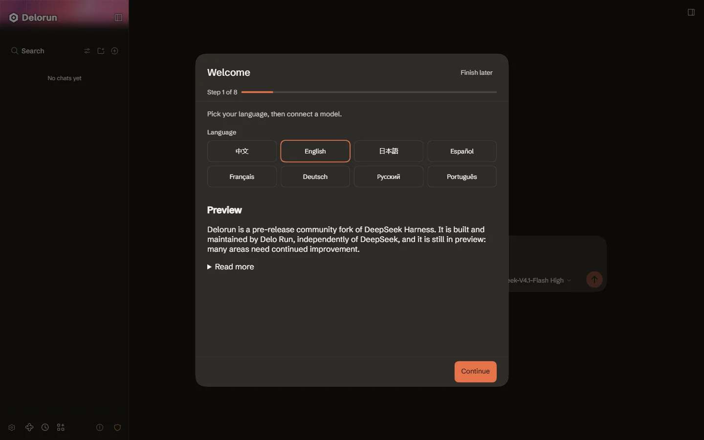

# 安装与首次运行

[English](install.md) | 中文

> 英文页面是当前版本；本页可能落后于它。

## 摘要

本页带你从零开始，直到你的第一次 chat。你只需运行一条命令：`npx delorun`。它会下载 Delorun，检查下载内容是否真实可信，问你几个问题，并完成 Delorun 的设置。之后你用 `delorun` 启动它，它会在浏览器中打开。此后一切都运行在你自己的电脑上。你需要一台 Delorun 支持的电脑、安装和启动它所需的 Node.js，以及你想与之对话的 AI 模型的密钥。chat 需要密钥；不过没有密钥 studio 也能打开，所以你可以先四处看看。

Delorun 是一个可以按你自己的工作来塑造的 agent harness。它构建在 [DeepSeek Harness](../../reference/glossary.zh.md#stock) 之上，后者是一个开源程序，让 AI 模型能够处理文件并在你的电脑上运行命令。

## 目录

- [开始之前](#before-you-start)
- [安装](#install)
- [通过 WSL2 使用 Windows](#windows-through-wsl2)
- [启动器验证什么](#what-the-launcher-verifies)
- [Setup：你将如何使用 Delorun](#setup-a-few-questions)
- [studio 与你的第一次 chat](#the-studio-and-your-first-chat)
- [默认工作区](#the-default-workspace)
- [没有浏览器的电脑](#a-computer-without-a-browser)
- [接下来](#next)
- [给想深入了解的人](#for-the-technically-curious)

<a id="before-you-start"></a>

## 开始之前

- **一台受支持的电脑。**x64 上的 Linux，或通过 WSL2 使用的 Windows（见[通过 WSL2 使用 Windows](#windows-through-wsl2)）。Delorun 不能在 ARM（arm64）上的 Linux、原生 Windows 或 macOS 上运行（见[已知问题](../help/known-issues.zh.md#where-delorun-runs)）。
- **[Node.js](https://nodejs.org) 24.9 或更新版本。**`delorun` 命令是一个 Node 程序，所以每次启动都需要 Node，而不只是安装时。用 `node --version` 检查。如果你没有 Node，或版本较旧，请使用 [nodejs.org](https://nodejs.org/en/download) 上的官方安装方式。Ubuntu 自带的 Node 软件包要旧得多（Ubuntu 24.04 提供的是 Node 18），所以 `apt` 给不了你可用的 Node。
- **bubblewrap（在 Linux 和 WSL2 中）。**它是限制 chat 所运行命令的程序。请用系统的包管理器安装 `bubblewrap` 软件包。没有它时，在有登录会话或正在运行 tmux 这类程序的电脑上，Delorun 会拒绝每一条命令，`delorun doctor` 会显示 `fail sandbox`（见 [Delorun 保护什么](../safety-and-updates/safety.zh.md#the-sandbox)）。
- **模型密钥。**密钥是让 Delorun 在你的账户下使用 AI 模型的秘密文本。运行模型的公司或服务器就是[模型提供方](../../reference/glossary.zh.md#provider)。默认是 DeepSeek API 密钥。其他提供方也可以使用（见[模型提供方](providers.zh.md)）。Setup does not ask for it: the studio does, the first time it opens, and you can add it later.
- **git**，`delorun update` 在更新之前用它保存你的设置（见[更新](../safety-and-updates/updates.zh.md)）。首次运行的 setup 不需要它。

<a id="install"></a>

## 安装

在终端中运行：

```sh
npx delorun
```

更喜欢用别的包管理器？下面这些使用 Node 运行同一个启动器：

```sh
pnpm dlx delorun
bunx delorun
```

`npx` 在安装 `delorun` 包之前可能会先问 `Ok to proceed? (y)`。请按 **y** 和回车。第一次运行会下载并安装 Delorun（这是一个很大的下载），然后开始 setup。Delorun 会打印下面描述的各项检查，然后问出 setup 的第一个问题。此后每一次 `npx delorun` 都会启动已安装的 Delorun，不再下载任何东西。

在结束时，setup 会打印后续步骤。第一步是一行需要你自己运行的命令，`npm install -g delorun@<version>`，它会安装 `delorun` 命令。之后你就可以输入 `delorun` 而不是 `npx delorun`。

Delorun 把一切都保存在一个文件夹 `~/.delorun` 中，只有你能打开它（见[你的 Delorun home](../customising/home.zh.md)）。

<details>
<summary>边界情况</summary>

- 如果你运行的是 macOS，那么启动器会在下载任何东西之前停止，并说明 Delorun 不能在 macOS 上运行。请使用 Linux，或通过 WSL2 使用 Windows。
- 如果你运行的是原生 Windows，那么启动器会在下载任何东西之前停止，并说明 Delorun 在 WSL2 中运行。请按照[通过 WSL2 使用 Windows](#windows-through-wsl2) 操作。
- 如果你的电脑运行的是发布版本未列出的其他系统或处理器，那么启动器会以 `PLATFORM_NOT_RELEASED` 停止，且不安装任何东西。
- 如果你的 Node 低于 24.9，那么启动器会以 `Delorun needs Node 24.9 or newer to start` 停止，并指出你的版本。请从 [nodejs.org](https://nodejs.org/en/download) 安装较新的 Node，然后再次运行 `npx delorun`。
- 如果某项检查失败，那么不会安装任何东西（见[启动器验证什么](#what-the-launcher-verifies)）。请再次运行 `npx delorun`；如果仍然失败，请见[安装与发布检查](../help/troubleshooting.zh.md#installs-and-release-checks)。
- 如果 `npm install -g` 以 `EACCES`（权限被拒绝）停止，那么你的 Node 是为整个系统安装的，npm 没有 root 权限就无法写入那里。请改为安装到你自己的文件夹：`npm install -g --prefix ~/.local delorun@<version>`，并把 `~/.local/bin` 加入你的 `PATH`。
- 如果你没有网络，那么首次安装无法下载发布版本。一旦安装了某个发布版本，启动它就不需要网络。
- 如果你设置了 `DELORUN_HOME`，那么 home 会创建在那里，而不是 `~/.delorun`（见[你的 Delorun home](../customising/home.zh.md#where-the-home-is)）。

</details>

<details>
<summary>进一步了解</summary>

启动器在任何 `delorun` 参数之前接受它自己的选项：

| 选项 | 作用 |
| --- | --- |
| `--profile <name>` | 使用 `default` 以外的另一个 [profile](../../reference/glossary.zh.md#profile)（见[你的 Delorun home](../customising/home.zh.md#profiles)）。 |
| `--release <version>` | 在尚未安装任何发布版本时，安装这个发布版本，而不是渠道当前的发布版本。 |
| `--` | 结束启动器的选项。它之后的所有内容都交给 `delorun`。 |

</details>

<a id="windows-through-wsl2"></a>

## 通过 WSL2 使用 Windows

Delorun 在 Windows 中通过 WSL2 运行，WSL2 是 Windows 的一项功能，可在 Windows 旁边运行 Linux。它不能在 PowerShell 这类原生 Windows 终端中运行。

1. 安装带有默认 Ubuntu 的 WSL2：打开 PowerShell 并运行 `wsl --install`，如果它要求，则重启 Windows。
2. 从“开始”菜单打开 Ubuntu 应用。此后的一切都在那个终端中进行。
3. 在 Ubuntu 内部而不是 Windows 中安装 Node.js 24.9 或更新版本（见[开始之前](#before-you-start)）。
4. 在 Ubuntu 内部安装 bubblewrap，即 `bubblewrap` 软件包（见[开始之前](#before-you-start)）。
5. 在那里运行 `npx delorun`，并按照[安装](#install)操作。

请把你的项目放在 Ubuntu 的主目录里，例如 `~/projects`，因为 Windows 驱动器（`/mnt/c`）上的文件对 Linux 程序来说很慢。请在你的 Windows 浏览器中，用 Delorun 打印的地址打开 studio。

<a id="what-the-launcher-verifies"></a>

## 启动器验证什么

在安装任何东西之前，启动器会证明下载的内容就是维护者发布的那个发布版本。它会打印每项检查：

```text
✔ Found release <version> on the stable channel                            0.4s
✔ Signature checked (release root 1)                                       0.1s
✔ Release log checked                                                      0.6s
⠹ Downloading delorun-<version>-linux-x64.tar.gz
  ██████████████░░░░░░░░░░   58%  126.4 / 218.0 MB  6.7 MB/s  ~14s left
```

- **渠道。**预览版发布在名为 `stable` 的渠道上，所以第一行这样写。
- **签名。**Delorun 的发布密钥为发布版本签名。启动器检查这些签名以及下载的文件是否与之吻合。如果有任何不吻合，就不会安装任何东西。
- **在一台机器上构建。**在 `1.0.0` 之前，维护者在维护者的电脑上构建并签署每个发布版本，没有第二个构建者重建它。当这样的 0.x 版本在预览根下验证通过时，启动器会安装它。若这样构建的版本是 `1.0.0` 版本，或是在更晚的根下签名的，启动器会拒绝它（[你信任什么](../safety-and-updates/trust.zh.md#how-releases-are-signed-in-the-preview)）。
- **公开发布日志。**每个发布版本还会被记入一份公开的、仅追加的[发布日志](../../reference/glossary.zh.md#release-log)。启动器会检查这个条目。如果无法访问日志，启动器只凭签名安装该发布版本，打印一条警告，并在下次能够访问日志的启动时再次检查日志。
- **每次启动。**启动器会把已安装的文件与已签名的列表比较。已安装发布版本的启动不需要网络。

你可以随时用 `delorun verify` 再次运行这些检查（见[日常使用](../everyday-use/daily-use.zh.md#check-the-release-and-your-setup)）。[你使用 Delorun 时信任什么](../safety-and-updates/trust.zh.md)说明了你仍然依赖什么。启动器从 releases.delorun.com 安装，以 GitHub Releases 和 Delorun 的一个备用主机作为后备，不使用其他任何主机。它不检查发布版本的 SBOM，npm 包也不带构建证明。

<details>
<summary>边界情况</summary>

- 如果日志与发布版本相矛盾，那么安装会停止。不要绕过它；请见[安装与发布检查](../help/troubleshooting.zh.md#installs-and-release-checks)。
- 如果 0.1.0-preview.2.7 或更早的副本无法更新，那么运行一次 `npx delorun@latest repair`：你的 home 会保留其 chat、设置和插件，而这次修复会替换运行时。
- 如果你想在每次启动时进行更严格的完整文件检查，请把 `DELORUN_RUNTIME_FULL_CHECK_DAYS` 设为 `0`。默认至少每 7 天对每个文件计算一次哈希；最大值是 30。

</details>

<a id="setup-a-few-questions"></a>

## 设置：几个问题

在新的 home 上第一次运行 `delorun` 会在终端里进行设置。它只问几个问题，其余由 studio 负责。没有终端或带 `--yes` 的运行什么也不问。

它以一行关于隐私的说明开头，那是说明而不是问题：

```text
Delorun sends nothing about you. Details: https://delorun.com/privacy
```

详情见[隐私页面](https://delorun.com/privacy)；Delorun 向网络请求什么，见[你信任什么](../safety-and-updates/trust.zh.md#what-leaves-your-machine)，而发布检查在“设置”→“通用”→“更新”中有自己的开关。设置按以下顺序提出这些问题：

1. **其他设备。** `Use Delorun from your other devices too? (phone, tablet, another computer, over Tailscale)` 提供 **No, just this computer**（默认）和 **Yes, over Tailscale**。选 Yes 会先检查这台电脑上的 Tailscale：它是否已安装、已登录，以及你的用户是否可以运行 `tailscale serve`。检查失败会让设备访问保持关闭并说明要修什么；设置的其余部分继续进行（见[从手机访问 studio](../everyday-use/reach.zh.md)）。你批准的设备可以读取和回复 chat，而每个敏感操作都会要求它的 PIN。
2. **DeepSeek Harness 的 chat。** 只有在你以前用过 DeepSeek Harness 且这个 Delorun home 没有 chat 时才会问：`Copy your chats from DeepSeek Harness?` 会导入它们，并保留其工作区文件夹（见[从 DeepSeek Harness 切换](switching.zh.md)）。
3. **studio 端口。** Delorun 使用 3080 端口，当另一个程序占用它时使用下一个空闲端口，并说明它选了哪一个。
4. **PIN 与命令。**（两个问题，在启动之后提出。）设置随后在这个终端里启动 Delorun，并在你的浏览器中打开 studio。如果你选择了设备访问，它会在 Delorun 运行之后问一次 `Set a PIN for your other devices now?`，因为 PIN 由运行中的 home 保存。它以 `Keep the delorun command?` 结束：选 **Yes** 会替你运行 `npm install -g delorun@<version>`，选 **No, keep using npx** 则让你继续使用 `npx delorun`。

设置不会要求你的模型密钥，studio 的欢迎屏幕会（见[studio 与你的第一个 chat](#the-studio-and-your-first-chat)）。设置也不会问 Delorun 询问多少、是否在后台运行，或该把 profile 叫什么：它采用安全的默认值。对于[提示](../../reference/glossary.zh.md#prompts-answer)，默认是 **Ask me first**，因此 Delorun 会在 chat 获得某个文件夹的完全访问、添加工具服务器、编辑自己的指令或安排工作之前询问（见[Delorun 保护什么](../safety-and-updates/safety.zh.md#consents)）。你可以在 studio 的“设置”→“通用”→“How Delorun runs”中更改其中任何一项（它会显示每一项的命令），或用 `delorun setup <section>` 更改。

随后 Delorun 在这个终端里运行。最后几行会说明这一点。开启设备访问时，它们如下所示：studio 的 Tailscale 地址（你可以从任何登录到你的 Tailscale 的设备完成设置），以及新设备如何配对。没有设备访问时，它们会说明 studio 只在这台电脑上打开，以及之后在哪里开启它（“设置”→“通用”→“How Delorun runs”，或 `delorun setup reach`）。`my-pc.example.ts.net` 代表你自己电脑的 Tailscale 名称：

```text
Finish setup here, or on any device signed in to your Tailscale:
https://my-pc.example.ts.net
A new device asks to pair: approve it here at this computer, or unlock it with
the PIN.

Delorun runs in this terminal. Ctrl+C stops it.
To keep it running after you close the terminal: delorun start --background
(or Settings → General → How Delorun runs).
Change an answer later: delorun setup <section> (delorun setup --list)
If something looks wrong: delorun doctor
```

按 Ctrl+C 停止 Delorun。下一次运行 `delorun` 会再次启动它，除非你在“设置”→“通用”→“How Delorun runs”中关闭了后台运行，否则它在后台启动。

**不带问题的设置。** 没有终端或带 `--yes` 时，设置什么也不问。它采用安全的默认值：没有设备访问、不导入、**Ask me first**、3080 端口或下一个空闲端口。它写入 profile，不启动任何东西，并打印 studio 将在哪里以及如何启动它：

```text
Delorun is set up. Nothing is running yet.
Studio: http://127.0.0.1:3080

Next:
  1. Install the delorun command, which npx does not keep:
     npm install -g delorun@<version>
  2. Add your model key in the studio (the welcome screen asks for it), or run delorun setup key.
  3. Start Delorun and open the studio: delorun
     Send a first message in a new chat. The install guide's section on your first chat walks through it: https://docs.delorun.com/guide/get-started/install#the-studio-and-your-first-chat

Change an answer later: delorun setup <section> (delorun setup --list shows the sections).
If something looks wrong: delorun doctor.
```

只有在启动器启动了设置时，才会出现安装这一步。当你选择了密钥变量时，密钥这一步改为指名该变量。

| 标志 | 它回答什么 |
| --- | --- |
| `--yes` | 采用每个默认值，什么也不问。 |
| `--phone`（或 `--devices`） | 开启通过 Tailscale 从你的其他设备访问，并在 Tailscale 未就绪时带着原因失败。在终端里，它还会提出 PIN 问题。 |
| `--import-dsh` | 在打印复制了什么、留下了什么之后，复制你的 DeepSeek Harness chat。 |
| `--port <n>` | 使用这个 studio 端口（1024 到 65535），而不是 3080 或下一个空闲端口。 |

<details>
<summary>边界情况</summary>

- 如果你对手机问题回答 **No**，那么手机访问不会有任何变化；之后用 `delorun reach on tailscale` 或 `delorun setup reach` 开启它。
- 如果你为 DeepSeek Harness 的 chat 选择 **Later**，那么什么也不会复制；随时可以运行 `delorun import-home`。
- 如果 3080 端口被占用而你带 `--yes` 运行，那么设置会取下一个空闲端口，打印 `! Port 3080 is in use, so the studio will use 3081. Change it later with: delorun setup profile`，然后继续。被占用的 `--port` 会失败并指名该端口。
- 如果 `npm install -g` 因权限不足被拒绝，那么设置会打印带 `--prefix ~/.local` 的同一条命令，并说明要把 `~/.local/bin` 加入你的 `PATH`。
- 如果启动器是为另一个发布通道（例如本地通道）构建的，那么它不在 npm 注册表上，因此该命令安装它来自的那个包文件 `npm install -g ./delorun-<version>.tgz`，而更新检查的说明会指名该通道的主机，而不是 releases.delorun.com 和 GitHub。
- 如果你在某个问题上按 Ctrl-C，那么设置会打印 `Setup cancelled. Nothing was saved. Run delorun to start again.` 并以状态码 130 退出。在问题结束之前关闭终端同样什么也不写入。
- 如果 `~/.dsh` 不存在，或你的 Delorun home 已经有 chat，那么 DeepSeek Harness 的问题会被跳过。
- 如果你以 root 用户运行设置，那么 **Never ask (dangerous)** 会被拒绝，`delorun setup prompts`、`--prompts dangerous` 和答案文档都会拒绝它。
- 如果你带 `--yes` 且不带 `--provider` 运行设置，那么它不设置任何模型提供方，并说明如何添加一个。运行 `delorun headless` 的脚本需要在自己的环境中设置密钥变量，因为设置从不保存它没有询问过的密钥。

</details>

<details>
<summary>更多</summary>

- 要改变主意，请再次运行 `delorun setup`。在终端里对已完成的设置运行时，它会说明这次运行做什么，然后带着你当前的选择重新提问。带 `--yes` 或 `--config` 时，已完成的设置保持不变。
- 用 `delorun setup <section>` 更改某一项答案。`delorun setup --list` 列出各节：`privacy`、`import`、`key`、`prompts`、`background`、`reach`、`changes-protection` 与 `profile`。`delorun setup key` 从终端设置模型提供方和密钥（见[模型提供方](providers.zh.md)），`delorun setup privacy` 设置发布检查，`delorun setup changes-protection` 设置对你的插件和 Delorun 的更改是否等待你的审查。
- 用另一个 profile 名称运行设置，以便并排进行多次设置（见[你的 Delorun home](../customising/home.zh.md#profiles)）。
- 对于脚本，`delorun setup --yes --provider deepseek-official` 从 `DEEPSEEK_API_KEY` 读取密钥。`delorun setup --config <file>` 从一个持有完整答案文档的 JSON 文件读取每一项答案。只有 `useCase` 的文件会被拒绝。这两种形式都不会自行开启远程访问或导入 `~/.dsh`，也都不会启动 Delorun：之后请运行 `delorun`。`--check-key` 检查来自环境的密钥（见[模型提供方](providers.zh.md#set-up-without-questions)）。
- 一份从 `DEEPSEEK_API_KEY` 读取密钥的完整答案文档如下所示。[答案 schema](../../contracts/c11-setup-answers.zh.md#answer-schema) 定义了每个字段。

  ```json setup-answers-example
  {
    "schemaVersion": 5,
    "useCase": "local",
    "modelProvider": { "id": "deepseek-official", "credential": { "source": "environment", "name": "DEEPSEEK_API_KEY" }, "baseURL": null, "model": null },
    "prompts": "safer",
    "background": true,
    "profile": { "name": null, "port": null },
    "reach": { "option": "none", "identityFactor": null },
    "importStockHome": false,
    "protectChanges": false,
    "updateCheck": true,
    "sections": []
  }
  ```

</details>

<a id="the-studio-and-your-first-chat"></a>

## studio 与你的第一个 chat

设置会启动 Delorun 并在你的浏览器中打开 studio。[studio](../../reference/glossary.zh.md#studio) 是 Delorun 用来与模型聊天的网页。它监听 `127.0.0.1`，只有你自己的电脑能访问，除非你开启[远程访问](../everyday-use/reach.zh.md)。浏览器用一个只能使用一次、一分钟后就过期的链接登录。`delorun open` 会用新链接再次打开 studio，而在已经设置好的 home 上运行 `delorun` 也会以同样的方式启动 Delorun 并打开 studio：

```text
Delorun is running in the background for the profile default at http://127.0.0.1:3080/; it keeps running after this terminal closes.
See it with delorun status, follow its log with delorun logs --follow, and stop it with delorun stop.
Run delorun open to open the studio in your browser.
Opened the studio in your browser.
```

第一次时，studio 会显示一个三步的简短首次运行引导，最后进入一个 chat：



1. **Welcome。** 选择语言。开启设备访问时，它还会显示你的 studio 的 Tailscale 地址，你可以从任何登录到你的 Tailscale 的设备在那里完成设置。一条预览版提示说明 Delorun 是 DeepSeek Harness 的社区分支，仍处于预览阶段；选择 Continue 表示知悉。
2. **Models。** 这里是你给 Delorun 模型密钥的地方。Delorun 已有的密钥会显示为 “Key found”，并说明它来自哪里（例如 “From DEEPSEEK_API_KEY in the environment Delorun started with”）以及一条 “How does Delorun know?” 说明。否则请粘贴你的 DeepSeek 密钥；Delorun 会用一次免费的提供方模型列表请求来测试它，并在提供方接受时显示 `Key works`。其他提供方在 **Add another provider** 之下，之后也可在“设置”→“智能体”→“模型”中找到（见[模型提供方](providers.zh.md)）。你可以跳过这一步，之后再添加密钥。
3. **Ready。** Delorun 列出它将使用的模型和工作区，并说明外观、智能体、插件和手机访问都在“设置”中。它提供三个可以尝试的想法，每个都带一个 **Copy** 按钮。**Start a chat** 会打开一个新的 chat；Delorun 从不替你发送第一条消息。

有两个步骤只在需要时才加入引导。只有当还没有默认工作区时，才会出现 Workspace 步骤。当手机访问开启且没有设置 PIN 时，会在你的电脑上出现 PIN 步骤：选择一个 PIN 或密码，输入两次，然后 **Set PIN**，或 **Skip**。步骤名称旁的 **Finish later** 会关闭引导并保留你的进度，下次会再次显示该引导。

引导过去所询问的其余内容都在“设置”中。“设置”→“通用”→“入门”中的 **Run setup again** 会打开完整引导：Welcome、Models、Look（颜色与主题）、Agents（作为 chat 可以交办工作的助手的 Claude Code 或 Codex）、Recommended [plugins](../../reference/glossary.zh.md#plugin)、Browser、Phone access、PIN、Workspace 与 Ready。“设置”→“通用”→“How Delorun runs”显示 Delorun 询问多少、是否在后台运行、profile 名称与 studio 端口，以及手机访问，每一项都附有更改它的 `delorun setup` 命令。

新的 chat 会在某个智能体 [preset](../../reference/glossary.zh.md#preset) 中启动，studio 称之为模式：Standard、PTC、Minimal 与 Creator。PTC 做 Standard 所做的一切，适合那些批量调用工具、然后对结果进行筛选、去重或汇总的任务。在 Creator 模式下，智能体与你一起编写插件和 preset。输入一条消息即可聊天。如果你没有设置任何提供方或密钥，模型无法回答；请在 Models 步骤或“设置”→“智能体”→“模型”中添加一个。

<details>
<summary>边界情况</summary>

- 如果浏览器没有打开，那么运行 `delorun open`，或运行 `delorun open --print` 并自己打开打印出的链接。
- 如果链接提示已过期，那么再次运行 `delorun open`。每个链接只能使用一次，且在一分钟内有效。
- 如果浏览器在 studio 地址显示 “unauthorized”（HTTP 401），那么你是在没有登录链接的情况下打开了该地址。请运行 `delorun open`。
- 如果 `delorun status` 显示 `state: not running`，那么用 `delorun start` 启动它；如果启动失败，请阅读 `delorun logs` 和[启动与停止](../help/troubleshooting.zh.md#starting-and-stopping)。
- 如果你的密钥没有设置，那么 `delorun doctor` 会为 `key` 显示一行 `!`，而 chat 会报告模型无法回答。请在 studio 的 Models 步骤或“设置”→“智能体”→“模型”中添加它，或运行 `delorun setup key`。

</details>

<details>
<summary>更多</summary>

- 从手机打开 studio：[从手机访问 studio](../everyday-use/reach.zh.md)。
- 查看一次 chat 的开销：[查看一次 chat 的开销](../everyday-use/cost-meter.zh.md)。
- 用插件、preset 和 skill 重塑 Delorun：[在哪里定制什么](../customising/customise.zh.md)。

</details>

<a id="the-default-workspace"></a>

## 默认工作区

chat 在工作区中工作：这是你电脑上的一个文件夹，模型可以读取和更改其中的文件。Delorun 的默认工作区是你“文档”文件夹中的 `Delorun/default-workspace`，如果你的系统没有“文档”文件夹，则在你的用户主目录中。studio 在第一次使用时创建它。请在 studio 中添加你自己的项目文件夹。

<details>
<summary>边界情况</summary>

- 如果所有候选文件夹都不能使用，例如因为其中一个位于你的 Delorun home 之内，那么启动会以 `delorun: Delorun found no folder for the default workspace.` 停止，并列出每个文件夹及其原因。请像消息所示那样，在你的 profile 的 `cordis.patch.yml` 中指定一个文件夹（见[启动与停止](../help/troubleshooting.zh.md#starting-and-stopping)）。
- 如果你不想使用默认工作区，那么请在新手引导的 Workspace 步骤中选择另一个文件夹。

</details>

<a id="a-computer-without-a-browser"></a>

## 没有浏览器的电脑

在服务器上或通过 SSH 时，Delorun 无法打开浏览器。请从你自己的电脑转发 studio 的端口，然后向 Delorun 索取一个链接：

```sh
# on your own computer
ssh -L 3080:127.0.0.1:3080 you@server
# on the server, in that SSH session
delorun open --print
```

`delorun open --print` 会打印一个链接，然后是 `This link signs in to the studio once, within one minute; run delorun open --print again for another.` 请在你自己电脑上的浏览器中打开该链接。你应该会看到 studio。

<details>
<summary>边界情况</summary>

- 如果你的转发使用另一个本地端口，那么链接必须指明它：`delorun open --print --port <that port>`。链接只在它所指明的主机和端口上登录。
- 如果 studio 使用的端口不是 3080，那么请转发那个端口；`delorun status` 会打印地址。

</details>

<a id="next"></a>

## 接下来

- 每天使用 Delorun：[日常使用](../everyday-use/daily-use.zh.md)。
- 选择或更换模型提供方：[模型提供方](providers.zh.md)。
- 从 DeepSeek Harness 迁移而来：[从 DeepSeek Harness 切换](switching.zh.md)。
- 了解哪些东西受到保护：[Delorun 保护什么](../safety-and-updates/safety.zh.md)。
- 如果出了问题：[故障排查](../help/troubleshooting.zh.md)。

<a id="for-the-technically-curious"></a>

## 给想深入了解的人

[发布 manifest 约定](../../contracts/c02-release-manifest.zh.md)和[发布日志约定](../../contracts/c18-release-log.zh.md)定义了启动器所做的每项签名和日志检查。[setup 答案约定](../../contracts/c11-setup-answers.zh.md)定义了每个 setup 问题及其写入的内容。[首次运行设计](../../design/first-run.zh.md)解释了 setup 为什么这样提问。
