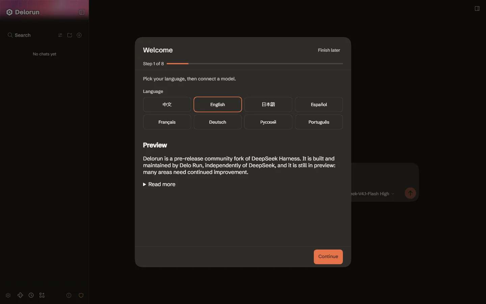

# Install and first run

English | [中文](install.zh.md)

## Summary

This page takes you from nothing to your first chat. You run one command, `npx delorun`. It downloads Delorun, checks that the download is genuine, asks a few questions, sets Delorun up, starts it and opens it in your browser. Everything then runs on your own computer. You need a computer that Delorun supports, Node.js to install and start it, and a key for the AI model you want to talk to. The studio's welcome screen asks for the key the first time it opens; a chat needs it, and you can skip it to look around first.

Delorun is an agent harness that you shape to your own work. It is built on [DeepSeek Harness](../reference/glossary.md#stock), the open-source program that lets an AI model work on files and run commands on your computer.

## Contents

- [Before you start](#before-you-start)
- [Install](#install)
- [Windows through WSL2](#windows-through-wsl2)
- [What the launcher verifies](#what-the-launcher-verifies)
- [Setup: a few questions](#setup-a-few-questions)
- [The studio and your first chat](#the-studio-and-your-first-chat)
- [The default workspace](#the-default-workspace)
- [A computer without a browser](#a-computer-without-a-browser)
- [Next](#next)
- [For the technically curious](#for-the-technically-curious)

## Before you start

- **A supported computer.** Linux on x64, or Windows through WSL2 ([Windows through WSL2](#windows-through-wsl2)). Delorun does not run on Linux on ARM (arm64), on native Windows or on macOS ([Roadmap](roadmap.md)).
- **[Node.js](https://nodejs.org) 24.9 or newer.** The `delorun` command is a Node program, so it needs Node every time it starts, not only to install it. Check with `node --version`. If you have no Node, or an older one, use one of the official ways to install Node on [nodejs.org](https://nodejs.org/en/download). Ubuntu's own package for Node is far older (Ubuntu 24.04 offers Node 18), so `apt` does not give you a Node that works.
- **bubblewrap, on Linux and in WSL2.** It is the program that confines the commands a chat runs. Install the `bubblewrap` package with your system's package manager. Without it, Delorun refuses every command on a computer that has a login session or a program such as tmux running, and `delorun doctor` shows `fail sandbox` ([What Delorun protects](safety.md#the-sandbox)).
- **A model key.** A key is a secret text that lets Delorun use an AI model on your account. The company or server that runs the model is the [model provider](../reference/glossary.md#provider). The default is a DeepSeek API key. Other providers work too ([Model providers](providers.md)). Setup does not ask for it: the studio does, the first time it opens, and you can add it later.
- **git**, which `delorun update` uses to save your settings before an update ([Updates](updates.md)). First-run setup does not need it.

## Install

Run this in a terminal:

```sh
npx delorun
```

Prefer another package manager? These run the same launcher, with Node:

```sh
pnpm dlx delorun
bunx delorun
```

`npx` may first ask `Ok to proceed? (y)` before it installs the `delorun` package. Press **y** and Enter. The first run downloads and installs Delorun, which is a large download, then starts setup. Delorun prints the checks described below, then asks the first setup question. Every later `npx delorun` starts the installed Delorun and downloads nothing.

Setup then starts Delorun in your terminal and opens the studio. Its last question offers to install the `delorun` command, `npm install -g delorun@<version>`, so that you can type `delorun` instead of `npx delorun`.

Delorun keeps everything in one folder, `~/.delorun`, which only you can open ([Your Delorun home](home.md)).

<details>
<summary>Edge cases</summary>

- If you run macOS, then the launcher stops before it downloads anything and says Delorun does not run on macOS. Use Linux, or Windows through WSL2.
- If you run native Windows, then the launcher stops before it downloads anything and says Delorun runs in WSL2. Follow [Windows through WSL2](#windows-through-wsl2).
- If your computer runs another system or processor that the release does not list, then the launcher stops with `PLATFORM_NOT_RELEASED` and installs nothing.
- If your Node is older than 24.9, then the launcher stops with `Delorun needs Node 24.9 or newer to start`, and names your version. Install a newer Node from [nodejs.org](https://nodejs.org/en/download) and run `npx delorun` again.
- If a check fails, then nothing is installed ([What the launcher verifies](#what-the-launcher-verifies)). Run `npx delorun` again; if it keeps failing, see [Installs and release checks](troubleshooting.md#installs-and-release-checks).
- If `npm install -g` stops with `EACCES` (permission denied), then your Node is installed for the whole system and npm cannot write there without root. Install into your own folder instead, `npm install -g --prefix ~/.local delorun@<version>`, and add `~/.local/bin` to your `PATH`.
- If you have no network, then the first install cannot download a release. Once a release is installed, starting needs no network.
- If you set `DELORUN_HOME`, then the home is created there instead of `~/.delorun` ([Your Delorun home](home.md#where-the-home-is)).

</details>

<details>
<summary>Go further</summary>

The launcher takes its own options before any `delorun` arguments:

| Option | What it does |
| --- | --- |
| `--profile <name>` | Uses another [profile](../reference/glossary.md#profile) than `default` ([Your Delorun home](home.md#profiles)). |
| `--release <version>` | Installs this release instead of the channel's current one, when no release is installed yet. |
| `--` | Ends the launcher's options. Everything after it goes to `delorun`. |

</details>

## Windows through WSL2

Delorun runs on Windows inside WSL2, the Windows feature that runs Linux next to Windows. It does not run in a native Windows terminal such as PowerShell.

1. Install WSL2 with its default Ubuntu: open PowerShell and run `wsl --install`, then restart Windows if it asks.
2. Open the Ubuntu app from the Start menu. Everything after this happens in that terminal.
3. Install Node.js 24.9 or newer inside Ubuntu, not in Windows ([Before you start](#before-you-start)).
4. Install bubblewrap inside Ubuntu, the `bubblewrap` package ([Before you start](#before-you-start)).
5. Run `npx delorun` there and follow [Install](#install).

Keep your projects inside the Ubuntu home folder, such as `~/projects`, because files on the Windows drives (`/mnt/c`) are slow for Linux programs. Open the studio from your Windows browser at the address Delorun prints.

## What the launcher verifies

Before it installs anything, the launcher proves the download is the release the maintainer published. It prints each check:

```text
Resolving the release: the stable channel names 0.1.0-preview.2.1.
Checking the signature: 0.1.0-preview.2.1 is signed under release root 1.
Checking the release log: verified.
Downloading delorun-0.1.0-preview.2.1-linux-x64.tar.gz (…).
Installing release 0.1.0-preview.2.1.
```

- **Channel.** A preview is published on the channel named `stable`, so the first line says so.
- **Signature.** Delorun's release keys sign the release. The launcher checks the signatures and that the downloaded file matches. If anything does not match, nothing is installed.
- **Built on one machine.** Until `1.0.0`, the maintainer builds and signs each release on the maintainer's PC, and no second builder rebuilds it. The launcher installs such a 0.x release when it verifies under the preview root. It refuses a release built this way when it is a `1.0.0` release or is signed under a later root ([What you trust](trust.md#how-releases-are-signed-in-the-preview)).
- **Public release log.** Every release is also entered in a public, append-only [release log](../reference/glossary.md#release-log). The launcher checks the entry. If the log cannot be reached, the launcher installs the release on its signature alone, prints a warning, and checks the log again at the next start that can reach it.
- **Every start.** The launcher compares the installed files with the signed list. A start with a release installed needs no network.

You can run these checks again at any time with `delorun verify` ([Daily use](daily-use.md#check-the-release-and-your-setup)). [What you trust when you use Delorun](trust.md) says what you still rely on. The launcher installs from releases.delorun.com, with GitHub Releases and a spare host of Delorun's as fallbacks, and from no other host. It does not check the release's SBOM, and the npm package carries no build attestation.

<details>
<summary>Edge cases</summary>

- If the log contradicts the release, then the install stops. Do not work around it; see [Installs and release checks](troubleshooting.md#installs-and-release-checks).
- If you want a stricter full file check at every start, then set `DELORUN_RUNTIME_FULL_CHECK_DAYS` to `0`. The default hashes every file at least every 7 days; the largest value is 30.

</details>

## Setup: a few questions

The first `delorun` on a new home runs setup in the terminal. It asks few questions, and the studio takes the rest. A run without a terminal, or with `--yes`, asks nothing.

It opens with one line about privacy, which is a note and not a question:

```text
Delorun sends nothing about you. Details: https://delorun.com/privacy
```

The details are on the [privacy page](https://delorun.com/privacy); what Delorun asks of the network is in [What you trust](trust.md#what-leaves-your-machine), and the release check has its own switch in Settings → General → Updates. Setup asks these questions in this order:

1. **Other devices.** `Use Delorun from your other devices too? (phone, tablet, another computer, over Tailscale)` offers **No, just this computer** (the default) and **Yes, over Tailscale**. Yes first checks Tailscale on this computer: that it is installed, signed in, and that your user may run `tailscale serve`. A check that fails leaves device access off and says what to fix; the rest of setup goes on ([Reach the studio from your phone](reach.md)). A device you approve reads and replies to chats, and each sensitive action asks for its PIN.
2. **DeepSeek Harness chats.** Only if you used DeepSeek Harness before and this Delorun home has no chats: `Copy your N DeepSeek Harness chats?`, over a summary of what will be copied and what stays behind. Your DeepSeek Harness folder is only read. The choices are **Yes**, **Later (delorun import-home)** and **Show what stays behind** ([Switching from DeepSeek Harness](switching.md)).
3. **The studio port.** Delorun takes port 3080 and, when another program uses it, the next free port, and says so. In a terminal it asks first: `Port 3080 is in use. Use 3081?` with **Yes** and **Enter another port**.
4. **The PIN and the command.** (Two questions, asked after the start.) Setup then starts Delorun in this terminal and opens the studio in your browser. If you chose device access, it asks `Set a PIN for your other devices now?` once Delorun runs, because the PIN is stored by the running home. It ends with `Keep the delorun command?`, which runs `npm install -g delorun@<version>` for you on **Yes**, or leaves you with `npx delorun` on **No, keep using npx**.

Setup does not ask for your model key. The studio's welcome screen does ([The studio and your first chat](#the-studio-and-your-first-chat)). Setup also does not ask how much Delorun asks, whether to run in the background, or what to call the profile: it takes safe defaults. **Ask me first** is the default for [prompts](../reference/glossary.md#prompts-answer), so Delorun asks before a chat gets full access to a folder, adds a tool server, edits its own instructions or schedules work ([What Delorun protects](safety.md#consents)). Change any of them in the studio's Settings → General → How Delorun runs, which shows the command for each, or with `delorun setup <section>`.

Delorun then runs in this terminal. The last lines say so. With device access on, they begin as below: the studio's Tailscale address, where you can finish setup from any device signed in to your Tailscale, and how a new device pairs. Without device access they say that the studio opens on this computer only and where to turn it on later (Settings → General → How Delorun runs, or `delorun setup reach`). `my-pc.example.ts.net` stands for your computer's own Tailscale name:

```text
Finish setup here, or on any device signed in to your Tailscale:
https://my-pc.example.ts.net
A new device asks to pair: approve it here at this computer, or unlock it with
the PIN.

Delorun runs in this terminal. Ctrl+C stops it.
To keep it running after you close the terminal: delorun start --background
(or Settings → General → How Delorun runs).
Change an answer later: delorun setup <section> (delorun setup --list)
If something looks wrong: delorun doctor
```

Press Ctrl+C to stop Delorun. The next `delorun` starts it again, in the background unless you turned that off in Settings → General → How Delorun runs.

**Setup without questions.** With no terminal, or with `--yes`, setup asks nothing. It takes the safe defaults: no device access, no import, **Ask me first**, port 3080 or the next free port. It writes the profile, starts nothing and prints where the studio will be and how to start it:

```text
Delorun is set up. Nothing is running yet.
Studio: http://127.0.0.1:3080

Next:
  1. Install the delorun command, which npx does not keep:
     npm install -g delorun@0.1.0-preview.2.1
  2. Add your model key in the studio (the welcome screen asks for it), or run delorun setup key.
  3. Start Delorun and open the studio: delorun
     Send a first message in a new chat. The install guide's section on your first chat walks through it: https://docs.delorun.com/guide/install#the-studio-and-your-first-chat

Change an answer later: delorun setup <section> (delorun setup --list shows the sections).
If something looks wrong: delorun doctor.
```

The install step appears only when the launcher started setup. The key step names the variable instead while you chose a key variable that is not set in your terminal. These flags answer the questions without asking them:

| Flag | What it answers |
| --- | --- |
| `--yes` | Takes every default and asks nothing. |
| `--phone` (or `--devices`) | Turns on access from your other devices over Tailscale, and fails with the reason when Tailscale is not ready. In a terminal it pre-selects Yes. |
| `--import-dsh` | Copies your DeepSeek Harness chats after it prints what is copied and what stays behind. |
| `--port <n>` | Uses this studio port, from 1024 to 65535, instead of 3080 or the next free port. |

<details>
<summary>Edge cases</summary>

- If you answer **No** to the phone question, then nothing about phone access changes; turn it on later with `delorun reach on tailscale` or `delorun setup reach`.
- If you choose **Later** for the DeepSeek Harness chats, then nothing is copied; run `delorun import-home` any time.
- If port 3080 is busy and you run with `--yes`, then setup takes the next free port, prints `! Port 3080 is in use, so the studio will use 3081. Change it later with: delorun setup profile`, and goes on. A `--port` that is busy fails with the port named.
- If `npm install -g` is refused for lack of permission, then setup prints the same command with `--prefix ~/.local` and says to add `~/.local/bin` to your `PATH`.
- If the launcher is built for another release channel, such as a local channel, then it is not on the npm registry, so the command installs the package file it came from, `npm install -g ./delorun-<version>.tgz`, and the update-check statement names that channel's host, not releases.delorun.com and GitHub.
- If you press Ctrl-C at a question, then setup prints `Setup cancelled. Nothing was saved. Run delorun to start again.` and exits with code 130. Closing the terminal before the questions end also writes nothing.
- If `~/.dsh` does not exist, or your Delorun home already has chats, then the DeepSeek Harness question is skipped.
- If you run setup as the root user, then **Never ask (dangerous)** is refused, by `delorun setup prompts`, by `--prompts dangerous` and by an answers document.
- If you run setup with `--yes` and no `--provider`, then it sets up no model provider and says how to add one. A script that runs `delorun headless` needs the key variable set in its own environment, because setup never stores a key it did not ask for.

</details>

<details>
<summary>Go further</summary>

- To change your mind, run `delorun setup` again. On a finished setup in a terminal it says what the run does, then asks its questions again with your current choices selected. With `--yes` or `--config`, a finished setup is left unchanged.
- Change one answer with `delorun setup <section>`. `delorun setup --list` lists the sections: `privacy`, `import`, `key`, `prompts`, `background`, `reach`, `changes-protection` and `profile`. `delorun setup key` sets the model provider and key from the terminal ([Model providers](providers.md)), `delorun setup privacy` the release check, and `delorun setup changes-protection` whether changes to your plugins and to Delorun wait for your review.
- Run setup with another profile name for several setups side by side ([Your Delorun home](home.md#profiles)).
- For scripts, `delorun setup --yes --provider deepseek-official` reads the key from `DEEPSEEK_API_KEY`. `delorun setup --config <file>` reads every answer from a JSON file that holds a complete answers document. A file with only `useCase` is refused. Neither form turns on remote access or imports `~/.dsh` by itself, and neither starts Delorun: run `delorun` afterwards. `--check-key` checks a key that comes from the environment ([Model providers](providers.md#set-up-without-questions)).
- A complete answers document that reads the key from `DEEPSEEK_API_KEY` looks like this. [Answer schema](../contracts/c11-setup-answers.md#answer-schema) explains each field.

  ```json setup-answers-example
  {
    "schemaVersion": 5,
    "useCase": "local",
    "modelProvider": { "id": "deepseek-official", "credential": { "source": "environment", "name": "DEEPSEEK_API_KEY" }, "baseURL": null, "model": null },
    "prompts": "safer",
    "background": true,
    "profile": { "name": null, "port": null },
    "reach": { "option": "none", "identityFactor": null },
    "importStockHome": false,
    "protectChanges": false,
    "updateCheck": true,
    "sections": []
  }
  ```

</details>

## The studio and your first chat

Setup starts Delorun and opens the studio in your browser. The [studio](../reference/glossary.md#studio) is Delorun's web page for chatting with the model. It listens on `127.0.0.1`, which only your own computer can reach, unless you turn on [remote access](reach.md). The browser signs in with a link that works once and expires after one minute. `delorun open` opens the studio again with a fresh link, and a run of `delorun` on a home that is already set up starts Delorun and opens the studio the same way:

```text
Delorun is running in the background for the profile default at http://127.0.0.1:3080/; it keeps running after this terminal closes.
See it with delorun status, follow its log with delorun logs --follow, and stop it with delorun stop.
Run delorun open to open the studio in your browser.
Opened the studio in your browser.
```

The first time, the studio shows a short first-run guide of three steps, ending in a chat:



1. **Welcome.** Choose the language. With device access on, it also shows your studio's Tailscale address, where you can finish setup from any device signed in to your Tailscale. A pre-release notice says that Delorun is a community fork of DeepSeek Harness that is still in preview; choose Continue to acknowledge it.
2. **Models.** This is where you give Delorun its model key. A key that Delorun already has shows as "Key found", with where it came from (for example "From DEEPSEEK_API_KEY in the environment Delorun started with") and a "How does Delorun know?" note. Otherwise paste your DeepSeek key; Delorun tests it with a free request for the provider's model list, and shows `Key works` when the provider accepts it. Other providers are under **Add another provider**, and later in Settings, Agent, Models ([Model providers](providers.md)). You can skip the step and add a key later.
3. **Ready.** Delorun lists the model and the workspace it will use, and says that the look, agents, plugins and phone access are in Settings. It offers three ideas to try, each with a **Copy** button. **Start a chat** opens a new chat; Delorun never sends a first message for you.

Two steps join the guide only when they are needed. A Workspace step appears only when no default workspace exists yet. A PIN step appears at your computer when phone access is on and no PIN is set: choose a PIN or passcode, typed twice, and **Set PIN**, or **Skip**. **Finish later**, beside the step name, closes the guide and keeps your place, and the guide shows again next time.

The rest of what the guide used to ask is in Settings. Settings → General → Getting started, **Run setup again**, opens the full guide: Welcome, Models, Look (colours and theme), Agents (Claude Code or Codex as helpers a chat can hand work to), Recommended [plugins](../reference/glossary.md#plugin), Browser, Phone access, PIN, Workspace and Ready. Settings → General → How Delorun runs shows how much Delorun asks, whether it runs in the background, the profile name and studio port, and phone access, each with the `delorun setup` command that changes it.

A new chat starts in one of the agent [presets](../reference/glossary.md#preset), which the studio calls modes: Standard, PTC, Minimal and Creator. PTC does everything Standard does and suits tasks that call tools in batches and then filter, deduplicate or summarise the results. In Creator mode, the agent writes plugins and presets with you. Type a message to chat. If you set up no provider or key, the model cannot answer; add one in the Models step or in Settings, Agent, Models.

<details>
<summary>Edge cases</summary>

- If the browser does not open, then run `delorun open`, or `delorun open --print` and open the printed link yourself.
- If the link says it has expired, then run `delorun open` again. Each link works once, within one minute.
- If the browser shows "unauthorized" (HTTP 401) at the studio address, then you opened the address without a sign-in link. Run `delorun open`. <!-- us-spelling: quoted output -->
- If `delorun status` says `state: not running`, then start it with `delorun start`; if the start fails, read `delorun logs` and [Starting and stopping](troubleshooting.md#starting-and-stopping).
- If your key is not set, then `delorun doctor` shows a `!` line for `key`, and a chat reports that the model cannot answer. Add it in the studio's Models step or Settings → Agent → Models, or run `delorun setup key`.

</details>

<details>
<summary>Go further</summary>

- Open the studio from your phone: [Reach the studio from your phone](reach.md).
- See what a chat costs: [See what a chat costs](cost-meter.md).
- Reshape Delorun with plugins, presets and skills: [Where to customise what](customise.md).

</details>

## The default workspace

A chat works in a workspace: a folder on your computer whose files the model may read and change. Delorun's default workspace is `Delorun/default-workspace` in your Documents folder, or in your home folder when your system has no Documents folder. The studio creates it the first time it is used. Add your own project folders in the studio.

<details>
<summary>Edge cases</summary>

- If none of the candidate folders can be used, for example because one would lie inside your Delorun home, then the start stops with `delorun: Delorun found no folder for the default workspace.` and lists each folder with the reason. Name a folder in your profile's `cordis.patch.yml`, as the message shows ([Starting and stopping](troubleshooting.md#starting-and-stopping)).
- If you would rather not use the default, then choose another folder in the guide's Workspace step, or add one from the sidebar's Add workspace.

</details>

## A computer without a browser

On a server or over SSH, Delorun cannot open a browser. Forward the studio's port from your own computer, then ask Delorun for a link:

```sh
# on your own computer
ssh -L 3080:127.0.0.1:3080 you@server
# on the server, in that SSH session
delorun open --print
```

`delorun open --print` prints a link, then `This link signs in to the studio once, within one minute; run delorun open --print again for another.` Open the link in the browser on your own computer. You should see the studio.

<details>
<summary>Edge cases</summary>

- If your forward uses another local port, then the link must name it: `delorun open --print --port <that port>`. A link signs in only at the host and port it names.
- If the studio uses another port than 3080, then forward that port instead; `delorun status` prints the address.

</details>

## Next

- Use Delorun every day: [Daily use](daily-use.md).
- Choose or change the model provider: [Model providers](providers.md).
- Coming from DeepSeek Harness: [Switching from DeepSeek Harness](switching.md).
- Know what is protected: [What Delorun protects](safety.md).
- If something went wrong: [Troubleshooting](troubleshooting.md).

## For the technically curious

The [release manifest contract](../contracts/c02-release-manifest.md) and the [release log contract](../contracts/c18-release-log.md) define every signature and log check the launcher makes. The [setup answers contract](../contracts/c11-setup-answers.md) defines each setup question and what it writes. The [first run design](../design/first-run.md) explains why setup asks what it asks.
