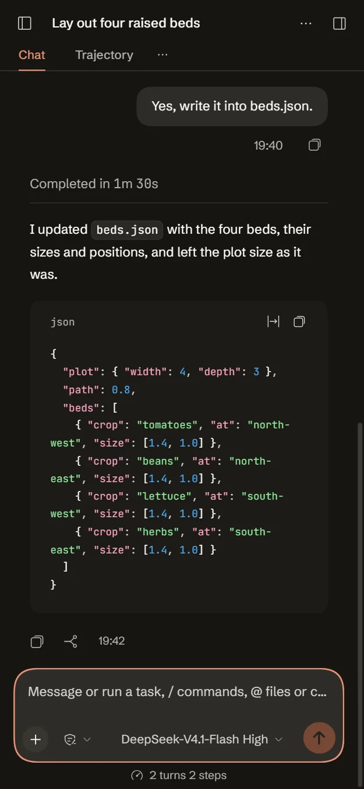

# 用手机访问 studio

[English](reach.md) | 中文

> 英文页面是当前版本；本页可能落后于它。

## 摘要

本页帮助你用手机打开你的 studio，并由你掌握谁能打开。你需要先让 Delorun 在你的电脑上运行起来（见[安装与首次运行](install.zh.md)），并且两台设备上都装有 [Tailscale](https://tailscale.com)（见[你需要什么](#what-you-need)）。

[studio](../reference/glossary.zh.md#studio) 是你在浏览器里与模型聊天的那个页面。远程访问（Delorun 也称它为 [reach](../reference/glossary.zh.md#reach)）让你能从手机或另一台[设备](../reference/glossary.zh.md#device)打开这个页面。它运行在你自己的 Tailscale 网络上。Tailscale 是一项把你的设备连接成一个私有网络的服务，这个网络称为你的 tailnet。Delorun 在这条路径上没有自己的服务：流量由 Tailscale 承载，由你的电脑决定谁可以登录。

tailnet 上的任何设备都能打开登录页面，但只有你在电脑上批准过的设备才能打开你的 chat。要批准一台设备，你需要输入它显示的 8 位数字代码。在未登录的设备上打开你的地址或它的任何页面，会先跳转到登录页面，登录之后再回到你打开的那个页面。远程访问在你开启之前是关闭的。

## 目录

- [你需要什么](#what-you-need)
- [从零开始](#start-from-nothing)
- [开启远程访问](#turn-remote-access-on)
- [批准设备](#approve-a-device)
- [让批准权掌握在你手里](#keep-approval-yours)
- [已批准的手机能做什么、不能做什么](#what-an-approved-phone-can-and-cannot-do)
- [Confirm with Face ID](#confirm-with-face-id)
- [Confirm with a PIN](#confirm-with-a-pin)
- [移除设备](#remove-a-device)
- [关闭远程访问](#turn-remote-access-off)
- [获取一次性所有者验证码](#get-a-one-time-owner-code)
- [Tailscale 能看到什么](#what-tailscale-sees)
- [接下来](#next)
- [给想深入了解的人](#for-the-technically-curious)

<a id="what-you-need"></a>

## 你需要什么

- Delorun 已在你的电脑上设置好并能正常工作（见[安装与首次运行](install.zh.md)）。
- 你的电脑和手机上都装有 Tailscale，并且都登录到同一个 tailnet。
- 在 Tailscale 管理控制台的 DNS 页面中，为你的 tailnet 开启 HTTPS 证书。Tailscale 需要它们来给你的电脑一个安全的地址。
- 在 Linux 上，你的用户需要有权限设置 `tailscale serve`，这是把手机的请求转发给 Delorun 的 Tailscale 功能。如果你的用户没有这个权限，`delorun reach on tailscale` 会打印出需要你自己运行的那一条命令：`sudo tailscale set --operator=$USER`。Delorun 从不运行 `sudo`。

<a id="start-from-nothing"></a>

## 从零开始

如果你还没有 Tailscale 账户，请按这条路径做。Tailscale 自己的页面给出了它们产品的步骤，所以本页只链接过去，不抄录。

1. **创建账户。**在 [login.tailscale.com/start](https://login.tailscale.com/start) 用你已有的身份注册。你的设备将在这个账户下加入同一个私有网络，即你的 tailnet。
2. **在运行 Delorun 的电脑上安装 Tailscale。**在 Linux 上以及 WSL2 内，按 Tailscale 的 [Linux 下载页面](https://tailscale.com/download/linux)操作，并用 `sudo tailscale up` 登录，它会打印一个要打开的链接。请安装在运行 Delorun 的 Linux 系统里，而不是只装在 Windows 上，因为 `delorun reach on tailscale` 会在 Delorun 所在的系统中运行 `tailscale` 命令。
3. **在手机上安装 Tailscale。**从 App Store 或 Google Play 获取应用（[下载页面](https://tailscale.com/download)），并用同一个账户登录。
4. **检查两台设备能互相看到。**在电脑上，`tailscale status` 会在电脑旁列出手机。在手机的应用里，电脑显示为已连接。如果任何一个缺失，说明两者登录的是不同的账户；请让其中一个退出再重新登录。
5. **开启 HTTPS 证书。**在 [Tailscale 管理控制台的 DNS 页面](https://login.tailscale.com/admin/dns)中，如果 MagicDNS 是关闭的就先开启，然后选择 **Enable HTTPS**。Tailscale 的 [HTTPS 页面](https://tailscale.com/kb/1153/enabling-https)对此有说明。
6. **让你的 Linux 用户可以设置 `tailscale serve`。**如果 `delorun reach on tailscale` 打印出 `sudo tailscale set --operator=$USER`，请自己运行一次该命令。
7. **启动 Delorun 并开启远程访问。**运行 `delorun start`，然后继续看[开启远程访问](#turn-remote-access-on)和[批准设备](#approve-a-device)。

<a id="turn-remote-access-on"></a>

## 开启远程访问

只需做一次，这样你的手机就有了可以打开的地址。在你电脑上的终端中运行：

```sh
delorun reach on tailscale
```

你也可以在 `delorun setup` 询问你将如何使用 Delorun 时，选择“Also from my phone or another device”，或对它的远程访问问题回答“是”。

该命令会检查 Tailscale，并询问 `This changes Tailscale on this computer … Continue? (y/N)`。请回答 `y`。加上 `--yes` 就不会询问；既没有终端又没有 `--yes` 时它会拒绝，这样就不会有东西在你不知情时改动 Tailscale。然后它把设置保存到你的 [profile](../reference/glossary.zh.md#profile) 中，并打印你的地址 `https://<your computer's name>.<your tailnet>.ts.net`。当 Delorun 正在运行时，它会立即应用这项更改，并打印地址是否已就绪。否则，远程访问会在你下次运行 `delorun start` 时启动。

你应该会看到一行以 “Remote access is on for the profile default at https://” 开头的文字，一段说明已批准的手机能做什么、不能做什么的声明，以及 Tailscale 能看到的内容（见 [Tailscale 能看到什么](#what-tailscale-sees)）。如果 Delorun 正在运行，接下来的几行会说明地址是否已就绪。最后几行以 “To add your phone:” 开头，给出[批准设备](#approve-a-device)的两个步骤，并附上你的登录地址，它以 `/auth/sign-in` 结尾。

之后要检查，请运行 `delorun reach status`。它会显示远程访问是否已开启，以及在 Delorun 运行期间地址是否已就绪。

如果命令打印的是一条拒绝信息，请在[故障排查](troubleshooting.zh.md#remote-access-and-devices)中找到其中的措辞。被拒绝时不会开启任何东西。

<details>
<summary>边界情况</summary>

- 如果该地址开启了 Tailscale Funnel，那么命令会拒绝，因为 Funnel 会把你的登录页面放到公共互联网上：请用拒绝信息打印的命令关闭 Funnel，然后再次运行 `delorun reach on tailscale`。
- 如果你的 Linux 用户无权设置 `tailscale serve`，那么不会写入任何内容，拒绝信息会打印 `sudo tailscale set --operator=$USER`：请自己运行一次，然后再次运行该命令。
- 如果另一条 `tailscale serve` 规则使用了同一个本地端口且不属于这个 studio，那么命令会移除它。当 Delorun 没有在该端口上提供服务时，它会移除该端口上的每一条规则，因为否则电脑上的任何程序都可以在那里应答你的手机。
- 如果 Delorun 正在运行但地址一直没有就绪，那么命令会以错误退出，并告诉你修复其上一行指出的问题后再次运行。
- 如果你传入 `tailscale` 以外的任何值，那么命令会以退出码 2 退出，并说明此构建只提供 `tailscale` 这一个选项。
- 如果你使用不止一个 profile，那么请加上 `--profile <name>`；远程访问是单个 profile 的设置。

</details>

<details>
<summary>进一步了解</summary>

- `delorun reach status` 显示远程访问是否已开启、地址是否已就绪，并打印登录地址以及添加手机的步骤。
- 在 `delorun setup` 中选择“Also from my phone or another device”，或运行 `delorun setup reach`，即可在设置过程中开启它。

</details>

<a id="approve-a-device"></a>

## 批准设备

设备只能在你的电脑上批准。这样可以防止 tailnet 上的陌生人进来。像这样批准一部手机：

1. 打开设备的批准窗口。如果你的手机以与这台电脑相同的用户登录了 Tailscale，请跳过这一步：手机无需窗口就可以提出请求，这台电脑上的 studio 会显示该请求。对于任何其他设备：
   - 运行 `delorun devices approve`，或在 studio 的“设置”→“设备”下选择 **Add a device**；
   - Delorun 必须正在运行，所以请先用 `delorun start` 启动它；
   - 窗口持续 5 分钟，在第一次批准时关闭。
2. 在手机上，打开你的登录地址（你的地址加上 `/auth/sign-in`；命令会打印它）。页面标题是 “Add this device”。核对它建议的设备名称，然后选择 **Ask for approval**。手机会显示一个 8 位数字代码以及它的有效时长。
3. 在电脑上，命令会列出每台等待中的设备，附有编号、简短的请求 id、名称、平台和时间。输入你能看到其屏幕的那台设备的编号，然后输入它显示的代码。输入 `c` 和一个编号，可以取消你不认识的请求。输错三次代码只会取消那一个请求。

你应该会在电脑上看到 “Approved <device name>. It signs in on its own now.”，手机则显示 “Approved” 并打开你的 studio。从此以后，手机会自动登录。

Tailscale 报告为以你所允许的用户登录的手机，可以在批准窗口之外提出请求。无论哪种情况，你都要在这台电脑上输入手机显示的 8 位数字代码，输错三次代码就会取消该请求。

`delorun devices list` 和“设备”部分列出每台已批准的设备。列表显示 id、名称、地址、批准时间和最近一次登录时间。没有设备时，`delorun devices list` 会说 “No device is trusted on this computer yet. Add one with delorun devices approve.”

<details>
<summary>在 studio 中批准</summary>

- 在“设置”→“设备”中，每台等待中的设备都有自己的代码输入框和一个 **Cancel request** 按钮。
- 无需窗口就提出请求的设备会在 studio 顶部显示为一条通知：选择 **Enter code**，在打开的输入框里输入这 8 位数字，输入框会在第八位数字时完成批准。这条通知绝不会从你正在输入的字段抢走键盘。
- 在“设置”→“设备”下，你可以选择谁可以提出请求、请求显示为通知、代码输入框还是只出现在列表中，以及窗口和请求的有效期。`delorun setup reach` 让你可以允许 tailnet 上的每台设备无需窗口就提出请求，`delorun reach status` 会说明谁可以提出请求。在手机上，这一部分会提示你到电脑上更改。

</details>

<details>
<summary>边界情况</summary>

- 如果手机显示 “Your computer isn’t ready yet”，那么批准窗口已经关闭：请执行第 1 步，然后在手机上选择 **Try again**。
- 如果手机显示 “Too many devices waiting”，那么已有 5 个请求在等待：请在电脑上输入 `c` 和编号来取消每一个你不认识的请求，或在“设备”部分选择 **Cancel request**，然后再从手机上重新请求。等待中的请求永远不会被自动替换。
- 如果你输错了代码，那么可以再输一次；第三次输错只会取消那一个请求：请从手机上重新请求以获得新代码。手机会显示 “Request cancelled”。
- 如果代码已超过 5 分钟，那么手机会显示 “This code expired”：请重新请求。
- 如果 `delorun devices approve` 在窗口关闭之前没有找到任何请求，那么它会以 “No device asked for approval before the window closed” 退出：请再次运行它，并在 5 分钟内从手机上提出请求。
- 如果 `delorun devices approve` 运行在无法回答其提问的环境中（标准输入不是终端，或已关闭），那么它会以退出码 1 退出，并提示 “this needs you at a terminal to answer; run it in one”：请在终端中运行它。
- 如果远程访问已关闭，那么 `delorun devices approve` 仍然可用，并说明手机目前还无法连到这台电脑：请先用 `delorun reach on tailscale` 开启它。
- 如果 Delorun 没有在运行，那么 `delorun devices approve` 会拒绝，并提示运行 `delorun start`。
- 如果设备名称或平台包含控制字符或文字方向字符，那么 home 会拒绝它，手机会要求换一个名称。
- 如果你选中了一台你看不到的设备，那么不要输入它的代码；输入 `c` 和它的编号来取消它。
- 如果你手机的浏览器偏好中文，那么登录页面是中文的。

</details>

<details>
<summary>进一步了解</summary>

- 运行 `delorun devices approve --profile <name>`，可以为另一个 profile 批准设备。
- 当你关闭再重新开启远程访问时，已批准的设备仍然保持已批准（见[关闭远程访问](#turn-remote-access-off)）。

</details>

<a id="keep-approval-yours"></a>

## 让批准权掌握在你手里

批准是留给你本人、在你的电脑上进行的。三个事实有助于让它一直如此。

- **代码把批准与你读到的屏幕绑定在一起。**窗口开启期间，tailnet 上的任何设备都可以提出请求，而 Delorun 无法分辨请求来自哪里。从另一台设备上读到的代码不会匹配。代码并不能证明谁持有这台设备：你批准时，任何拿着你已解锁手机的人都能得到这个批准。
- **模型在[沙箱](../reference/glossary.zh.md#sandbox)中运行的命令无法批准设备。**studio 的“设备”部分只应答持有 studio 自己登录凭据的浏览器，而 `delorun devices` 通过一条需要你的 Delorun home 中某个文件里的令牌的通道与 Delorun 通信。沙箱中的命令两者都读不到。
- **在沙箱之外、以你的身份运行的程序，可以在你不在时批准设备。**对于你让它以[完全访问](../reference/glossary.zh.md#full-access)运行的任何命令都是如此。电脑上的其他程序或其他用户可以访问 studio 的端口，但需要 studio 的登录凭据才能使用“设备”部分。在批准窗口之外，Delorun 会拒绝每一个请求被批准的操作。

<a id="what-an-approved-phone-can-and-cannot-do"></a>

## 已批准的手机能做什么、不能做什么

An approved phone is you: it can already ask the model to do things, so it can do everything that is no riskier than a message. A few sensitive actions ask you to confirm each one, with Face ID or your PIN, and a few things never work from a phone.



Without asking, the phone can:

- 阅读你的 chat 和工作区，并在 chat 运行时跟随它；
- 回复、附加文件、编辑或撤回排队中的消息、fork 一个 chat，并在你已有的[工作区](../reference/glossary.zh.md#workspace)中，用你的任何[预设](../reference/glossary.zh.md#preset)开始一个 chat。选择预设本身不授予任何权限：工作区的完全访问和每一次批准提示仍然决定该 chat 可以做什么；
- 读取 chat 自身工作区的文件并查看其改动。工作区之外的文件会被拒绝，包括通过链接到达的文件，Delorun 自己文件夹中的任何内容也一样；
- 重命名、置顶、归档、恢复和重新排序 chat，重命名和重新排序工作区，以及把工作区移到回收站；
- 设置、编辑、暂停和清除 chat 的目标，以及创建、编辑、运行和删除计划中的后续任务；
- 选择 chat 的模型，这也会把它保存为新 chat 的默认值；
- 阅读已安装的[插件](../reference/glossary.zh.md#plugin)、你可以撤销的 profile 更改、已保存的设置版本及其之间的差异、harness 信任什么，以及较新版本的发行说明；
- 查看哪些 chat 被暂缓或已了结并暂缓或了结它们，以及关闭危险模式；
- 查看哪些 MCP 服务器和外部 agent 在等待你的同意或持有授权，并拒绝或撤销它们（拒绝和撤销只是收回同意）；
- 对 chat 或某条消息给出反馈；
- 回答普通的提示和模型提出的问题，并停止一次运行或一个后台任务。

After you confirm each one with Face ID or your PIN, the phone can also:

- 更改设置；
- 运行只更改该 chat 的斜杠命令：`/compact`、`/export`、`/goal`、`/permission` 和 `/plan`；手机不运行其他斜杠命令；
- 安装、启用、更新或移除插件，以及撤销或恢复 profile 更改。Delorun 自己的防护插件和远程访问无法以这种方式关闭或更改，会改变它们的撤销或恢复也会被拒绝；
- 在「变更」中撤销插件的变更或丢弃任何等待中的变更，以及打开保护；
- 用文件夹选择器浏览文件夹、添加工作区，并在不属于你的工作区的文件夹中开始 chat；
- 运行模型编写的插件代码；
- grant full access, whether a command asks to run outside the sandbox or a workspace asks to be put on full access, and allow an external agent to work in a workspace. The phone asks for Face ID or your PIN when you answer, and if you cancel, the prompt keeps waiting;
- 接受某个 [MCP 服务器](../reference/glossary.zh.md#mcp-server)，因为接受会让它的命令在你的电脑上运行；
- 把设置保存为一个版本，并切换到已保存的版本；
- 放宽工作区的网络、运行信任检查，以及发送问题报告（其中可能包含你电脑上的路径）；
- keep what you changed: nothing is set back later, and undo and the saved setup versions are how you roll a change back.

No confirmation opens a window: each sensitive action asks again, also right after you approve a new phone and while you set Delorun up from it.

Only your computer, whatever the phone confirms:

- 开启或关闭远程访问、设置或更改 PIN，以及批准或移除设备；
- dismiss the notice that tells you a phone changed protection;
- 关闭更新检查（开启则可以在手机上进行）；
- 在你电脑上的应用程序中打开文件或文件夹。

手机会把这些显示为 “Do this on your computer”，并附上原因。

The phone can also open a terminal, turn protection off, apply changes to your plugins or to Delorun's own files, turn a plugin off or on, start a work session, create a plugin, move a setup file in or out, or restart Delorun. Each of these takes its own confirmation, with [Face ID](#confirm-with-face-id) or your PIN.

Never, whatever the phone confirms:

- 读取或更改你的密钥和其他凭据，或你的账户；
- 关闭 **Ask before external agents run**；手机仍然可以把它打开，并更改其运行时间上限（见[外部 agent](safety.zh.md#external-agents)）；
- 放宽新 chat 开始时的权限，例如把它调向完全访问；手机仍然可以把它调得更严格；
- 回答会让模型管理工作区及其指令的提示；
- 在你电脑上的编辑器中打开设置文件；
- reset the home.

当手机尝试其他被拒绝的操作时，你应该会看到 studio 的错误信息。

你已经在电脑上设为完全访问的工作区，仍然可以从手机上操作，那里的命令可以做你的用户能做的任何事。保护你的，是手机自身的锁，以及丢失设备时将其移除。

<details>
<summary>边界情况</summary>

- If a workspace is on full access, then the phone still confirms with Face ID or your PIN to open or attach to a terminal there, and so does dangerous mode: a terminal is a shell with your authority, so the phone confirms each terminal it opens.
- 如果手机的会话空闲了 12 小时，或自登录起已过去 14 天，那么会话结束，它打开的连接也会关闭：手机会用自己的密钥从登录页面重新登录。
- 如果你批准或移除了任何设备，那么每部手机已打开的连接都会关闭：每部手机会自动重新登录。
- 如果回复以你电脑上的文件的形式显示图片，或你预览了某个文件，那么它不会在手机上显示：附加在消息中的图片则会显示。
- 如果你丢失了手机，请立即运行 `delorun devices remove <device id>`（见[移除设备](#remove-a-device)）。

</details>

<details>
<summary>进一步了解</summary>

- “设置”→“安全”→“外部 agent”中的 **Ask before external agents run** 仍然是只能在电脑上更改的设置（见[外部 agent](safety.zh.md#external-agents)）。
- **从手机上设置。**手机上的设置引导会标出只有你的电脑才能完成的步骤（例如 PIN），说明原因，并提供 **Do it on my computer**。这会把该步骤保留在你的 home 中，而不是手机的浏览器里，之后你电脑上的 studio 会在侧边栏显示一个安静的 **Finish setup · N left**。它只打开这些步骤，略过你已经完成的步骤，没有剩余步骤时就会消失。

</details>

<a id="confirm-with-face-id"></a>

## Confirm with Face ID

Face ID is how an approved phone confirms one sensitive action at the moment it happens, with the phone's own lock instead of a code from your computer. "Face ID" here means whatever your phone uses: Face ID or Touch ID on an iPhone, a fingerprint or screen lock on Android, Windows Hello on Windows. Behind it is a passkey that stays on the phone, which the [glossary](../reference/glossary.zh.md#face-id) explains. Delorun never sees your face or fingerprint.

Every action a phone can take is in one of three groups:

- **Never asks.** Reading, following a chat, replying, attaching files, stopping a run, and the other actions listed above as working without asking.
- **Asks every time.** The actions listed above as asking each time: opening a terminal, turning protection off, applying changes to your plugins or to Delorun's own files, restarting Delorun, saving or removing a provider key, and answering a prompt that grants full access. The phone shows a sheet that names the action, and you confirm with Face ID, or with your PIN on a phone without it. One confirmation covers that one action, once, within 30 seconds.
- **Only at your computer.** Approving or removing devices, setting the PIN, turning remote access on or off, and the other actions listed above as staying at your computer. Face ID never opens these.

No phone holds an unlock for a while: neither a code from your computer, your PIN nor a new phone's first sign-in opens one, so each sensitive action asks again. A terminal you opened with Face ID stays open for its own follow-up work, so you are not asked for every keystroke. It ends after 5 minutes idle, 60 minutes in all, or when the phone signs out. Another terminal needs its own confirmation.

**Set up Face ID.**

1. **While you pair the phone.** On your computer, approve the phone as in [Approve a device](#approve-a-device). Once you do, the phone offers **Set up Face ID**. Choose it, then confirm with the phone's lock when it asks. **Skip for now** hides the offer for that visit, and Settings, Face ID offers it again.
2. **Later, on a phone that is already paired.** Open Settings, Face ID on the phone and choose **Add Face ID**. The phone shows an 8-digit code. At your computer, open Settings, Face ID, pick the phone under **Device**, type the code and choose **Confirm**. Back on the phone, choose **Set up Face ID** and confirm with its lock. The code ties the new passkey to the screen you can see, as an approval code does.

Each phone has its own passkey. Adding Face ID on one phone changes nothing on another.

**When Face ID fails or is not there.**

Choose **Use PIN instead** on the sheet to confirm the same action with your PIN ([Confirm with a PIN](#confirm-with-a-pin)). A correct PIN confirms that one action only. The sheet shows this choice as soon as Face ID is cancelled or does not work. If you have set no PIN, the sheet says **Or do this at your computer**: take that action at your computer.

Cancelling the phone's own sheet counts for nothing. A wrong passkey or a wrong PIN counts as a wrong PIN try: the fifth on one phone removes that phone, and ten across all phones pause PIN and Face ID confirmations until you run `delorun devices pin resume` at your computer.

**What Face ID does not do.**

- It does not sign a phone in. The phone's own key and your approval still do that.
- It does not let a phone do what only your computer may do.
- It does not make a stolen, unlocked phone safe by itself. On an iPhone, turn on **Stolen Device Protection** in Settings, Face ID & Passcode, so that someone who learns the phone's passcode still cannot use Face ID, change the passcode or turn the protection off away from your usual places without waiting an hour.
- It does not work in a browser that cannot make a platform passkey. Some versions of Firefox, and other browsers without one, say "This browser cannot use Face ID here"; that phone confirms actions with its PIN, or you take them at your computer. Safari on an iPhone and Chrome on Android work in the browsers tried.

<details>
<summary>Edge cases</summary>

- If you set up Face ID on one address and later change your reach address, then the old passkey does not work on the new one: the phone says to set Face ID up again.
- If the phone's sheet runs longer than 60 seconds, then the request expires — choose the action again.
- If a passkey syncs between your devices through your account, then it still works only on the phone that created it with Delorun, because the phone's own session is part of the check.
- If you choose Use PIN while a passkey fails, then the failed passkey tries still count as wrong tries.
- If you use only your computer, then nothing here applies: the computer is never asked.
- If an action's request is larger than 1 MiB, then Face ID cannot cover it — do it at your computer.

</details>

<details>
<summary>Go further</summary>

- `delorun devices list` shows each device; Settings, Face ID on your computer lists every device's passkeys with when each was last used.
- Face ID rows are listed in `AUTH_CLASSES` ([reach design](../design/reach.zh.md)).

</details>

<a id="confirm-with-a-pin"></a>

## Confirm with a PIN

PIN mode lets an approved phone confirm a sensitive action by typing a PIN or passcode, the same way Face ID does: on a phone without Face ID, and on a phone with it when Face ID fails. A correct PIN confirms that one action, once; the next action asks again. A phone opens the studio without the PIN. It is off until you turn it on, and you can only turn it on at your computer. It works only on the Tailscale private address, not on a Funnel address.

一旦开启了手机访问，首次运行引导会在 PIN 步骤中提供这一选项，且只在你的电脑上；在那里选择 **Skip** 会让 PIN 模式保持关闭。你也可以稍后在“设置”的 PIN 模式中设置，或在 Delorun 运行期间，在终端中运行 `delorun devices pin set`。它会两次询问密码，输入的字符不会显示。PIN 至少有 6 位数字，并且不能是重复或连续的数字，例如 `111111` 或 `123456`。口令至少有 10 个字符，可以是任何不全是数字的密码。要通过管道输入一行而不是手工输入，请添加 `--stdin`。

你应该会看到 “PIN mode is on, with a PIN.” 以及一份简短的允许事项列表。设置或更改 PIN、开启或关闭该模式，以及批准设备，仍然只能在你的电脑上进行。

The mode limits wrong tries. The fifth wrong try on one device removes that device and signs it out; approve it again at your computer. Ten wrong tries across all your devices pause the PIN and Face ID for everyone until you run `delorun devices pin resume`.

| 命令 | 作用 |
| --- | --- |
| `delorun devices pin set` | 开启 PIN 模式，或更改 PIN 或口令。 |
| `delorun devices pin off` | Turns PIN mode off and drops the PIN. A phone without Face ID then takes its sensitive actions at your computer. |
| `delorun devices pin resume` | Resumes the PIN and Face ID after wrong tries paused them. |
| `delorun devices pin status` | 说明 PIN 模式是否已开启以及如何设置。Delorun 没有运行时也可使用。 |

<details>
<summary>边界情况</summary>

- If Delorun is not running, then `pin set`, `off` and `resume` stop and say so. Start it with `delorun start`, then run the command again. Nothing changes until then.
- 如果 PIN 太弱，那么命令会说明原因且不做任何更改（见[故障排查](troubleshooting.zh.md)中的 `PIN_FAILED`）。
- If `delorun devices pin status` says "PIN mode is off. Turn it on with delorun devices pin set.", then a phone without Face ID takes its sensitive actions at your computer.

</details>

<a id="remove-a-device"></a>

## 移除设备

当你丢失了某台设备或不再使用它时，请移除它。用 `delorun devices list` 中的 id 运行 `delorun devices remove <device id>`，或在你电脑上 studio 的“设备”部分选择该设备旁的 **Remove**。

你应该会看到 “Removed <device id>; <n> session(s) ended.” 该设备会立即退出登录，它打开的连接也会关闭。要再次使用它，需要重新批准。

**Remove a passkey.** Remove a passkey when you replace a phone's lock or no longer trust it. At your computer, open Settings, Face ID and choose **Remove** beside the passkey, or **Remove device** to remove the whole device; removing a device with `delorun devices remove <device id>` removes its passkeys in the same step. On a phone, open Settings, Face ID: the phone lists its own passkeys, and you choose **Remove** beside one and confirm with Face ID. **Show all devices**, which asks for Face ID, lists the others. To remove another device's passkey, or another device, the phone must hold a passkey itself: a PIN cannot confirm it. You should see the passkey gone from the list; a phone with no passkey left confirms with a code or its PIN again.

<details>
<summary>边界情况</summary>

- 如果 Delorun 没有在运行，那么 `delorun devices remove` 仍然可用：它直接更改已保存的设备记录，该设备无法再次登录。
- 如果你给出的 id 不在列表中，那么命令会失败并说明原因：请从 `delorun devices list` 中复制 id。

</details>

<a id="turn-remote-access-off"></a>

## 关闭远程访问

运行 `delorun reach off`。

你应该会看到 “Remote access is off for the profile default.” 和 “Tailscale no longer serves this computer's studio.” 正在运行的 Delorun 会立即关闭远程监听器，下次启动时也不会再打开。Delorun 运行期间，它每分钟重新检查一次 Tailscale，如果你的地址开启了 Funnel，就会停止提供服务。

已批准的设备仍然保持已批准，所以再次开启远程访问时不会再次要求批准它们。如果你不再需要它们，请移除。

<details>
<summary>边界情况</summary>

- 如果 Delorun 在没有清理的情况下停止了（例如电脑断电），那么 Tailscale 会继续把你的地址转发到固定的本地端口，直到 Delorun 再次启动或你运行 `delorun reach off`；这段时间里，同一台电脑上的另一个用户可以在该端口上向你的手机提供一个页面：如果你与他人共用电脑，请运行 `delorun reach off`。
- 如果没有安装 Tailscale，那么 `delorun reach off` 会这样说明并结束：没有任何东西在提供 studio。
- 如果已安装 Tailscale 但无法移除规则，那么命令会说明 Tailscale 可能仍在提供 studio，并以错误退出：请修复消息指出的原因（例如运行它打印的命令），然后再次运行。

</details>

<a id="get-a-one-time-owner-code"></a>

## 获取一次性所有者验证码

`delorun devices code` 会在终端中打印一个新的一次性所有者验证码。验证码只能使用一次，有效期 10 分钟，仅对这台电脑的 studio 有效，新验证码会取代上一个。它只会打印到终端：当输出被重定向到别处时，命令会告诉你在终端中运行它。

你应该会看到 “Owner code:” 后面跟着验证码，然后是 “It works once, for 10 minutes, on this computer's studio.”

批准手机不需要这个验证码：在你的电脑上用 `delorun devices approve` 批准设备，就会认领一个尚无所有者的 home。studio 中没有任何地方会索要这个验证码。

<a id="what-tailscale-sees"></a>

## Tailscale 能看到什么

Tailscale 的协调服务能看到你电脑的名称、你的电脑和每台设备的 IP 地址、连接时间和流量大小。除非开启了 Tailnet Lock，否则 Tailscale 可以把设备添加到你的 tailnet，并且它会为你的地址获取证书。每台设备仍然需要你在电脑上批准。见[你使用 Delorun 时信任什么](trust.zh.md)。

远程访问尚未经过外部安全评审。它的测试使用的是伪造的 `tailscale`，从未在真实的 tailnet 或手机上运行过。

<a id="next"></a>

## 接下来

- 要了解手机连接时哪些东西仍受保护，请阅读 [Delorun 保护什么](safety.zh.md)。
- 要了解 Tailscale 和其他方能看到什么，请阅读[你使用 Delorun 时信任什么](trust.zh.md)。
- 如果出了问题，请在[故障排查](troubleshooting.zh.md#remote-access-and-devices)中找到那条消息。

<a id="for-the-technically-curious"></a>

## 给想深入了解的人

[设备批准约定](../contracts/c05-device-approval.zh.md)定义了批准代码，以及已批准的设备可以做什么。代码由设备的密钥和它发出的请求计算得出，所以从另一台设备上读到的代码不会匹配。电脑从不显示或返回它。

[远程访问提供方约定](../contracts/c07-reach-providers.zh.md)定义了 Delorun 如何驱动 Tailscale：`delorun reach on tailscale` 把一个固定的本地端口（即远程监听器）写入 profile，并让 `tailscale serve` 指向它。

[远程访问设计](../design/reach.zh.md#never-run-on-a-real-tailnet-or-phone)解释了各项选择，并列出了仍未尝试的内容。
