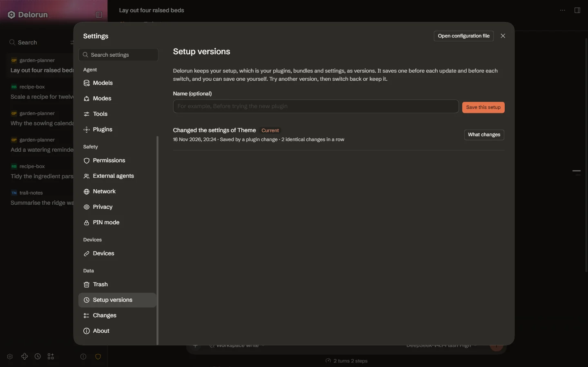

# 更新

[English](updates.md) | 中文

> 英文页面是当前版本；本页可能落后于它。

## 摘要

本页介绍如何查看新的 Delorun 发布版本会改变什么、如何安全地应用它，以及出问题时如何回退。你需要通过启动器安装 Delorun（见[安装与首次运行](../get-started/install.zh.md)），并且安装有 git。当存在更新的发布版本时 Delorun 会告诉你，在应用任何东西之前会显示它将改变什么，并且只有在你确认之后才会应用。切换之前，它会保存你的 [profile 历史](../../reference/glossary.zh.md#profile-history)；当新的发布版本改变了 chat 的存储方式时，它会先复制你的 chat 数据。切换之后，它会检查新的发布版本，如果检查失败，会自行回退。你的插件、预设和 profile 更改会被保留；当某个发布版本无法保留其中某一项时，报告会在你做决定之前指出它。

## 目录

- [更新通知](#the-update-notice)
- [检查并阅读报告](#check-and-read-the-report)
- [应用更新](#apply-an-update)
- [更新期间会发生什么](#what-happens-during-an-update)
- [改变格式的 chat 数据](#chat-data-that-changes-format)
- [切换回去](#going-back)
- [用你下载的文件更新](#update-from-files-you-downloaded)
- [在 studio 中试用另一套设置](#try-another-setup-in-the-studio)
- [渠道](#channels)
- [接下来](#next)
- [给想深入了解的人](#for-the-technically-curious)

<a id="the-update-notice"></a>

## 更新通知

Delorun 每天从 releases.delorun.com 获取一次已签名的发布文件，并从 GitHub 获取最新发布版本的清单和日志记录，检查其渠道上是否存在更新的发布版本。这次检查不会发送任何关于你的安装的信息，而这两个主机能看到你电脑的地址。它会验证文件的签名，且不下载任何发布版本。当存在更新的发布版本时，Delorun 会在三个地方告诉你：

- 在终端中，Delorun 启动时显示一行，例如 `Delorun 0.1.3 is available (security fix; all your plugins stay compatible). Run: delorun update`；
- 在 studio 中，显示为 chat 列表底部的一张卡片，其中说明发布版本的类型、它会关闭你的多少个插件以及要运行的命令；**Hide this notice until a newer release** 只会针对该发布版本隐藏它；
- 在 `delorun doctor` 中，它也会报告失败的检查及其原因。

你用来访问 studio 的手机或其他设备会看到没有控件的通知，因为更新是在你的电脑上应用的（见[用手机访问 studio](../everyday-use/reach.zh.md)）。

只有通过启动器安装的 Delorun 才会运行这项检查，源码检出不会。可以在 studio 的“设置”→“通用”→“更新”中用 **Check for new releases** 关闭它，或使用 `delorun setup privacy`。setup 会让它保持开启；审阅界面上的“更多设置”会询问。关闭检查之后，Delorun 不发出任何更新请求，也不显示通知，而你运行 `delorun update` 时它仍然可用。

<a id="check-and-read-the-report"></a>

## 检查并阅读报告

```text
delorun update --check     # is there a newer release? applies nothing
delorun update --report    # what would the newest release change? applies nothing
```

`delorun update --check` 会立即运行检查，并打印 `Delorun <version> is the newest release on the <channel> channel.`，或者打印通知行和该发布版本的摘要。它不需要 Delorun 正在运行，也不需要 git。

`delorun update --report` 需要 Delorun 正在运行，也需要 git。它会下载最新的发布版本，验证它，把它安装在正在运行的版本旁边但不切换过去，并打印更新报告，然后打印 `Nothing changed. Run delorun update to apply it.` 报告显示：

- 你从哪个版本升级到哪个版本，包括 Delorun 的版本、它所运行的 DeepSeek Harness 的版本，以及渠道；
- 发布检查：签名、发布文件的新鲜度和公开的发布日志；
- 更新会改变的每个插件、bundle 和 profile 条目，以及原因（bundle 是插件和设置的包，profile 条目在报告中称为行，是你的 profile 列表中的一个插件）：`kept`、`changed`、`disabled` 或 `removed`。如果某个插件声明的版本范围不包含新的发布版本，它会被列为 `disabled`，并给出它声明的范围，对于 DeepSeek Harness 的范围，还给出为该确切版本接受风险的命令（见[在有大量插件时更新 Delorun](../plugin-guides/updating-with-plugins.zh.md#check-read-the-report)）。Delorun 无法预测的项目（例如它无法读取其 `package.json` 的插件）会这样说明；
- 在“Your changes to Delorun's own files”下，列出你改动过的每个 Delorun 自身的文件，以及你的改动是否会被合并到新的发布版本中。被合并的改动会把你的版本以 `<file>.mine` 的名字保存在新文件旁边；
- chat 数据是否改变格式，以及副本的大小和可用磁盘空间（见[改变格式的 chat 数据](#chat-data-that-changes-format)）。

没有任何变化时，报告会显示 `No plugin, bundle or profile row changes.` 报告涵盖插件、bundle 和 profile 条目；它不列出设置值，设置值会原样保留。

<a id="apply-an-update"></a>

## 应用更新

运行 `delorun update`。它需要 Delorun 正在运行。它会打印同样的报告并询问 `Apply the update to Delorun <version>?`，默认答案为 No。报告的有效期是十分钟：确认一份更旧的报告，Delorun 会要求你阅读新的报告。

- `delorun update --yes` 无需询问就确认，但只适用于不会关闭任何东西、不会移除任何东西、不会合并你对 Delorun 自身文件的改动、也不含 Delorun 无法预测的内容的报告，而且只在发布日志检查通过时才可用。任何其他报告都需要你运行 `delorun update` 并自行决定。
- 没有可供询问的终端时，`delorun update` 会回答“否”，且不做任何更改。
- 更新需要 git，它保存你的 profile 历史；没有 git 时，Delorun 会在获取任何东西之前拒绝。`--report` 同样需要 git；只有 `--check` 不需要。

Delorun 从不应用你没有确认过的更新，检查也不应用任何东西。

<a id="update-from-files-you-downloaded"></a>

<a id="what-happens-during-an-update"></a>

## 更新期间会发生什么

`delorun update` 会逐步打印每个步骤：

1. **检查与安装。**Delorun 下载发布版本，验证它的签名、它的已签名文件列表以及它在公开发布日志中的条目，并把它安装在正在运行的发布版本旁边。无法通过验证的发布版本会被拒绝，且不会有任何改变。
2. **快照。**Delorun 保存一个名为 `Before update to Delorun <version>` 的 profile 历史版本，其中包含你的 profile 的补丁、bundle 列表和插件版本豁免。
3. **等待。**正在运行的 chat 完成各自的轮次；新消息会收到 “Delorun started no new turn: an update is waiting for running chats”，待 Delorun 恢复后你再次发送即可。Delorun 最多等待 30 分钟，然后以 `DRAIN_TIMEOUT` 停止更新，且不做任何更改。
4. **切换。**studio 停止，如果需要则写入 chat 数据副本，新的发布版本启动。这一步期间 studio 不可用。
5. **健康检查。**两分钟之内，新的发布版本必须验证自己的文件、应答自己的健康请求、启动之前已启动的每个插件、保持 profile 的 bundle 列表，并且不关闭报告中没有点名的任何东西。

如果健康检查失败，或新的发布版本停止运行，Delorun 会自行回退到你原来的发布版本和 profile，并打印哪项检查失败：`Delorun <version> failed its health check (<check>); Delorun <previous> runs again with the profile from before. See delorun logs.` 成功时它会打印 `Delorun <version> runs now.`

<a id="chat-data-that-changes-format"></a>

## 改变格式的 chat 数据

大多数发布版本存储 chat 的方式与前一个发布版本相同。当某个发布版本改变了 chat 或其他存储数据的写入方式时，报告会这样说明，例如 `Chat data: Delorun 1.1.0 keeps chat data in a format Delorun 1.0.0 may not read.`，而 Delorun 把这种改变视为单向的：新的发布版本一旦启动，旧的发布版本可能就无法读取这些数据。

对于这样的更新，Delorun 会提议先复制你的 chat 数据，并且默认进行复制：`The chat data changes format. Take a copy first?` 副本保存你的 chat 和插件存储（`sessions/` 和 `storages/`）原来的样子，位于你的 Delorun home 的 `data-copies/<version>/` 中；附件保留在原处，密钥从不被复制。报告会显示副本的大小和可用空间，放不下时 Delorun 会以 `DATA_COPY_NO_SPACE` 拒绝。

- `delorun update --data-copy` 即使格式没有改变也会复制一份。
- `delorun update --no-data-copy` 跳过复制。没有副本时，新的发布版本首次启动之后，你就无法回退到旧的发布版本；只有你的 profile 可以回退。

Delorun 只保留一份副本。`delorun recover status` 会列出它及其大小，一旦你不再需要回退，`delorun recover discard <path>` 就会移除它。

<a id="going-back"></a>

## 切换回去

`delorun recover` 显示你的 profile 所处的状态，并带你回退：

| 命令 | 作用 |
| --- | --- |
| `delorun recover` 或 `delorun recover status` | 显示最近一次更新、它的快照、存在多少个 profile 版本、安全模式是否开启，以及每份数据副本及其大小。`--json` 以 JSON 格式打印。 |
| `delorun recover rollback` | 回退到最近一次更新之前的发布版本，并使用在它之前所做的 profile 快照。当 chat 数据改变了格式时，它会把较新的数据搁置一旁并放回副本；没有副本时，它会以 `ROLLBACK_NEEDS_DATA_COPY` 拒绝。 |
| `delorun recover rollback --profile-only` | 恢复 profile 快照，并保持当前运行的发布版本。 |
| `delorun recover restore <version>` | 立即恢复任何已保存的 profile 版本。 |
| `delorun recover discard <path>` | 移除 `status` 列出的数据副本或搁置文件夹。 |
| `delorun recover safe-mode` | 不带你自己的插件启动（见[日常使用](../everyday-use/daily-use.zh.md#safe-mode-and-recovery)）。 |

无论 Delorun 是否在运行，`delorun recover rollback` 都可以使用；正在运行的 Delorun 会先等待运行中的 chat。回退在旧的发布版本启动并通过检查时完成。Delorun 保留两个已安装的发布版本，即正在运行的和它之前的那一个，所以它可以回退一个发布版本。

回退不会合并。当数据格式发生变化时，较新的发布版本留下的 chat 数据（包括你在更新之后开始的 chat）会被搁置到你的 Delorun home 的 `data-set-aside/` 中，而不是被删除，更新之前所做的副本则回到原处；一旦你不再需要这个文件夹，`delorun recover discard <path>` 就会移除它。密钥从不回退。

## 用你下载的文件更新

当无法访问发布渠道时（例如在防火墙之后），请把发布版本的文件从它的发布页面下载到一个文件夹中，然后运行：

```sh
delorun update --from ~/Downloads/delorun-0.2.0
```

该文件夹中有 `delorun-<version>.manifest.json`、`delorun-<version>.manifest.log.json`、`delorun-<version>-<platform>.files.json`、该平台的压缩包，以及可选的 `timestamp.json` 和 `root/<n>.root.json`。提供同样文件的 `https:` 地址也可以；`http:` 会被拒绝。Delorun 检查这些文件的方式与检查渠道更新完全相同：签名、发布日志、文件列表和压缩包摘要。然后它显示报告并询问，更新的其余部分保持不变，包括快照、数据副本、健康检查和自动回退。

文件夹唯一可能放宽的，是渠道对“这是当前发布版本”的确认。如果时间戳缺失或已过期，Delorun 会问 `The release channel cannot confirm that 0.2.0 is current … Install 0.2.0 from … on its signature and release-log entry alone?`。请在终端中回答；`--yes` 从不回答它，没有终端时 Delorun 会拒绝。比你正在运行的版本更旧的发布版本会被拒绝（请用 `delorun recover rollback` 回退），签名错误或缺少文件的发布版本也会被拒绝；拒绝信息会指出该文件。Delorun 不会保留过期的时间戳，如果它无法访问发布日志，则会记录日志未经检查。

<details>
<summary>边界情况</summary>

- `--from` 不能与 `--check` 或 `--report` 组合使用。
- 含有多个发布版本的文件夹会更新到最新的那个。
- 已经安装且完整的发布版本不会被再次获取。

</details>

<a id="try-another-setup-in-the-studio"></a>

## 在 studio 中试用另一套设置

“设置”→“数据”→“设置版本”列出 Delorun 为你的设置（即你的插件、bundle 和设置）保存的版本，最新的在前。当前版本有标记，每个版本都说明它是怎么产生的：一次更新、你的一次保存，或一次切换。它与 `delorun recover` 使用的是同一份历史，所以在这里保存的版本可以在那里恢复，反之亦然。



- **Save this setup** 保存当前的设置，如果你给出名称就带上名称。如果最新的版本已经包含它，则不会保存新的内容，页面会这样说明。
- 版本上的 **What changes** 用平实的话显示哪些插件会回来、更改版本或被移除，哪些 bundle 会加入或离开你的 bundle 列表，你的插件行和设置是否改变，以及哪些版本豁免和构建决定会改变。它不写入任何东西。
- **Switch to this version** 先把你当前的设置保存为一个版本，然后带回所选的那个。页面会告诉你改变了什么，以及 Delorun 在重启之后才会运行切换后的设置：请运行 `delorun stop`，再运行 `delorun start`。切换回去就是切换到之前保存的版本，所以保留一套设置和回退是同一个步骤。

保存和切换只能在运行 Delorun 的那台电脑上的 studio 中进行。你用来访问 studio 的手机或其他设备能看到列表和更改内容，每个版本显示 **Do this at your computer** 而不是按钮；即使页面被改动，home 也会拒绝来自这类设备的保存或切换。安全模式和更新失败之后的回退照常工作（见[切换回去](#going-back)）。

<a id="channels"></a>

## 渠道

每个发布版本属于一个渠道，`stable` 或 `beta`；预览版本在 `stable` 上，所以 0.1.0 会作为一次普通更新到来。发布版本在它自己的渠道上检查更新；没有任何设置可以把一个安装移到另一个渠道。只要渠道当前的发布版本比正在运行的更新，`delorun update` 就会提供它。它从不提供更低的版本；`delorun recover rollback` 会回到前一个发布版本。

<details>
<summary>边界情况</summary>

- 如果你的报告已超过十分钟，那么 Delorun 会显示 `Delorun did not update: the update report is unknown or older than ten minutes.` 请再次运行 `delorun update`。
- 如果发布日志检查没有完成，那么 `--yes` 会拒绝并说明这一点。请不带 `--yes` 运行 `delorun update` 自行决定，或在日志有应答之后再运行一次。
- 如果副本在磁盘上放不下，那么 Delorun 会以 `DATA_COPY_NO_SPACE` 拒绝。请腾出一些空间，或选择 `--no-data-copy`，并了解这样之后你无法回退到旧的发布版本。

</details>

<details>
<summary>进一步了解</summary>

- 在决定之前阅读报告：`delorun update --report` 会把发布版本安装在你的版本旁边，且不做任何更改。
- 始终做一份 chat 数据副本：`delorun update --data-copy`。
- 关闭每日检查：“设置”→“通用”→“更新”，或 `delorun setup privacy`。
- 清理旧副本：`delorun recover status` 会列出它们，`delorun recover discard <path>` 会移除其中一份。
- 恢复任何已保存的 profile 版本：`delorun recover restore <version>`。

</details>

<a id="next"></a>

## 接下来

- 在有大量第三方插件时更新：[在有大量插件时更新 Delorun](../plugin-guides/updating-with-plugins.zh.md)。
- 使用 Delorun：[日常使用](../everyday-use/daily-use.zh.md)。
- 让你自己的更改在更新中保留：[修改你的 harness](../customising/changing-your-harness.zh.md)。
- 如果更新失败：[更新与回退](../help/troubleshooting.zh.md#updates-and-rollback)。

<a id="for-the-technically-curious"></a>

## 给想深入了解的人

[更新报告约定](../../contracts/c03-update-report.zh.md)定义了报告、健康检查和回退，[发布 manifest 约定](../../contracts/c02-release-manifest.zh.md)定义了渠道和签名，[更新与回退设计](../../design/update-and-rollback.zh.md)和[更新通知设计](../../design/update-notice.zh.md)解释了更新为何这样运作。
