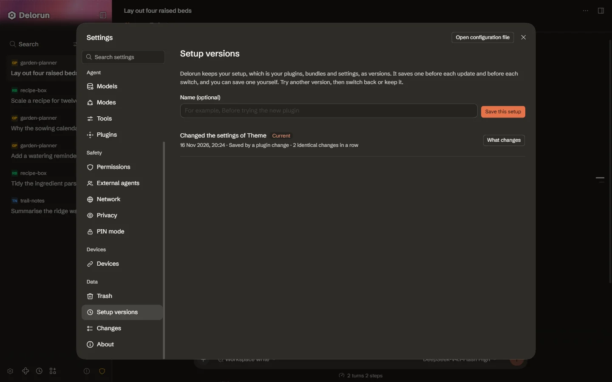

# Updates

English | [中文](updates.zh.md)

## Summary

This page shows how to see what a new Delorun release would change, apply it safely, and go back if it goes wrong. You need Delorun installed with its launcher ([Install and first run](install.md)) and git. Delorun tells you when a newer release exists, shows what it would change before it applies anything, and applies it only when you confirm. Before the switch it saves your [profile's history](../reference/glossary.md#profile-history), and when the new release changes how chats are stored, it copies your chat data first. After the switch it checks the new release and goes back on its own if a check fails. Your plugins, presets and profile changes carry over; when a release cannot carry one, the report names it before you decide.

## Contents

- [The update notice](#the-update-notice)
- [Check and read the report](#check-and-read-the-report)
- [Apply an update](#apply-an-update)
- [What happens during an update](#what-happens-during-an-update)
- [Chat data that changes format](#chat-data-that-changes-format)
- [Going back](#going-back)
- [Update from files you downloaded](#update-from-files-you-downloaded)
- [Try another setup in the studio](#try-another-setup-in-the-studio)
- [Channels](#channels)
- [Next](#next)
- [For the technically curious](#for-the-technically-curious)

## The update notice

Once a day, Delorun fetches the signed release files from releases.delorun.com, and the newest release's manifest and log record from GitHub, and checks whether a newer release exists on its channel. The check sends nothing about your installation, and those two hosts see your computer's address. It verifies the files' signatures and downloads no release. When a newer release exists, Delorun says so in three places:

- in the terminal, when Delorun starts, as a line such as `Delorun 0.1.3 is available (security fix; all your plugins stay compatible). Run: delorun update`;
- in the studio, as a card at the bottom of the chat list, which names the kind of release, how many of your plugins it would turn off and the command to run; **Hide this notice until a newer release** hides it for that release only;
- in `delorun doctor`, which also reports a failed check with its reason.

A phone or other device you reach the studio from sees the notice without its controls, because an update is applied at your computer ([Reach the studio from your phone](reach.md)).

The check runs only for Delorun installed with its launcher, not for a source checkout. Turn it off in the studio's Settings → General → Updates with **Check for new releases**, or with `delorun setup privacy`. Setup leaves it on and does not ask; `delorun setup privacy` asks, and `--no-update-check` turns it off for a whole setup run. With the check off, Delorun makes no update request and shows no notice, and `delorun update` still works when you run it.

## Check and read the report

```text
delorun update --check     # is there a newer release? applies nothing
delorun update --report    # what would the newest release change? applies nothing
```

`delorun update --check` runs the check now and prints either `Delorun <version> is the newest release on the <channel> channel.` or the notice line and the release's summary. It needs no running Delorun and no git.

`delorun update --report` needs Delorun running and git. It downloads the newest release, verifies it, installs it beside the running one without switching to it, and prints the update report, then `Nothing changed. Run delorun update to apply it.` The report shows:

- the versions you go from and to, of Delorun and of the DeepSeek Harness it runs on, and the channel;
- the release checks: the signature, the freshness of the release files and the public release log;
- every plugin, bundle and profile entry the update would change, with the reason (a bundle is a package of plugins and settings, and a profile entry, which the report calls a row, is one plugin in your profile's list): `kept`, `changed`, `disabled` or `removed`. A plugin whose declared version ranges exclude the new release is listed as `disabled`, with the range it declares and, for a DeepSeek Harness range, the command that accepts the risk for that exact version ([Update Delorun with many plugins](updating-with-plugins.md#check-read-the-report)). An item Delorun cannot predict, such as a plugin whose `package.json` it cannot read, says so;
- under "Your changes to Delorun's own files", each file of Delorun itself that you changed, and whether your change would be merged into the new release. A merged change keeps your version beside the new file as `<file>.mine`;
- whether the chat data changes format, with the size of the copy and the free disk space ([Chat data that changes format](#chat-data-that-changes-format)).

When nothing changes, the report says `No plugin, bundle or profile row changes.` The report also names the settings of the rows Delorun protects, such as the guards and the sandbox, that the new release changes, adds or drops, in plain words: `Delorun <version> changes the settings of the External agents row (delorun-agent-seats): turns on live agents.` Only a release can change these rows this way; the report never lists a setting you changed yourself. Apart from these, the report does not list setting values, which carry over unchanged.

## Apply an update

Run `delorun update`. It needs Delorun running. It prints the same report and asks `Apply the update to Delorun <version>?`, with No as the default. A report is valid for ten minutes: confirm an older one and Delorun asks you to read a fresh report.

- `delorun update --yes` confirms without asking, but only a report that turns nothing off, removes nothing, merges none of your changes to Delorun's own files and holds nothing Delorun cannot predict, and only when the release-log check passed. Any other report needs you to run `delorun update` and decide.
- Without a terminal to ask in, `delorun update` answers no and changes nothing.
- An update needs git, which saves your profile's history; without git, Delorun refuses before it fetches anything. `--report` needs git too; only `--check` does not.

Delorun never applies an update you have not confirmed, and the check applies nothing.

## What happens during an update

`delorun update` prints each step as it goes:

1. **Checking and installing.** Delorun downloads the release, verifies its signature, its signed file list and its entry in the public release log, and installs it beside the running release. A release that does not verify is refused, and nothing changes.
2. **Snapshot.** Delorun saves a profile history version named `Before update to Delorun <version>`, holding your profile's patches, bundle list and plugin version exemptions.
3. **Waiting.** Running chats finish their turns; a new message gets "Delorun started no new turn: an update is waiting for running chats" and you send it again once Delorun is back. Delorun waits up to 30 minutes, then stops the update with `DRAIN_TIMEOUT` and changes nothing.
4. **Switching.** The studio stops, the chat-data copy is written when one is taken, and the new release starts. The studio is unavailable for this step.
5. **Health check.** Within two minutes the new release must verify its own files, answer its health request, start every plugin that started before, keep the profile's bundle list, keep every protected row's settings except the ones the release itself changes, and turn off nothing the report did not name. A report made by an older release cannot name a protected setting that the new release changes; the new release then checks its own signed files, accepts exactly that change, and shows it with the update's outcome in Settings → Updates.

If the health check fails, or the new release stops, Delorun goes back on its own to the release and profile you had and prints which check failed: `Delorun <version> failed its health check (<check>); Delorun <previous> runs again with the profile from before. See delorun logs.` On success it prints `Delorun <version> runs now.`

## Chat data that changes format

Most releases store chats as the release before did. When a release changes how chats or other stored data are written, the report says so, for example `Chat data: Delorun 1.1.0 keeps chat data in a format Delorun 1.0.0 may not read.`, and Delorun treats the change as one-way: once the new release has started, the older release may not read the data.

For such an update, Delorun offers to copy your chat data first, and the copy is the default: `The chat data changes format. Take a copy first?` The copy holds your chats and plugin stores (`sessions/` and `storages/`) as they were, in `data-copies/<version>/` in your Delorun home; attachments stay where they are, and secrets are never copied. The report shows the size of the copy and the free space, and Delorun refuses with `DATA_COPY_NO_SPACE` when it does not fit.

- `delorun update --data-copy` takes a copy even when the format does not change.
- `delorun update --no-data-copy` skips it. Without the copy, you cannot go back to the older release after the new one first starts; only your profile can go back.

Delorun keeps one copy. `delorun recover status` lists it with its size, and `delorun recover discard <path>` removes it once you no longer need to go back.

## Going back

`delorun recover` shows where your profile stands and takes you back:

| Command | What it does |
| --- | --- |
| `delorun recover` or `delorun recover status` | Shows the last update, its snapshot, how many profile versions exist, whether safe mode is on, and each data copy with its size. `--json` prints it as JSON. |
| `delorun recover rollback` | Goes back to the release before the last update, with the profile snapshot taken before it. When the chat data changed format, it sets the newer data aside and puts the copy back; without a copy it refuses with `ROLLBACK_NEEDS_DATA_COPY`. |
| `delorun recover rollback --profile-only` | Restores the profile snapshot and keeps the running release. |
| `delorun recover restore <version>` | Restores any saved profile version at once. |
| `delorun recover discard <path>` | Removes a data copy or a set-aside folder that `status` lists. |
| `delorun recover safe-mode` | Starts without your own plugins ([Daily use](daily-use.md#safe-mode-and-recovery)). |

`delorun recover rollback` works whether Delorun runs or not; a running Delorun first waits for running chats. The rollback completes when the older release starts and passes its check. Delorun keeps two releases installed, the running one and the one before, so it can go back one release.

A rollback does not merge. When the data format changed, the chat data as the newer release left it, with the chats you started after the update, is set aside in `data-set-aside/` in your Delorun home, not deleted, and the copy taken before the update comes back in its place; `delorun recover discard <path>` removes the folder once you no longer need it. Secrets are never rolled back.

## Update from files you downloaded

When the release channel cannot be reached, for example behind a firewall, download the release's files from its release page into one folder and run:

```sh
delorun update --from ~/Downloads/delorun-0.2.0
```

The folder holds `delorun-<version>.manifest.json`, `delorun-<version>.manifest.log.json`, `delorun-<version>-<platform>.files.json`, the platform's archive, and optionally `timestamp.json` and `root/<n>.root.json`. An `https:` address that serves the same files also works; `http:` is refused. Delorun checks the files exactly as it checks a channel update: the signature, the release log, the file list and the archive digests. Then it shows the report and asks, and the rest of the update is unchanged, including the snapshot, the data copy, the health check and the automatic rollback.

The one thing a folder can loosen is the channel's confirmation that this is the current release. If the timestamp is missing or out of date, Delorun asks `The release channel cannot confirm that 0.2.0 is current … Install 0.2.0 from … on its signature and release-log entry alone?`. Answer in a terminal; `--yes` never answers it, and without a terminal Delorun refuses. A release older than the one you run is refused (go back with `delorun recover rollback`), and so is a release with a wrong signature or a missing file; the refusal names the file. Delorun does not keep the out-of-date timestamp, and if it could not reach the release log, it records that the log was not checked.

<details>
<summary>Edge cases</summary>

- `--from` cannot be combined with `--check` or `--report`.
- A folder with several releases updates to the newest one.
- A release that is already installed and intact is not fetched again.

</details>

## Try another setup in the studio

Settings → Data → Setup versions lists the versions Delorun keeps of your setup, which is your plugins, bundles and settings, newest first. The current one is marked, and each says what made it: an update, a save by you, or a switch. It is the same history that `delorun recover` uses, so a version saved here can be restored there and the other way round.



- **Save this setup** keeps the setup as it is now, with a name if you give one. If the latest version already holds it, nothing new is saved and the page says so.
- **What changes** on a version shows, in plain words, which plugins would come back, change version or be removed, which bundles would join or leave your bundle list, whether your plugin rows and settings change, and which version exemptions and build decisions change. It writes nothing.
- **Switch to this version** saves your current setup as a version first, then brings the chosen one back. The page tells you what changed and that Delorun runs the switched setup after a restart: run `delorun stop`, then `delorun start`. Switching back is switching to the version saved before, so keeping a setup or going back is the same step.

Saving and switching work only in the studio on the computer Delorun runs on. A phone or other device you reach the studio from sees the list and the changes, and each version shows **Do this at your computer** instead of a button; the home refuses a save or a switch from such a device even if its page is changed. Safe mode and the rollback after a failed update work as before ([Going back](#going-back)).

## Channels

Each release belongs to a channel, `stable` or `beta`; the preview releases are on `stable`. A release checks for updates on its own channel; no setting moves an installation to another channel. `delorun update` offers the channel's current release whenever it is newer than the running one. It never offers a lower version; `delorun recover rollback` returns to the previous release.

<details>
<summary>Edge cases</summary>

- If your report is older than ten minutes, then Delorun says `Delorun did not update: the update report is unknown or older than ten minutes.` Run `delorun update` again.
- If the release-log check did not complete, then `--yes` refuses with a message saying so. Run `delorun update` without `--yes` to decide, or run it again once the log answers.
- If the copy does not fit on the disk, then Delorun refuses with `DATA_COPY_NO_SPACE`. Free some space or choose `--no-data-copy`, knowing that you then cannot go back to the older release.

</details>

<details>
<summary>Go further</summary>

- Read the report before you decide: `delorun update --report` installs the release beside yours and changes nothing.
- Always take a chat-data copy: `delorun update --data-copy`.
- Turn the daily check off: Settings → General → Updates, or `delorun setup privacy`.
- Clean up old copies: `delorun recover status` lists them, and `delorun recover discard <path>` removes one.
- Restore any saved profile version: `delorun recover restore <version>`.

</details>

## Next

- Update with many third-party plugins: [Update Delorun with many plugins](updating-with-plugins.md).
- Use Delorun: [Daily use](daily-use.md).
- Keep your own changes through updates: [Changing your harness](changing-your-harness.md).
- If an update failed: [Updates and rollback](troubleshooting.md#updates-and-rollback).

## For the technically curious

The [update report contract](../contracts/c03-update-report.md) defines the report, the health check and rollback, the [release manifest contract](../contracts/c02-release-manifest.md) defines channels and signatures, and the [update and rollback design](../design/update-and-rollback.md) and [update notice design](../design/update-notice.md) explain why updates work this way.
